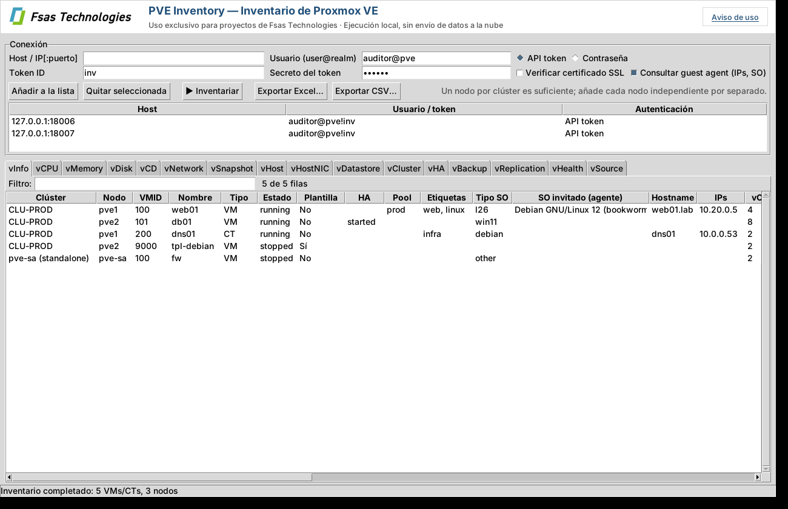

# PVE Inventory: Proxmox-VE-Inventar im Stil von RVTools

> **Ausschließlich für Projekte von Fsas Technologies.** Das Tool läuft lokal, liest nur von den angegebenen Proxmox-VE-Servern und lädt nichts in die Cloud hoch (siehe [Nutzungshinweis](#nutzungshinweis)).

Windows-Tool, das sich mit der API von **Proxmox VE 8 und 9** verbindet, sowohl mit **Clustern** als auch mit **einzelnen Knoten**, und ein vollständiges Inventar in Registerkarten erstellt, das am Bildschirm angezeigt und nach **Excel** (ein Blatt pro Registerkarte) oder **CSV** exportiert werden kann. Nur lesend: Es ändert nichts in Proxmox.



**Sprachen:** [castellano](README.md) · [English](README.en.md) · Deutsch · [Français](README.fr.md) · [Português](README.pt.md) · [Italiano](README.it.md)

## Sprachen

Seit Version 1.0 funktionieren beide Tools (Inventar und Planer) auf **Spanisch, Englisch, Deutsch, Französisch, Portugiesisch und Italienisch**: Fenster, Meldungen, Kommandozeilenhilfe, Excel/CSV und alle Word-Dokumente.

* **Grafische Oberfläche:** Auswahl *Sprache* (im Inventar oben rechts, im Planer im Menü *Sprache*). Die Änderung wirkt sofort und wird für das nächste Mal gespeichert. Beim ersten Start wird die Windows-Sprache verwendet (oder Englisch, wenn es keine der sechs ist).
* **Kommandozeile:** `--lang es|en|de|fr|pt|it` (oder `--idioma`) oder die Umgebungsvariable `PVE_LANG`. Ohne Angabe gilt die Systemsprache.
* **Excel/CSV:** Spaltenköpfe, Hinweis und feste Werte (`Ja`/`Nein`, *vHealth*-Warnungen…) erscheinen in der gewählten Sprache. Der Planer liest ein Inventar in **jeder** der sechs Sprachen und erstellt seine Dokumente in der gewünschten Sprache. Der Kunde kann das Inventar also in seiner Sprache ausführen und der Plan in einer anderen geliefert werden.
* Auch die Namen der erzeugten Dateien werden übersetzt (`migration_plan.xlsx`, `Migrationsplan.xlsx`…).

## Nutzungshinweis

* Internes Tool ausschließlich für Projekte von Fsas Technologies; Weitergabe oder Nutzung außerhalb dieses Rahmens ist nicht gestattet.
* Es läuft vollständig auf dem Rechner des Benutzers und lädt nichts in die Cloud hoch. Es sendet keine Daten an Fsas Technologies oder Dritte und hat keine Telemetrie.
* Es verbindet sich nur mit den angegebenen Proxmox-VE-Servern, über deren API und nur lesend.
* Es speichert keine Passwörter oder Tokens auf der Festplatte.
* Die Berichte können vertrauliche Kundendaten enthalten: Behandeln Sie sie gemäß der Vertraulichkeitsrichtlinie des Projekts.
* Bereitstellung „wie besehen“, ohne Gewährleistung.

Der Hinweis wird beim ersten Öffnen der Anwendung angezeigt (er muss akzeptiert werden), ist jederzeit über die Schaltfläche *Nutzungshinweis* erreichbar, erscheint als erstes Blatt (**Hinweis**) jeder Excel-Datei und als `LIESMICH_HINWEIS.txt` in jedem CSV-Export.

## Registerkarten

| Blatt | Inhalt |
|---|---|
| **vInfo** | Eine Zeile pro VM/CT: Knoten, Status, Vorlage, HA, Pool, Tags, BS, tatsächliches BS und IPs (Guest Agent), vCPU, RAM, Festplatten, NICs, Snapshots, Uptime, BIOS, Sperre, Erstellungsdatum |
| **vCPU** | Sockets, Kerne, CPU-Typ, Limits, NUMA, aktuelle Auslastung |
| **vMemory** | Zugewiesener Speicher, Balloon, Swap (CT), aktuelle Auslastung |
| **vDisk** | Jede Festplatte: Speicher, Volume, Größe, Format, Cache, SSD, iothread, Backup, ungenutzte Festplatten |
| **vCD** | CD-ROM-Laufwerke und eingebundene ISOs |
| **vNetwork** | Jede NIC: Modell, MAC, Bridge, VLAN, Firewall, getrennt, IPs |
| **vSnapshot** | Snapshots mit Datum, Alter und ob sie RAM enthalten |
| **vPassthrough** | An VMs und CTs durchgereichte PCI-/USB-/serielle Geräte und ob sie *Resource Mapping* nutzen |
| **vBackupStatus** | Pro VM/CT: Anzahl Sicherungen, letztes Backup, Alter, Größe, Speicher und Verifizierung |
| **vHost** | Knoten: PVE-Version, Kernel, CPU, RAM, Swap, Root-Festplatte, Uptime, EFI/Secure Boot, Anzahl VMs, Verhältnis vCPU:Thread, Subskription |
| **vPhysicalDisk** | Physische Festplatten: Modell, Seriennummer, Größe, Typ, SMART-Status, SSD-Verschleiß, Verwendung (LVM, ZFS, OSD…) |
| **vRepo** | Auf jedem Knoten aktivierte Proxmox-APT-Repositories (enterprise, no-subscription, test, Ceph) |
| **vCert** | Zertifikate der Knoten: Aussteller, Ablauf, verbleibende Tage, Fingerabdruck |
| **vHostNIC** | Alle Netzwerkschnittstellen der Knoten |
| **vBond** | Teaming: Modus (802.3ad, active-backup…), Slaves, Hash-Policy, primär und welche Bridge es nutzt |
| **vBridge** | Linux-/OVS-Bridges: Ports, VLAN aware, erlaubte VLANs, IP sowie wie viele VM-NICs und welche VLANs daran hängen |
| **vHostVLAN** | VLAN-Schnittstellen der Knoten (eno1.50, vlan50…) |
| **vSDN** | SDN: Zonen (simple, VLAN, QinQ, VXLAN, EVPN), VNets, Tags/VNI, Subnetze, Gateway, SNAT, DHCP, Controller, Exit-Nodes, Peers, IPAM/DNS, verbundene VM-NICs und noch nicht angewendete Änderungen |
| **vSDNObj** | SDN: Controller (EVPN/BGP/ISIS), IPAM (pve, NetBox, phpIPAM), DNS (PowerDNS) und Fabrics von PVE 9. Tokens und Schlüssel werden nie exportiert |
| **vCorosync** | Cluster-Netzwerk: Corosync-Links jedes Knotens, Stimmen, Modus |
| **vDatastore** | Speicher pro Knoten: Typ, gemeinsam genutzt, Inhalt, Kapazität, Belegung |
| **vZFS** | ZFS-Pools: Zustand, Größe, Belegung, Fragmentierung |
| **vCephOSD** / **vCephPool** | Ceph-OSDs (Status, Klasse, Belegung, Latenzen) und -Pools (Replikate, PGs, Belegung) |
| **vCluster** | Übersicht pro Cluster oder Einzelknoten: Quorum, Knoten, Summen von CPU/RAM/Speicher, Ceph |
| **vHA** | HA-Ressourcen, HA-Gruppen (PVE 8) und HA-Regeln (PVE 9) |
| **vBackup** | Geplante Backup-Jobs |
| **vReplication** | ZFS-Replikationsjobs |
| **vTasks** | Tasks mit Fehlern oder Warnungen der letzten 7 Tage |
| **vFirewall** / **vFirewallObj** | Firewall-Regeln (Datacenter, Security Groups, Knoten), Aliase und IPSets |
| **vUsers** / **vACL** | Benutzer, API-Tokens (Ablauf, Rechtetrennung) und zugewiesene Berechtigungen |
| **vHealth** | Warnungen: Speicher oder ZFS voll/degradiert, Ceph nicht OK, ausgefallene OSDs, SMART-Fehler, verschlissene SSDs, ablaufende Zertifikate, VMs ohne oder mit altem Backup, alte Snapshots, Corosync ohne Redundanz, Bonds mit nur einer Schnittstelle, Enterprise-Repository ohne Subskription, ausstehende Updates, nicht antwortender Guest Agent, ausgefallene Knoten oder fehlendes Quorum… |
| **vSource** | Womit verbunden wurde, wann, PVE-Version, Sprache und Fehler |

In der Anwendung sind die Registerkarten in einer Seitenleiste nach Kategorien gruppiert (Virtuelle Maschinen, Hosts, Netzwerk, Speicher, Cluster, Sicherheit, Übersicht).

## Exportformat

Die Blätter und Spalten der Excel-/CSV-Dateien bilden ein stabiles, versioniertes Format (derzeit Version 1), das von anderen Anwendungen wie dem Migrationsplaner gelesen werden kann. Es ist in [docs/FORMATO_EXPORTACION.md](docs/FORMATO_EXPORTACION.md) (auf Spanisch) dokumentiert und in `pvetools/schema.py` definiert. Intern ist das Format spanisch; Spaltenköpfe in anderen Sprachen werden beim Export übersetzt und beim Einlesen zurückübersetzt. Ein automatischer Test schlägt fehl, wenn das Inventar Spalten exportiert, die nicht im Format enthalten sind.

## Verbindung herstellen

* **Cluster:** Es genügt, **einen beliebigen Knoten** des Clusters hinzuzufügen; alle werden inventarisiert. Fügen Sie mehrere desselben Clusters hinzu, wird der erste antwortende verwendet und die übrigen übersprungen (nützlich als Ausweichlösung, wenn ein Knoten ausgefallen ist).
* **Einzelne Knoten:** Fügen Sie jeden einzeln hinzu.
* In derselben Liste können mehrere Cluster und Einzelknoten mit unterschiedlichen Zugangsdaten gemischt werden.
* Selbstsignierte Zertifikate: werden standardmäßig akzeptiert (aktivieren Sie *SSL-Zertifikat prüfen*, wenn Sie gültige Zertifikate verwenden).
* Passwörter und Secrets **werden nicht auf der Festplatte gespeichert**; gespeichert wird nur die Liste der Hosts und Benutzer (`%APPDATA%\PVEInventory\connections.json`).

### Empfohlen: Benutzer und API-Token nur mit Leserechten

Auf einem beliebigen Knoten (einmal pro Cluster):

```bash
pveum user add inventario@pve --comment "Inventar nur lesend"
pveum user token add inventario@pve inv --privsep 0      # das angezeigte Secret aufbewahren
```

Weisen Sie die Berechtigungen mit einer Nur-Lese-Rolle zu. Um über den Guest Agent auch IPs und BS der VMs zu sehen, ist ein zusätzliches Recht nötig, das sich je nach Version unterscheidet:

```bash
# PVE 9
pveum role add InventarioRO -privs "Sys.Audit VM.Audit VM.GuestAgent.Audit Datastore.Audit Pool.Audit SDN.Audit Mapping.Audit"
# PVE 8
pveum role add InventarioRO -privs "Sys.Audit VM.Audit VM.Monitor Datastore.Audit Pool.Audit SDN.Audit Mapping.Audit"

pveum acl modify / -user inventario@pve -role InventarioRO
```

Wenn Sie ohne VM-IPs auskommen, können Sie die mitgelieferte Rolle `PVEAuditor` verwenden. Im Tool: Benutzer `inventario@pve`, Token-ID `inv` und das Secret.

Benutzer und Passwort (`root@pam` usw.) funktionieren ebenfalls.

### Konten mit Zwei-Faktor-Authentifizierung (2FA)

Hat das Konto 2FA, fragt das Tool beim Verbinden nach dem Code, genau wie die Proxmox-Weboberfläche:

* **Grafische Oberfläche:** Es erscheint ein Fenster für den 6-stelligen Code aus der Authenticator-App (TOTP) oder einen Wiederherstellungscode. Ist der Code ungültig, wird erneut gefragt (bis zu 3-mal). Der Code wird nicht gespeichert.
* **Kommandozeile:** `--totp 123456` (oder ein Wiederherstellungscode). Ohne Angabe und bei interaktiver Konsole wird danach gefragt. Für geplante Aufgaben ein API-Token verwenden, da der Code alle 30 Sekunden abläuft.
* Unterstützt werden TOTP, Wiederherstellungscodes und Yubico OTP. Konten, die **nur** einen FIDO-/WebAuthn-Schlüssel haben, sind hier nicht nutzbar: Es wird ein API-Token benötigt.
* Im Blatt *vSource* wird es vermerkt, z. B. `Passwort + 2FA (TOTP)`.

Am bequemsten für den Kunden bleibt dennoch das **API-Token nur mit Leserechten** aus dem vorigen Abschnitt: kein 2FA, kein Ablauf nach 30 Sekunden und nur die nötigen Rechte.

## Verwendung

**Grafische Oberfläche:** Starten Sie `PVEInventory.exe`, geben Sie Host, Benutzer und Token oder Passwort ein, klicken Sie auf *Zur Liste hinzufügen* (für jeden Cluster oder Einzelknoten wiederholen) und dann auf *Inventarisieren*. Jede Registerkarte hat einen Filter und Sortierung pro Spalte. Danach *Excel exportieren…* oder *CSV exportieren…* wählen.

**Kommandozeile** (für geplante Aufgaben):

```bat
pveinventory-cli.exe --host pve1.meinedomain.local --host pve-sa.meinedomain.local ^
    --user inventario@pve --token-id inv --token-secret XXXXXXXX ^
    -o C:\Inventar\pve.xlsx --csv C:\Inventar\csv --lang de
```

Optionen: `--password-env VAR` (Passwort aus einer Umgebungsvariablen), `--totp CODE` (Konten mit 2FA), `PVE_TOKEN_SECRET` (Secret aus einer Umgebungsvariablen), `--no-agent` (schneller, ohne VM-IPs), `--verify-ssl`, `--anonymize` (siehe unten), `--lang` (Sprache von Excel/CSV und Meldungen). Exit-Code: 0 alles OK, 1 eine Verbindung ist fehlgeschlagen, 2 alle sind fehlgeschlagen.

## Inventar anonymisieren

Damit der Kunde das Inventar ohne identifizierende Daten senden kann, aktivieren Sie **Beim Export anonymisieren** vor
*Excel exportieren…* / *CSV exportieren…* (oder verwenden Sie `--anonymize` auf der Kommandozeile). Die Schaltfläche *Was wird anonymisiert?* erklärt es in der Anwendung selbst.

* **Durch Pseudonyme ersetzt** werden die Namen von Clustern, Knoten, VMs/CTs, Hostnamen, Domänen, Speichern, Pools,
  Tags, Benutzern, Gruppen, Realms, SDN-Zonen, VNets, Controllern, IPAM und DNS, Firewall-Objekten, HA-Gruppen, Jobs, Snapshots, ISOs, Pfade und
  Server von Speichern sowie Seriennummern von Festplatten (`CLUSTER-01`, `NODO-01`, `VM-0001`, `STORAGE-01`…). Derselbe Wert
  erhält auf allen Blättern immer dasselbe Pseudonym, sodass die Beziehungen VM-Knoten-Netzwerk-Speicher erhalten bleiben.
* **IPs:** werden unter Beibehaltung der Netzwerkstruktur umgewandelt (zwei IPs desselben Subnetzes bleiben im selben Subnetz und
  `.1` bleibt `.1`). Mit *IPs beibehalten* / `--keep-ips` bleiben sie unverändert. **MACs:** Der Hersteller (OUI) bleibt erhalten.
* **Geleert** werden Beschreibungen, Kommentare, E-Mails, SDN-Aliase und Zertifikat-Fingerabdrücke.
* **Erhalten bleiben** CPU, RAM, Festplatten und Größen, Speichertypen, BS, Status, Versionen, VLANs, Bridges `vmbrN`,
  die Proxmox-Standardnamen (`local`, `local-lvm`, `rpool`, `root@pam`…) und ein Rollenhinweis im Pseudonym
  (`-crit`, wenn Name, Pool oder Tag kritisch wirkt (db, sql, sap, dc…), und `-test`, wenn es nach Testsystem aussieht), den der
  Planer zur Reihenfolge der Wellen nutzt. Damit **liefert der Planer genau denselben Plan** wie mit dem echten Inventar.
* **Zuordnung:** Neben dem Export wird `<name>_Zuordnung_VERTRAULICH.xlsx` mit der Tabelle echt ↔ Pseudonym gespeichert.
  **Sie bleibt beim Kunden und wird nicht versendet.** Mit *Anonymisierung rückgängig machen…* (oder `--revert DATEI --mapping ZUORDNUNG`)
  kann der Kunde die echten Namen in jede Excel-/CSV-Datei zurückschreiben: das anonymisierte Inventar oder die **Excel-Datei des
  Migrationsplans**, die wir liefern. Wird dieselbe Zuordnung für einen weiteren Export verwendet (`--mapping`), ändern sich die
  Pseudonyme nicht, was nützlich ist, wenn mehrere Cluster getrennt inventarisiert werden.

```bat
pveinventory-cli.exe --host pve1 --user inventario@pve --token-id inv --token-secret XXXX --anonymize -o inventar_anonym.xlsx --lang de
pveinventory-cli.exe --revert Migrationsplan.xlsx --mapping inventar_anonym_Zuordnung_VERTRAULICH.xlsx
```

## Wenn die Excel-Datei nicht erscheint oder sich nicht öffnet

Seit Version 0.7.1 des Inventars (0.4.1 des Planers) werden alle Dateien sicher gespeichert: Sie werden zuerst in eine temporäre Datei im selben Ordner geschrieben, die Excel-/Word-Datei wird auf Gültigkeit geprüft und erst dann auf den endgültigen Namen umbenannt. Schlägt etwas fehl, bleibt die vorherige Datei unverändert und eine Meldung nennt die Ursache. Am Ende wird der vollständige Pfad mit der Schaltfläche *Im Ordner anzeigen* angezeigt.

Gibt es trotzdem Probleme, sind die üblichen Ursachen auf Benutzerrechnern:

* **Die .exe wurde direkt aus dem ZIP oder der E-Mail geöffnet**, ohne zu entpacken: Windows startet sie aus einem temporären Ordner, den es danach löscht. Entpacken Sie das ZIP vor der Verwendung.
* **„Überwachter Ordnerzugriff“ von Windows Defender** verhindert, dass neue Programme in Dokumente und Desktop schreiben. Es erscheint eine Meldung von Windows-Sicherheit; speichern Sie in einem anderen Ordner oder lassen Sie die .exe zulassen.
* **Synchronisierter Ordner (OneDrive, SharePoint) oder Netzlaufwerk:** Die Datei kann verzögert hochgeladen werden oder „nur online“ bleiben. Warten Sie das Ende der Synchronisierung ab, bevor Sie sie senden oder kopieren.
* **Die Datei war in Excel geöffnet**, als erneut mit demselben Namen exportiert wurde: Schließen Sie sie und wiederholen Sie den Vorgang.

## Die .exe erstellen

Option A, auf einem Windows-PC mit installiertem Python 3.10+: `build.bat` ausführen. Es erzeugt `dist\PVEInventory.exe` (GUI) und `dist\pveinventory-cli.exe` (Konsole), die eigenständig sind und ohne Installation auf jedes Windows 10/11 kopiert werden können.

Option B, auf GitHub: Laden Sie das Projekt in ein Repository hoch; der Workflow `.github/workflows/build-windows.yml` erstellt beide .exe-Dateien (Actions → *Build Windows exe* → *Run workflow*, oder durch ein Tag `v1.0.0`, das sie zusätzlich als Release veröffentlicht).

## Entwicklung und Tests

```bash
pip install -r requirements.txt
python -m pvetools                 # GUI (ohne Argumente) oder CLI (mit Argumenten)
PVE_LANG=es python -m pytest tests # Tests gegen ein simuliertes Proxmox (PVE-9-Cluster + PVE-8-Knoten)
python tools/gen_format_doc.py     # erzeugt docs/FORMATO_EXPORTACION*.md nach Änderungen an schema.py neu
python tools/i18n_check.py         # prüft, dass jeder Text in alle sechs Sprachen übersetzt ist
```

Die Texte werden im Code auf Spanisch geschrieben und mit `_()` (bzw. `N_()`/`D()` für Datenwerte) markiert; ihre Übersetzungen stehen in `pvetools/tr_catalog.py` (Inventar) und `pvemigplan/tr_catalog.py` (Planer). Wenn Sie einen neuen Text hinzufügen, ergänzen Sie seine Übersetzung im Katalog: Der Test `tests/test_i18n.py` schlägt fehl, wenn eine fehlt.

`tests/mock_pve.py` simuliert die Proxmox-API, sodass ohne echte Server getestet werden kann.

## Migrationsplaner (interne Nutzung)

Im Ordner `pvemigplan/` befindet sich **PVE Migration Planner**, eine eigene Anwendung (wird nicht an den Kunden weitergegeben), die die Excel-/CSV-Dateien
dieses Tools liest und das Design der neuen Plattform sowie den Migrationsplan in Excel und Word erstellt. Außerdem gibt es einen Modus
**nur Analyse**, der einen Bericht über die aktuelle Infrastruktur (mit Diagrammen und Befunden) ohne Migrationsvorschlag erstellt.
Er kann die Dokumente für einen **neuen Cluster ohne Migration** erzeugen (ohne Inventar oder mit einem Inventar ohne VMs) und speichert die
Arbeit als **Projekt** (`.pveplan`, mit dem Inventar darin), um sie später fortzusetzen. Siehe [docs/PLANIFICADOR.de.md](docs/PLANIFICADOR.de.md).
