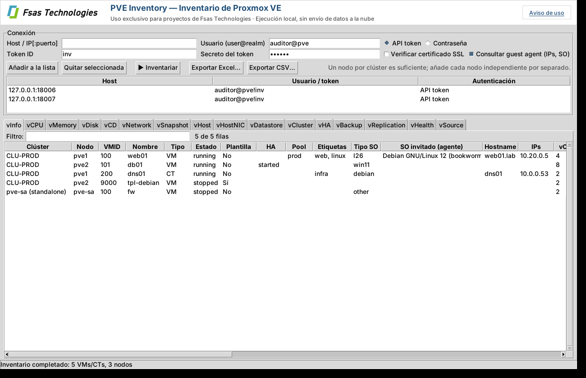

# PVE Inventory: RVTools-style inventory for Proxmox VE

> **For use in Fsas Technologies projects only.** The tool runs locally, only reads from the Proxmox VE servers you specify and uploads nothing to the cloud (see [Terms of use](#terms-of-use)).

A Windows tool that connects to the API of **Proxmox VE 8 and 9**, both **clusters** and **standalone nodes**, and builds a complete inventory in tabs that you can view on screen and export to **Excel** (one sheet per tab) or **CSV**. Read-only: it changes nothing in Proxmox.



**Languages:** [castellano](README.md) · English · [Deutsch](README.de.md) · [Français](README.fr.md) · [Português](README.pt.md) · [Italiano](README.it.md)

## Languages

Since version 1.0 both tools (inventory and planner) work in **Spanish, English, German, French, Portuguese and Italian**: windows, messages, command-line help, Excel/CSV and every Word document.

* **GUI:** *Language* selector (in the inventory, top right; in the planner, *Language* menu). The change is immediate and remembered for next time. The first time, the Windows language is used (or English if it is none of the six).
* **Command line:** `--lang es|en|de|fr|pt|it` (or `--idioma`), or the `PVE_LANG` environment variable. If not given, the system language.
* **Excel/CSV:** headers, the notice and fixed values (`Yes`/`No`, *vHealth* warnings…) are written in the chosen language. The planner reads an inventory in **any** of the six languages and writes its documents in whichever one you choose, so the customer can run the inventory in their language and the plan can be delivered in another.
* The names of the generated files are translated too (`migration_plan.xlsx`, `Migrationsplan.xlsx`…).

## Terms of use

* Internal tool intended exclusively for Fsas Technologies projects; distribution or use outside that scope is not permitted.
* It runs entirely on the user's computer and uploads nothing to the cloud. It sends no data to Fsas Technologies or third parties and has no telemetry.
* It only connects to the Proxmox VE servers you specify, through their API and in read-only mode.
* It does not store passwords or tokens on disk.
* Reports may contain sensitive customer information: handle them according to the project's confidentiality policy.
* Provided "as is", without warranty.

The notice is shown the first time the application is opened (it must be accepted), is always available from the *Terms of use* button, appears as the first sheet (**Notice**) of every Excel file and as `README_NOTICE.txt` in every CSV export.

## Tabs

| Sheet | Contents |
|---|---|
| **vInfo** | One row per VM/CT: node, state, template, HA, pool, tags, OS, real OS and IPs (guest agent), vCPU, RAM, disks, NICs, snapshots, uptime, BIOS, lock, creation date |
| **vCPU** | Sockets, cores, CPU type, limits, NUMA, current usage |
| **vMemory** | Allocated memory, balloon, swap (CT), current usage |
| **vDisk** | Each disk: storage, volume, size, format, cache, SSD, iothread, backup, unused disks |
| **vCD** | CD-ROM drives and mounted ISOs |
| **vNetwork** | Each NIC: model, MAC, bridge, VLAN, firewall, disconnected, IPs |
| **vSnapshot** | Snapshots with date, age and whether they include RAM |
| **vPassthrough** | PCI/USB/serial devices passed through to VMs and CTs, and whether they use *resource mapping* |
| **vBackupStatus** | Per VM/CT: number of backups, last backup, age, size, storage and verification |
| **vHost** | Nodes: PVE version, kernel, CPU, RAM, swap, root disk, uptime, EFI/Secure Boot, number of VMs, vCPU:thread ratio, subscription |
| **vPhysicalDisk** | Physical disks: model, serial, size, type, SMART status, SSD wearout, usage (LVM, ZFS, OSD…) |
| **vRepo** | Proxmox APT repositories enabled on each node (enterprise, no-subscription, test, Ceph) |
| **vCert** | Node certificates: issuer, expiry, days left, fingerprint |
| **vHostNIC** | All network interfaces of the nodes |
| **vBond** | Teaming: mode (802.3ad, active-backup…), slaves, hash policy, primary and which bridge uses it |
| **vBridge** | Linux/OVS bridges: ports, VLAN aware, allowed VLANs, IP, and how many VM NICs and which VLANs hang off it |
| **vHostVLAN** | Node VLAN interfaces (eno1.50, vlan50…) |
| **vSDN** | SDN: zones (simple, VLAN, QinQ, VXLAN, EVPN), VNets, tags/VNI, subnets, gateway, SNAT, DHCP, controller, exit nodes, peers, IPAM/DNS, connected VM NICs and pending changes |
| **vSDNObj** | SDN: controllers (EVPN/BGP/ISIS), IPAM (pve, NetBox, phpIPAM), DNS (PowerDNS) and PVE 9 fabrics. Tokens and keys are never exported |
| **vCorosync** | Cluster network: corosync links of each node, votes, mode |
| **vDatastore** | Storages per node: type, shared, content, capacity, usage |
| **vZFS** | ZFS pools: health, size, usage, fragmentation |
| **vCephOSD** / **vCephPool** | Ceph OSDs (state, class, usage, latencies) and pools (replicas, PGs, usage) |
| **vCluster** | Summary per cluster or standalone node: quorum, nodes, CPU/RAM/storage totals, Ceph |
| **vHA** | HA resources, HA groups (PVE 8) and HA rules (PVE 9) |
| **vBackup** | Scheduled backup jobs |
| **vReplication** | ZFS replication jobs |
| **vTasks** | Tasks with errors or warnings in the last 7 days |
| **vFirewall** / **vFirewallObj** | Firewall rules (datacenter, security groups, nodes), aliases and IPSets |
| **vUsers** / **vACL** | Users, API tokens (expiry, privilege separation) and assigned permissions |
| **vHealth** | Warnings: storage or ZFS full/degraded, Ceph not OK, OSDs down, failing SMART, worn SSDs, certificates about to expire, VMs without backup or with old backups, old snapshots, corosync without redundancy, single-interface bonds, enterprise repository without subscription, pending updates, unresponsive guest agent, nodes down or without quorum… |
| **vSource** | What was connected to, when, PVE version, language and errors |

In the application the tabs are grouped in a side panel by category (Virtual machines, Hosts, Network, Storage, Cluster, Security, Summary).

## Export format

The sheets and columns of the Excel/CSV are a stable, versioned format (currently version 1), designed to be read by other applications such as the migration planner. It is documented in [docs/FORMATO_EXPORTACION.md](docs/FORMATO_EXPORTACION.md) (in Spanish) and defined in `pvetools/schema.py`. Internally the format is Spanish; headers in other languages are translated on export and translated back on import. An automated test fails if the inventory exports columns that are not in the format.

## How to connect

* **Cluster:** adding **any one node** of the cluster is enough; all of them are inventoried. If you add several from the same cluster, the first one that answers is used and the rest are skipped (useful as a fallback if a node is down).
* **Standalone nodes:** add each one separately.
* You can mix several clusters and standalone nodes in the same list, with different credentials.
* Self-signed certificates: accepted by default (tick *Verify SSL certificate* if you use valid certificates).
* Passwords and secrets **are not stored on disk**; only the list of hosts and users is remembered (`%APPDATA%\PVEInventory\connections.json`).

### Recommended: read-only user and API token

On any node (once per cluster):

```bash
pveum user add inventario@pve --comment "Read-only inventory"
pveum user token add inventario@pve inv --privsep 0      # keep the secret it prints
```

Assign permissions with a read-only role. To also see VM IPs and OS through the guest agent you need an extra privilege, which differs between versions:

```bash
# PVE 9
pveum role add InventarioRO -privs "Sys.Audit VM.Audit VM.GuestAgent.Audit Datastore.Audit Pool.Audit SDN.Audit Mapping.Audit"
# PVE 8
pveum role add InventarioRO -privs "Sys.Audit VM.Audit VM.Monitor Datastore.Audit Pool.Audit SDN.Audit Mapping.Audit"

pveum acl modify / -user inventario@pve -role InventarioRO
```

If you can do without VM IPs, you can use the built-in `PVEAuditor` role. In the tool: user `inventario@pve`, Token ID `inv` and the secret.

User and password (`root@pam`, etc.) also work.

### Accounts with two-factor authentication (2FA)

If the account has 2FA, the tool asks for the code when connecting, just like the Proxmox web UI:

* **GUI:** a window appears to enter the 6-digit code from the authenticator app (TOTP) or a recovery code. If the code is not valid it asks again (up to 3 times). The code is not stored.
* **Command line:** `--totp 123456` (or a recovery code). If not given and the console is interactive, it asks for it. For scheduled tasks use an API token, because the code expires every 30 seconds.
* TOTP, recovery codes and Yubico OTP are supported. Accounts that **only** have a FIDO/WebAuthn key cannot be used here: an API token is required.
* The *vSource* sheet records it, e.g. `Password + 2FA (TOTP)`.

Even so, the most convenient option for the customer is the **read-only API token** from the previous section: it does not ask for 2FA, does not expire after 30 seconds and has only the permissions it needs.

## Usage

**GUI:** run `PVEInventory.exe`, fill in host, user and token or password, click *Add to list* (repeat for each cluster or standalone node) and then *Run inventory*. Each tab has a filter and per-column sorting. Then click *Export Excel…* or *Export CSV…*.

**Command line** (for scheduled tasks):

```bat
pveinventory-cli.exe --host pve1.mydomain.local --host pve-sa.mydomain.local ^
    --user inventario@pve --token-id inv --token-secret XXXXXXXX ^
    -o C:\Inventory\pve.xlsx --csv C:\Inventory\csv --lang en
```

Options: `--password-env VAR` (password from an environment variable), `--totp CODE` (2FA accounts), `PVE_TOKEN_SECRET` (secret from an environment variable), `--no-agent` (faster, no VM IPs), `--verify-ssl`, `--anonymize` (see below), `--lang` (language of the Excel/CSV and messages). Exit code: 0 all OK, 1 some connection failed, 2 all failed.

## Anonymising the inventory

So that the customer can send the inventory without identifying data, tick **Anonymise on export** before
*Export Excel…* / *Export CSV…* (or use `--anonymize` on the command line). The *What is anonymised?* button explains it inside the application.

* **Replaced by pseudonyms:** names of clusters, nodes, VMs/CTs, hostnames, domains, storages, pools,
  tags, users, groups, realms, SDN zones, VNets, controllers, IPAM and DNS, firewall objects, HA groups, jobs, snapshots, ISOs, storage paths and
  servers, and disk serial numbers (`CLUSTER-01`, `NODO-01`, `VM-0001`, `STORAGE-01`…). The same value
  always gets the same pseudonym on every sheet, so the VM-node-network-storage relationships are kept.
* **IPs:** transformed while keeping the network structure (two IPs in the same subnet stay in the same subnet and
  `.1` stays `.1`). With *Keep IPs* / `--keep-ips` they are left untouched. **MACs:** the vendor (OUI) is kept.
* **Cleared:** descriptions, comments, emails, SDN aliases and certificate fingerprints.
* **Kept:** CPU, RAM, disks and sizes, storage types, OS, states, versions, VLANs, `vmbrN` bridges,
  Proxmox default names (`local`, `local-lvm`, `rpool`, `root@pam`…) and a role hint in the pseudonym
  (`-crit` if the name, pool or tag looks critical (db, sql, sap, dc…) and `-test` if it looks like a test system), which the
  planner uses to order the waves. With all that, **the planner produces exactly the same plan** as with the real inventory.
* **Mapping:** next to the export, `<name>_mapping_CONFIDENTIAL.xlsx` is saved with the real ↔ pseudonym table.
  **The customer keeps it and does not send it.** With *Revert anonymisation…* (or `--revert FILE --mapping MAP`)
  the customer can restore the real names in any Excel/CSV: the anonymised inventory or the **migration plan Excel**
  we deliver. If the same mapping is reused for another export (`--mapping`), the
  pseudonyms do not change, which is useful when several clusters are inventoried separately.

```bat
pveinventory-cli.exe --host pve1 --user inventario@pve --token-id inv --token-secret XXXX --anonymize -o anonymous_inventory.xlsx
pveinventory-cli.exe --revert migration_plan.xlsx --mapping anonymous_inventory_mapping_CONFIDENTIAL.xlsx
```

## If the Excel file does not appear or does not open

Since inventory version 0.7.1 (planner 0.4.1) all files are saved safely: they are first written to a temporary file in the same folder, the Excel/Word file is checked for validity, and only then is it renamed to the final name. If something fails, the previous file is left intact and a message shows the cause. When finished, the full path is shown with a *Show in folder* button.

If there are still problems, the usual causes on users' computers are:

* **The .exe was opened from inside the ZIP or the email** without extracting it: Windows runs it from a temporary folder that it deletes afterwards. Extract the ZIP before using it.
* **Windows Defender "Controlled folder access"** blocks new programs from writing to Documents and Desktop. A Windows Security notification appears; save to another folder or ask for the .exe to be allowed.
* **Synchronised folder (OneDrive, SharePoint) or network drive:** the file may take a while to upload or stay "online only". Wait for the synchronisation to finish before sending or copying it.
* **The file was open in Excel** when exporting again with the same name: close it and try again.

## Building the .exe

Option A, on a Windows PC with Python 3.10+ installed: run `build.bat`. It produces `dist\PVEInventory.exe` (GUI) and `dist\pveinventory-cli.exe` (console), which are self-contained and can be copied to any Windows 10/11 without installing anything.

Option B, on GitHub: push the project to a repository and the `.github/workflows/build-windows.yml` workflow builds both .exe files (Actions → *Build Windows exe* → *Run workflow*, or by creating a `v1.0.0` tag, which also publishes them as a release).

## Development and testing

```bash
pip install -r requirements.txt
python -m pvetools                 # GUI (no arguments) or CLI (with arguments)
PVE_LANG=es python -m pytest tests # tests against a simulated Proxmox (PVE 9 cluster + PVE 8 node)
python tools/gen_format_doc.py     # regenerates docs/FORMATO_EXPORTACION*.md after changing schema.py
python tools/i18n_check.py         # checks that every text is translated into all six languages
```

Texts are written in Spanish in the code, marked with `_()` (or `N_()`/`D()` for data values), and their translations live in `pvetools/tr_catalog.py` (inventory) and `pvemigplan/tr_catalog.py` (planner). When you add a new text, add its translation to the catalog: the `tests/test_i18n.py` test fails if one is missing.

`tests/mock_pve.py` simulates the Proxmox API, so everything can be tested without real servers.

## Migration planner (internal use)

The `pvemigplan/` folder contains **PVE Migration Planner**, a separate application (not sent to the customer) that reads the Excel/CSV
from this tool and produces the design of the new platform and the migration plan in Excel and Word. It also has an
**assessment-only** mode that produces a report on the current infrastructure (with charts and findings) without proposing a migration,
can produce the documents for a **new cluster without migration** (no inventory, or an inventory without VMs) and saves the
work as a **project** (`.pveplan`, with the inventory inside) to pick up later. See [docs/PLANIFICADOR.en.md](docs/PLANIFICADOR.en.md).
