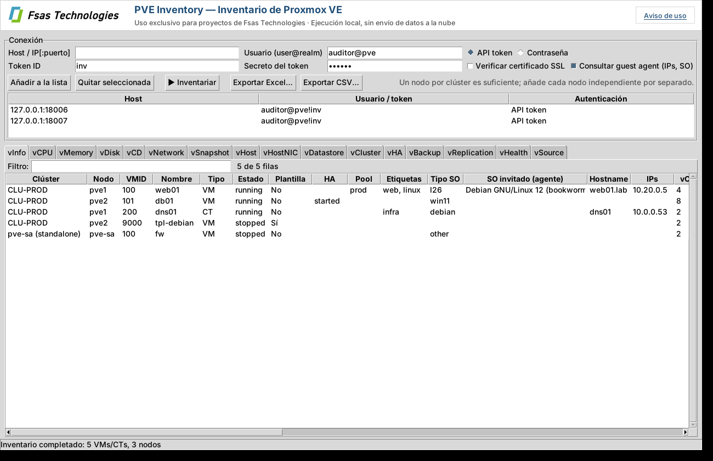

# PVE Inventory : inventaire de Proxmox VE à la manière de RVTools

> **Usage réservé aux projets de Fsas Technologies.** L'outil s'exécute en local, lit uniquement les serveurs Proxmox VE indiqués et n'envoie rien vers le cloud (voir [Conditions d'utilisation](#conditions-dutilisation)).

Outil Windows qui se connecte à l'API de **Proxmox VE 8 et 9**, aussi bien aux **clusters** qu'aux **nœuds autonomes**, et produit un inventaire complet en onglets, consultable à l'écran et exportable vers **Excel** (une feuille par onglet) ou **CSV**. Lecture seule : il ne modifie rien dans Proxmox.



**Langues :** [castellano](README.md) · [English](README.en.md) · [Deutsch](README.de.md) · Français · [Português](README.pt.md) · [Italiano](README.it.md)

## Langues

Depuis la version 1.0, les deux outils (inventaire et planificateur) fonctionnent en **espagnol, anglais, allemand, français, portugais et italien** : fenêtres, messages, aide de la ligne de commande, Excel/CSV et tous les documents Word.

* **Interface graphique :** sélecteur *Langue* (dans l'inventaire, en haut à droite ; dans le planificateur, menu *Langue*). Le changement est immédiat et mémorisé pour la fois suivante. Au premier lancement, la langue de Windows est utilisée (ou l'anglais si ce n'est aucune des six).
* **Ligne de commande :** `--lang es|en|de|fr|pt|it` (ou `--idioma`), ou la variable d'environnement `PVE_LANG`. Sans indication, la langue du système.
* **Excel/CSV :** les en-têtes, l'avis et les valeurs fixes (`Oui`/`Non`, alertes *vHealth*…) sont écrits dans la langue choisie. Le planificateur lit un inventaire dans **n'importe laquelle** des six langues et produit ses documents dans celle que l'on choisit : le client peut donc exécuter l'inventaire dans sa langue et le plan être livré dans une autre.
* Les noms des fichiers générés sont aussi traduits (`migration_plan.xlsx`, `plan_migration.xlsx`…).

## Conditions d'utilisation

* Outil interne destiné exclusivement aux projets de Fsas Technologies ; sa diffusion ou son utilisation en dehors de ce cadre n'est pas autorisée.
* Il s'exécute entièrement sur le poste de l'utilisateur et n'envoie rien vers le cloud. Il n'envoie aucune donnée à Fsas Technologies ni à des tiers et ne contient aucune télémétrie.
* Il se connecte uniquement aux serveurs Proxmox VE indiqués, via leur API et en lecture seule.
* Il n'enregistre ni mots de passe ni jetons sur le disque.
* Les rapports peuvent contenir des informations sensibles du client : traitez-les selon la politique de confidentialité du projet.
* Fourni « en l'état », sans garantie.

L'avis s'affiche à la première ouverture de l'application (il faut l'accepter), reste accessible via le bouton *Conditions d'utilisation*, apparaît comme première feuille (**Avis**) de chaque Excel et sous la forme `LISEZMOI_AVIS.txt` dans chaque export CSV.

## Onglets

| Feuille | Contenu |
|---|---|
| **vInfo** | Une ligne par VM/CT : nœud, état, modèle, HA, pool, étiquettes, OS, OS réel et IP (guest agent), vCPU, RAM, disques, cartes réseau, snapshots, uptime, BIOS, verrou, date de création |
| **vCPU** | Sockets, cœurs, type de CPU, limites, NUMA, utilisation actuelle |
| **vMemory** | Mémoire allouée, balloon, swap (CT), utilisation actuelle |
| **vDisk** | Chaque disque : stockage, volume, taille, format, cache, SSD, iothread, sauvegarde, disques inutilisés |
| **vCD** | Lecteurs CD-ROM et ISO montées |
| **vNetwork** | Chaque carte réseau : modèle, MAC, bridge, VLAN, pare-feu, déconnectée, IP |
| **vSnapshot** | Snapshots avec date, ancienneté et inclusion ou non de la RAM |
| **vPassthrough** | Périphériques PCI/USB/série transmis aux VM et CT, et s'ils utilisent le *resource mapping* |
| **vBackupStatus** | Par VM/CT : nombre de sauvegardes, dernière sauvegarde, ancienneté, taille, stockage et vérification |
| **vHost** | Nœuds : version PVE, noyau, CPU, RAM, swap, disque racine, uptime, EFI/Secure Boot, nombre de VM, ratio vCPU:thread, abonnement |
| **vPhysicalDisk** | Disques physiques : modèle, numéro de série, taille, type, état SMART, usure SSD, utilisation (LVM, ZFS, OSD…) |
| **vRepo** | Dépôts APT Proxmox activés sur chaque nœud (enterprise, no-subscription, test, Ceph) |
| **vCert** | Certificats des nœuds : émetteur, expiration, jours restants, empreinte |
| **vHostNIC** | Toutes les interfaces réseau des nœuds |
| **vBond** | Agrégation : mode (802.3ad, active-backup…), esclaves, hash policy, primaire et bridge qui l'utilise |
| **vBridge** | Bridges Linux/OVS : ports, VLAN aware, VLAN autorisés, IP, et combien de cartes réseau de VM et quels VLAN y sont rattachés |
| **vHostVLAN** | Interfaces VLAN des nœuds (eno1.50, vlan50…) |
| **vSDN** | SDN : zones (simple, VLAN, QinQ, VXLAN, EVPN), VNets, tags/VNI, sous-réseaux, passerelle, SNAT, DHCP, contrôleur, exit nodes, peers, IPAM/DNS, cartes réseau de VM connectées et modifications en attente d'application |
| **vSDNObj** | SDN : contrôleurs (EVPN/BGP/ISIS), IPAM (pve, NetBox, phpIPAM), DNS (PowerDNS) et fabrics de PVE 9. Les jetons et clés ne sont jamais exportés |
| **vCorosync** | Réseau du cluster : liens corosync de chaque nœud, votes, mode |
| **vDatastore** | Stockages par nœud : type, partagé, contenu, capacité, utilisation |
| **vZFS** | Pools ZFS : état, taille, utilisation, fragmentation |
| **vCephOSD** / **vCephPool** | OSD (état, classe, utilisation, latences) et pools Ceph (réplicas, PG, utilisation) |
| **vCluster** | Résumé par cluster ou nœud autonome : quorum, nœuds, totaux CPU/RAM/stockage, Ceph |
| **vHA** | Ressources HA, groupes HA (PVE 8) et règles HA (PVE 9) |
| **vBackup** | Tâches de sauvegarde planifiées |
| **vReplication** | Tâches de réplication ZFS |
| **vTasks** | Tâches en erreur ou avec avertissements des 7 derniers jours |
| **vFirewall** / **vFirewallObj** | Règles de pare-feu (datacenter, security groups, nœuds), alias et IPSets |
| **vUsers** / **vACL** | Utilisateurs, jetons API (expiration, séparation des privilèges) et permissions attribuées |
| **vHealth** | Alertes : stockage ou ZFS plein/dégradé, Ceph non OK, OSD hors service, SMART en échec, SSD usés, certificats proches de l'expiration, VM sans sauvegarde ou avec sauvegarde ancienne, snapshots anciens, corosync sans redondance, bonds à une seule interface, dépôt enterprise sans abonnement, mises à jour en attente, guest agent qui ne répond pas, nœuds hors service ou sans quorum… |
| **vSource** | À quoi on s'est connecté, quand, version de PVE, langue et erreurs |

Dans l'application, les onglets sont regroupés dans un panneau latéral par catégorie (Machines virtuelles, Hosts, Réseau, Stockage, Cluster, Sécurité, Résumé).

## Format d'export

Les feuilles et colonnes de l'Excel/CSV constituent un format stable et versionné (actuellement version 1), conçu pour être lu par d'autres applications comme le planificateur de migration. Il est documenté dans [docs/FORMATO_EXPORTACION.md](docs/FORMATO_EXPORTACION.md) (en espagnol) et défini dans `pvetools/schema.py`. En interne le format est en espagnol ; les en-têtes dans les autres langues sont traduits à l'export et retraduits à la lecture. Un test automatique échoue si l'inventaire exporte des colonnes absentes du format.

## Comment se connecter

* **Cluster :** il suffit d'ajouter **n'importe quel nœud** du cluster ; tous sont inventoriés. Si vous en ajoutez plusieurs du même cluster, le premier qui répond est utilisé et les autres sont ignorés (utile en secours si un nœud est hors service).
* **Nœuds autonomes :** ajoutez-les un par un.
* Vous pouvez mélanger dans la même liste plusieurs clusters et nœuds autonomes, avec des identifiants différents.
* Certificats auto-signés : acceptés par défaut (cochez *Vérifier le certificat SSL* si vous utilisez des certificats valides).
* Les mots de passe et secrets **ne sont pas enregistrés sur le disque** ; seule la liste des hôtes et utilisateurs est mémorisée (`%APPDATA%\PVEInventory\connections.json`).

### Recommandé : utilisateur et jeton API en lecture seule

Sur n'importe quel nœud (une fois par cluster) :

```bash
pveum user add inventario@pve --comment "Inventaire lecture seule"
pveum user token add inventario@pve inv --privsep 0      # conservez le secret affiché
```

Attribuez les permissions avec un rôle en lecture seule. Pour voir aussi les IP et l'OS des VM via le guest agent, un privilège supplémentaire est nécessaire ; il diffère selon la version :

```bash
# PVE 9
pveum role add InventarioRO -privs "Sys.Audit VM.Audit VM.GuestAgent.Audit Datastore.Audit Pool.Audit SDN.Audit Mapping.Audit"
# PVE 8
pveum role add InventarioRO -privs "Sys.Audit VM.Audit VM.Monitor Datastore.Audit Pool.Audit SDN.Audit Mapping.Audit"

pveum acl modify / -user inventario@pve -role InventarioRO
```

Si les IP des VM ne vous sont pas nécessaires, vous pouvez utiliser le rôle intégré `PVEAuditor`. Dans l'outil : utilisateur `inventario@pve`, Token ID `inv` et le secret.

L'utilisateur et mot de passe (`root@pam`, etc.) fonctionnent aussi.

### Comptes avec double authentification (2FA)

Si le compte a la 2FA, l'outil demande le code lors de la connexion, comme l'interface web de Proxmox :

* **Interface graphique :** une fenêtre permet de saisir le code à 6 chiffres de l'application d'authentification (TOTP) ou un code de récupération. Si le code n'est pas valide, il est redemandé (jusqu'à 3 fois). Le code n'est pas enregistré.
* **Ligne de commande :** `--totp 123456` (ou un code de récupération). S'il n'est pas indiqué et que la console est interactive, il est demandé. Pour les tâches planifiées, utilisez un jeton API, car le code expire toutes les 30 secondes.
* TOTP, codes de récupération et Yubico OTP sont pris en charge. Les comptes qui n'ont **que** une clé FIDO/WebAuthn ne peuvent pas être utilisés ici : un jeton API est nécessaire.
* La feuille *vSource* l'indique, p. ex. `Mot de passe + 2FA (TOTP)`.

Le plus pratique pour le client reste néanmoins le **jeton API en lecture seule** de la section précédente : pas de 2FA, pas d'expiration au bout de 30 secondes et uniquement les permissions nécessaires.

## Utilisation

**Interface graphique :** lancez `PVEInventory.exe`, renseignez l'hôte, l'utilisateur et le jeton ou le mot de passe, cliquez sur *Ajouter à la liste* (à répéter pour chaque cluster ou nœud autonome) puis sur *Inventorier*. Chaque onglet a un filtre et un tri par colonne. Cliquez ensuite sur *Exporter Excel…* ou *Exporter CSV…*.

**Ligne de commande** (pour les tâches planifiées) :

```bat
pveinventory-cli.exe --host pve1.mondomaine.local --host pve-sa.mondomaine.local ^
    --user inventario@pve --token-id inv --token-secret XXXXXXXX ^
    -o C:\Inventaire\pve.xlsx --csv C:\Inventaire\csv --lang fr
```

Options : `--password-env VAR` (mot de passe depuis une variable d'environnement), `--totp CODE` (comptes avec 2FA), `PVE_TOKEN_SECRET` (secret depuis une variable d'environnement), `--no-agent` (plus rapide, sans IP des VM), `--verify-ssl`, `--anonymize` (voir ci-dessous), `--lang` (langue de l'Excel/CSV et des messages). Code de sortie : 0 tout OK, 1 une connexion a échoué, 2 toutes ont échoué.

## Anonymiser l'inventaire

Pour que le client puisse envoyer l'inventaire sans données identifiantes, cochez **Anonymiser à l'export** avant
*Exporter Excel…* / *Exporter CSV…* (ou utilisez `--anonymize` en ligne de commande). Le bouton *Qu'est-ce qui est anonymisé ?* l'explique dans l'application.

* **Remplacés par des pseudonymes :** noms de clusters, nœuds, VM/CT, hostnames, domaines, stockages, pools,
  étiquettes, utilisateurs, groupes, realms, zones, VNets, contrôleurs, IPAM et DNS SDN, objets de pare-feu, groupes HA, tâches, snapshots, ISO, chemins et
  serveurs de stockage, et numéros de série des disques (`CLUSTER-01`, `NODO-01`, `VM-0001`, `STORAGE-01`…). Une même valeur
  reçoit toujours le même pseudonyme sur toutes les feuilles, de sorte que les relations VM-nœud-réseau-stockage sont conservées.
* **IP :** transformées en conservant la structure du réseau (deux IP du même sous-réseau restent dans le même sous-réseau et
  la `.1` reste la `.1`). Avec *Conserver les IP* / `--keep-ips`, elles restent inchangées. **MAC :** le fabricant (OUI) est conservé.
* **Vidés :** descriptions, commentaires, e-mails, alias SDN et empreintes de certificats.
* **Conservés :** CPU, RAM, disques et tailles, types de stockage, OS, états, versions, VLAN, bridges `vmbrN`,
  noms par défaut de Proxmox (`local`, `local-lvm`, `rpool`, `root@pam`…) et un indice de rôle dans le pseudonyme
  (`-crit` si le nom, le pool ou l'étiquette semble critique (db, sql, sap, dc…) et `-test` s'il ressemble à un système de test), que le
  planificateur utilise pour ordonner les vagues. Ainsi, **le planificateur produit exactement le même plan** qu'avec l'inventaire réel.
* **Correspondance :** à côté de l'export est enregistré `<nom>_correspondance_CONFIDENTIEL.xlsx` avec la table réel ↔ pseudonyme.
  **Le client la conserve et ne l'envoie pas.** Avec *Annuler l'anonymisation…* (ou `--revert FICHIER --mapping CORRESPONDANCE`),
  le client peut rétablir les vrais noms dans n'importe quel Excel/CSV : l'inventaire anonymisé ou l'**Excel du plan de
  migration** que nous lui livrons. Si la même correspondance est réutilisée pour un autre export (`--mapping`), les
  pseudonymes ne changent pas, ce qui est utile quand plusieurs clusters sont inventoriés séparément.

```bat
pveinventory-cli.exe --host pve1 --user inventario@pve --token-id inv --token-secret XXXX --anonymize -o inventaire_anonyme.xlsx --lang fr
pveinventory-cli.exe --revert plan_migration.xlsx --mapping inventaire_anonyme_correspondance_CONFIDENTIEL.xlsx
```

## Si l'Excel n'apparaît pas ou ne s'ouvre pas

Depuis la version 0.7.1 de l'inventaire (0.4.1 du planificateur), tous les fichiers sont enregistrés de façon sûre : ils sont d'abord écrits dans un fichier temporaire du même dossier, l'Excel/Word est vérifié, et seulement ensuite il est renommé avec son nom définitif. En cas d'échec, le fichier précédent reste intact et un message indique la cause. À la fin, le chemin complet s'affiche avec un bouton *Afficher dans le dossier*.

Si des problèmes persistent, les causes habituelles sur les postes des utilisateurs sont :

* **Le .exe a été ouvert depuis le ZIP ou l'e-mail** sans être extrait : Windows l'exécute depuis un dossier temporaire qu'il supprime ensuite. Extrayez le ZIP avant de l'utiliser.
* **L'« Accès contrôlé aux dossiers » de Windows Defender** empêche les nouveaux programmes d'écrire dans Documents et Bureau. Une notification de Sécurité Windows apparaît ; enregistrez dans un autre dossier ou demandez que le .exe soit autorisé.
* **Dossier synchronisé (OneDrive, SharePoint) ou lecteur réseau :** le fichier peut mettre du temps à être envoyé ou rester « en ligne uniquement ». Attendez la fin de la synchronisation avant de l'envoyer ou de le copier.
* **Le fichier était ouvert dans Excel** lors d'un nouvel export sous le même nom : fermez-le et recommencez.

## Compiler le .exe

Option A, sur un PC Windows avec Python 3.10+ installé : exécutez `build.bat`. Il produit `dist\PVEInventory.exe` (GUI) et `dist\pveinventory-cli.exe` (console), autonomes et copiables sur n'importe quel Windows 10/11 sans rien installer.

Option B, sur GitHub : poussez le projet dans un dépôt et le workflow `.github/workflows/build-windows.yml` compile les deux .exe (Actions → *Build Windows exe* → *Run workflow*, ou en créant un tag `v1.0.0`, qui les publie aussi comme release).

## Développement et tests

```bash
pip install -r requirements.txt
python -m pvetools                 # GUI (sans arguments) ou CLI (avec arguments)
PVE_LANG=es python -m pytest tests # tests avec un Proxmox simulé (cluster PVE 9 + nœud PVE 8)
python tools/gen_format_doc.py     # régénère docs/FORMATO_EXPORTACION*.md après modification de schema.py
python tools/i18n_check.py         # vérifie que tous les textes sont traduits dans les six langues
```

Les textes sont écrits en espagnol dans le code, marqués avec `_()` (ou `N_()`/`D()` pour les valeurs de données), et leurs traductions se trouvent dans `pvetools/tr_catalog.py` (inventaire) et `pvemigplan/tr_catalog.py` (planificateur). Lorsque vous ajoutez un texte, ajoutez sa traduction au catalogue : le test `tests/test_i18n.py` échoue s'il en manque une.

`tests/mock_pve.py` simule l'API de Proxmox, ce qui permet de tester sans serveurs réels.

## Planificateur de migration (usage interne)

Le dossier `pvemigplan/` contient **PVE Migration Planner**, une application distincte (non remise au client) qui lit l'Excel/CSV
de cet outil et produit la conception de la nouvelle plateforme et le plan de migration en Excel et Word. Elle dispose aussi d'un mode
**analyse seule** qui produit un rapport sur l'infrastructure actuelle (avec graphiques et constats) sans proposer de migration,
peut produire les documents d'un **nouveau cluster sans migration** (sans inventaire ou avec un inventaire sans VM) et enregistre le
travail comme **projet** (`.pveplan`, inventaire inclus) pour le reprendre plus tard. Voir [docs/PLANIFICADOR.fr.md](docs/PLANIFICADOR.fr.md).
