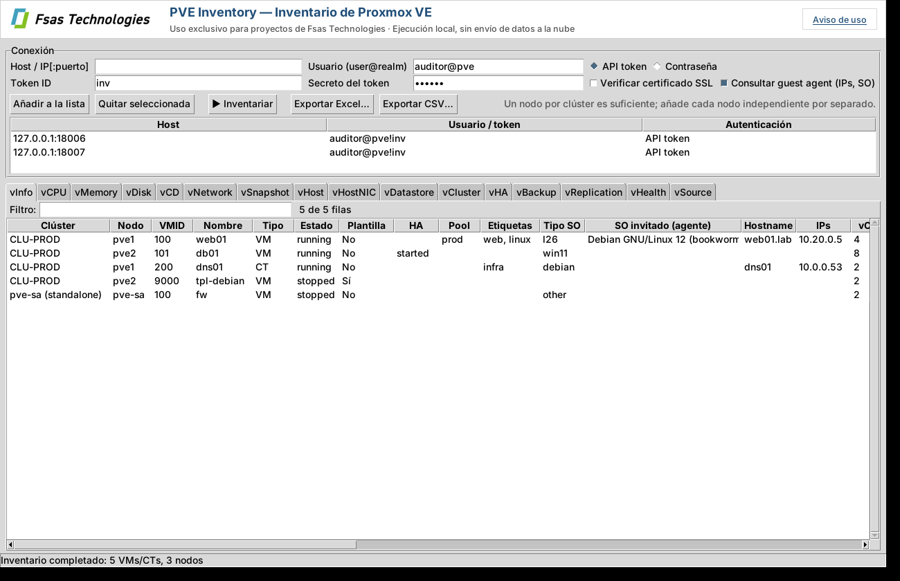

# PVE Inventory: inventario di Proxmox VE in stile RVTools

> **Uso esclusivo per progetti di Fsas Technologies.** Lo strumento viene eseguito in locale, legge solo dai server Proxmox VE indicati e non carica nulla nel cloud (vedi [Avviso d'uso](#avviso-duso)).

Strumento per Windows che si collega all'API di **Proxmox VE 8 e 9**, sia a **cluster** sia a **nodi indipendenti**, e genera un inventario completo in schede consultabile a schermo ed esportabile in **Excel** (un foglio per scheda) o **CSV**. Sola lettura: non modifica nulla in Proxmox.



**Lingue:** [castellano](README.md) · [English](README.en.md) · [Deutsch](README.de.md) · [Français](README.fr.md) · [Português](README.pt.md) · Italiano

## Lingue

Dalla versione 1.0 i due strumenti (inventario e pianificatore) funzionano in **spagnolo, inglese, tedesco, francese, portoghese e italiano**: finestre, messaggi, guida della riga di comando, Excel/CSV e tutti i documenti Word.

* **Interfaccia grafica:** selettore *Lingua* (nell'inventario in alto a destra; nel pianificatore, menu *Lingua*). La modifica è immediata e viene ricordata per la volta successiva. Al primo avvio si usa la lingua di Windows (o l'inglese se non è nessuna delle sei).
* **Riga di comando:** `--lang es|en|de|fr|pt|it` (o `--idioma`), oppure la variabile d'ambiente `PVE_LANG`. Se non indicata, la lingua del sistema.
* **Excel/CSV:** intestazioni, avviso e valori fissi (`Sì`/`No`, avvisi di *vHealth*…) sono scritti nella lingua scelta. Il pianificatore legge un inventario in **qualsiasi** delle sei lingue e genera i documenti in quella scelta, quindi il cliente può eseguire l'inventario nella propria lingua e il piano può essere consegnato in un'altra.
* Anche i nomi dei file generati vengono tradotti (`migration_plan.xlsx`, `piano_migrazione.xlsx`…).

## Avviso d'uso

* Strumento interno destinato esclusivamente ai progetti di Fsas Technologies; non ne è consentita la distribuzione né l'uso al di fuori di tale ambito.
* Viene eseguito interamente sul computer dell'utente e non carica nulla nel cloud. Non invia dati a Fsas Technologies né a terzi e non ha telemetria.
* Si collega solo ai server Proxmox VE indicati, tramite la loro API e in sola lettura.
* Non salva password né token su disco.
* I report possono contenere informazioni sensibili del cliente: trattali secondo la politica di riservatezza del progetto.
* Fornito "così com'è", senza garanzia.

L'avviso viene mostrato alla prima apertura dell'applicazione (va accettato), è sempre disponibile dal pulsante *Avviso d'uso*, compare come primo foglio (**Avviso**) di ogni Excel e come `LEGGIMI_AVVISO.txt` in ogni esportazione CSV.

## Schede

| Foglio | Contenuto |
|---|---|
| **vInfo** | Una riga per VM/CT: nodo, stato, template, HA, pool, tag, SO, SO reale e IP (guest agent), vCPU, RAM, dischi, NIC, snapshot, uptime, BIOS, blocco, data di creazione |
| **vCPU** | Socket, core, tipo di CPU, limiti, NUMA, utilizzo attuale |
| **vMemory** | Memoria assegnata, balloon, swap (CT), utilizzo attuale |
| **vDisk** | Ogni disco: storage, volume, dimensione, formato, cache, SSD, iothread, backup, dischi inutilizzati |
| **vCD** | Unità CD-ROM e ISO montate |
| **vNetwork** | Ogni NIC: modello, MAC, bridge, VLAN, firewall, scollegata, IP |
| **vSnapshot** | Snapshot con data, anzianità e se includono la RAM |
| **vPassthrough** | Dispositivi PCI/USB/seriali passati a VM e CT, e se usano il *resource mapping* |
| **vBackupStatus** | Per VM/CT: n. di copie, ultimo backup, anzianità, dimensione, storage e verifica |
| **vHost** | Nodi: versione PVE, kernel, CPU, RAM, swap, disco root, uptime, EFI/Secure Boot, n. di VM, rapporto vCPU:thread, sottoscrizione |
| **vPhysicalDisk** | Dischi fisici: modello, numero di serie, dimensione, tipo, stato SMART, usura SSD, utilizzo (LVM, ZFS, OSD…) |
| **vRepo** | Repository APT di Proxmox abilitati su ogni nodo (enterprise, no-subscription, test, Ceph) |
| **vCert** | Certificati dei nodi: emittente, scadenza, giorni rimanenti, impronta |
| **vHostNIC** | Tutte le interfacce di rete dei nodi |
| **vBond** | Teaming: modalità (802.3ad, active-backup…), slave, hash policy, primaria e quale bridge lo usa |
| **vBridge** | Bridge Linux/OVS: porte, VLAN aware, VLAN consentite, IP e quante NIC di VM e quali VLAN vi sono collegate |
| **vHostVLAN** | Interfacce VLAN dei nodi (eno1.50, vlan50…) |
| **vSDN** | SDN: zone (simple, VLAN, QinQ, VXLAN, EVPN), VNet, tag/VNI, subnet, gateway, SNAT, DHCP, controller, exit node, peer, IPAM/DNS, NIC di VM collegate e modifiche in attesa di applicazione |
| **vSDNObj** | SDN: controller (EVPN/BGP/ISIS), IPAM (pve, NetBox, phpIPAM), DNS (PowerDNS) e fabric di PVE 9. Token e chiavi non vengono mai esportati |
| **vCorosync** | Rete del cluster: link corosync di ogni nodo, voti, modalità |
| **vDatastore** | Storage per nodo: tipo, condiviso, contenuto, capacità, utilizzo |
| **vZFS** | Pool ZFS: stato, dimensione, utilizzo, frammentazione |
| **vCephOSD** / **vCephPool** | OSD (stato, classe, utilizzo, latenze) e pool Ceph (repliche, PG, utilizzo) |
| **vCluster** | Riepilogo per cluster o nodo indipendente: quorum, nodi, totali CPU/RAM/storage, Ceph |
| **vHA** | Risorse HA, gruppi HA (PVE 8) e regole HA (PVE 9) |
| **vBackup** | Job di backup pianificati |
| **vReplication** | Job di replica ZFS |
| **vTasks** | Task con errori o avvisi degli ultimi 7 giorni |
| **vFirewall** / **vFirewallObj** | Regole firewall (datacenter, security group, nodi), alias e IPSet |
| **vUsers** / **vACL** | Utenti, API token (scadenza, separazione dei privilegi) e permessi assegnati |
| **vHealth** | Avvisi: storage o ZFS pieno/degradato, Ceph non OK, OSD fuori servizio, SMART in errore, SSD usurati, certificati in scadenza, VM senza backup o con backup vecchio, snapshot vecchi, corosync senza ridondanza, bond con una sola interfaccia, repository enterprise senza sottoscrizione, aggiornamenti in sospeso, guest agent che non risponde, nodi fuori servizio o senza quorum… |
| **vSource** | A cosa ci si è collegati, quando, versione di PVE, lingua ed errori |

Nell'applicazione le schede sono raggruppate in un pannello laterale per categorie (Macchine virtuali, Hosts, Rete, Storage, Cluster, Sicurezza, Riepilogo).

## Formato di esportazione

I fogli e le colonne dell'Excel/CSV sono un formato stabile e versionato (oggi versione 1), pensato per essere letto da altre applicazioni come il pianificatore di migrazione. È documentato in [docs/FORMATO_EXPORTACION.md](docs/FORMATO_EXPORTACION.md) (in spagnolo) e definito in `pvetools/schema.py`. Internamente il formato è in spagnolo; le intestazioni nelle altre lingue vengono tradotte in esportazione e ritradotte in lettura. Un test automatico fallisce se l'inventario esporta colonne che non fanno parte del formato.

## Come collegarsi

* **Cluster:** basta aggiungere **un nodo qualsiasi** del cluster; vengono inventariati tutti. Se ne aggiungi più di uno dello stesso cluster, si usa il primo che risponde e gli altri vengono saltati (utile come riserva se un nodo è fuori servizio).
* **Nodi indipendenti:** aggiungili uno per uno.
* Nella stessa lista puoi mescolare più cluster e nodi singoli, con credenziali diverse.
* Certificati autofirmati: accettati per impostazione predefinita (spunta *Verifica certificato SSL* se usi certificati validi).
* Password e segreti **non vengono salvati su disco**; si ricorda solo l'elenco di host e utenti (`%APPDATA%\PVEInventory\connections.json`).

### Consigliato: utente e API token in sola lettura

Su un nodo qualsiasi (una volta per cluster):

```bash
pveum user add inventario@pve --comment "Inventario sola lettura"
pveum user token add inventario@pve inv --privsep 0      # conserva il segreto mostrato
```

Assegna i permessi con un ruolo di sola lettura. Per vedere anche IP e SO delle VM tramite il guest agent serve un privilegio aggiuntivo, che cambia tra le versioni:

```bash
# PVE 9
pveum role add InventarioRO -privs "Sys.Audit VM.Audit VM.GuestAgent.Audit Datastore.Audit Pool.Audit SDN.Audit Mapping.Audit"
# PVE 8
pveum role add InventarioRO -privs "Sys.Audit VM.Audit VM.Monitor Datastore.Audit Pool.Audit SDN.Audit Mapping.Audit"

pveum acl modify / -user inventario@pve -role InventarioRO
```

Se non ti servono gli IP delle VM, puoi usare il ruolo incluso `PVEAuditor`. Nello strumento: utente `inventario@pve`, Token ID `inv` e il segreto.

Funziona anche con utente e password (`root@pam`, ecc.).

### Account con secondo fattore (2FA)

Se l'account ha la 2FA, lo strumento chiede il codice al momento della connessione, come l'interfaccia web di Proxmox:

* **Interfaccia grafica:** compare una finestra per inserire il codice a 6 cifre dell'app di autenticazione (TOTP) o un codice di recupero. Se il codice non è valido, viene richiesto di nuovo (fino a 3 volte). Il codice non viene salvato.
* **Riga di comando:** `--totp 123456` (o un codice di recupero). Se non è indicato e la console è interattiva, viene chiesto. Per le attività pianificate usa un API token, perché il codice scade ogni 30 secondi.
* Sono supportati TOTP, codici di recupero e Yubico OTP. Gli account che hanno **solo** una chiave FIDO/WebAuthn non possono essere usati qui: serve un API token.
* Nel foglio *vSource* resta annotato, ad es. `Password + 2FA (TOTP)`.

Resta comunque più comodo per il cliente l'**API token in sola lettura** della sezione precedente: non chiede la 2FA, non scade dopo 30 secondi e ha solo i permessi necessari.

## Uso

**Interfaccia grafica:** esegui `PVEInventory.exe`, compila host, utente e token o password, premi *Aggiungi all'elenco* (ripeti per ogni cluster o nodo singolo) e poi *Inventaria*. Ogni scheda ha filtro e ordinamento per colonna. Poi premi *Esporta Excel…* o *Esporta CSV…*.

**Riga di comando** (per attività pianificate):

```bat
pveinventory-cli.exe --host pve1.miodominio.local --host pve-sa.miodominio.local ^
    --user inventario@pve --token-id inv --token-secret XXXXXXXX ^
    -o C:\Inventario\pve.xlsx --csv C:\Inventario\csv --lang it
```

Opzioni: `--password-env VAR` (password da una variabile d'ambiente), `--totp CODICE` (account con 2FA), `PVE_TOKEN_SECRET` (segreto da una variabile d'ambiente), `--no-agent` (più veloce, senza IP delle VM), `--verify-ssl`, `--anonymize` (vedi sotto), `--lang` (lingua dell'Excel/CSV e dei messaggi). Codice di uscita: 0 tutto OK, 1 una connessione non è riuscita, 2 non è riuscita nessuna.

## Anonimizzare l'inventario

Perché il cliente possa inviare l'inventario senza dati identificativi, spunta **Anonimizza all'esportazione** prima di
*Esporta Excel…* / *Esporta CSV…* (o usa `--anonymize` dalla riga di comando). Il pulsante *Cosa viene anonimizzato?* lo spiega nell'applicazione stessa.

* **Vengono sostituiti da pseudonimi** i nomi di cluster, nodi, VM/CT, hostname, domini, storage, pool,
  tag, utenti, gruppi, realm, zone, VNet, controller, IPAM e DNS SDN, oggetti firewall, gruppi HA, job, snapshot, ISO, percorsi e
  server di storage e numeri di serie dei dischi (`CLUSTER-01`, `NODO-01`, `VM-0001`, `STORAGE-01`…). Lo stesso valore
  riceve sempre lo stesso pseudonimo in tutti i fogli, così le relazioni VM-nodo-rete-storage restano intatte.
* **IP:** vengono trasformati mantenendo la struttura di rete (due IP della stessa subnet restano nella stessa subnet e
  il `.1` resta il `.1`). Con *Conserva IP* / `--keep-ips` non vengono toccati. **MAC:** si conserva il produttore (OUI).
* **Vengono svuotati** descrizioni, commenti, email, alias SDN e impronte dei certificati.
* **Si conservano** CPU, RAM, dischi e dimensioni, tipi di storage, SO, stati, versioni, VLAN, bridge `vmbrN`,
  i nomi predefiniti di Proxmox (`local`, `local-lvm`, `rpool`, `root@pam`…) e un indizio di ruolo nello pseudonimo
  (`-crit` se il nome, il pool o il tag sembra critico (db, sql, sap, dc…) e `-test` se sembra di test), che il
  pianificatore usa per ordinare le ondate. Con tutto ciò **il pianificatore produce esattamente lo stesso piano** dell'inventario reale.
* **Corrispondenza:** accanto all'esportazione si salva `<nome>_corrispondenza_RISERVATO.xlsx` con la tabella reale ↔ pseudonimo.
  **La conserva il cliente e non viene inviata.** Con *Annulla anonimizzazione…* (o `--revert FILE --mapping MAPPA`)
  il cliente può ripristinare i nomi reali in qualsiasi Excel/CSV: l'inventario anonimizzato o l'**Excel del piano di
  migrazione** che gli consegniamo. Se la stessa corrispondenza viene riutilizzata in un'altra esportazione (`--mapping`), gli
  pseudonimi non cambiano, cosa utile quando si inventariano più cluster separatamente.

```bat
pveinventory-cli.exe --host pve1 --user inventario@pve --token-id inv --token-secret XXXX --anonymize -o inventario_anonimo.xlsx --lang it
pveinventory-cli.exe --revert piano_migrazione.xlsx --mapping inventario_anonimo_corrispondenza_RISERVATO.xlsx
```

## Se l'Excel non compare o non si apre

Dalla versione 0.7.1 dell'inventario (0.4.1 del pianificatore) tutti i file vengono salvati in modo sicuro: vengono scritti prima in un file temporaneo nella stessa cartella, si verifica che l'Excel/Word sia valido e solo allora viene rinominato con il nome definitivo. Se qualcosa va storto, il file precedente resta intatto e compare un messaggio con la causa. Al termine viene mostrato il percorso completo con un pulsante *Mostra nella cartella*.

Se ci sono ancora problemi, le cause abituali sui computer degli utenti sono:

* **Il .exe è stato aperto dall'interno dello ZIP o dell'email** senza estrarlo: Windows lo esegue da una cartella temporanea che poi cancella. Estrai lo ZIP prima di usarlo.
* **L'«Accesso alle cartelle controllato» di Windows Defender** impedisce ai programmi nuovi di scrivere in Documenti e Desktop. Compare una notifica di Sicurezza di Windows; salva in un'altra cartella o chiedi che il .exe venga consentito.
* **Cartella sincronizzata (OneDrive, SharePoint) o unità di rete:** il file può impiegare tempo a essere caricato o restare «solo online». Attendi la fine della sincronizzazione prima di inviarlo o copiarlo.
* **Il file era aperto in Excel** quando lo hai esportato di nuovo con lo stesso nome: chiudilo e ripeti.

## Compilare il .exe

Opzione A, su un PC Windows con Python 3.10+ installato: esegui `build.bat`. Genera `dist\PVEInventory.exe` (GUI) e `dist\pveinventory-cli.exe` (console), autonomi e copiabili su qualsiasi Windows 10/11 senza installare nulla.

Opzione B, su GitHub: carica il progetto in un repository e il workflow `.github/workflows/build-windows.yml` compila i due .exe (Actions → *Build Windows exe* → *Run workflow*, oppure creando un tag `v1.0.0`, che li pubblica anche come release).

## Sviluppo e test

```bash
pip install -r requirements.txt
python -m pvetools                 # GUI (senza argomenti) o CLI (con argomenti)
PVE_LANG=es python -m pytest tests # test con un Proxmox simulato (cluster PVE 9 + nodo PVE 8)
python tools/gen_format_doc.py     # rigenera docs/FORMATO_EXPORTACION*.md dopo aver modificato schema.py
python tools/i18n_check.py         # verifica che tutti i testi siano tradotti nelle sei lingue
```

I testi sono scritti in spagnolo nel codice, marcati con `_()` (o `N_()`/`D()` per i valori di dati), e le loro traduzioni si trovano in `pvetools/tr_catalog.py` (inventario) e `pvemigplan/tr_catalog.py` (pianificatore). Quando aggiungi un testo nuovo, aggiungi la sua traduzione al catalogo: il test `tests/test_i18n.py` fallisce se ne manca una.

`tests/mock_pve.py` simula l'API di Proxmox, quindi si può testare senza server reali.

## Pianificatore di migrazione (uso interno)

Nella cartella `pvemigplan/` si trova **PVE Migration Planner**, un'applicazione a parte (non viene consegnata al cliente) che legge l'Excel/CSV
di questo strumento e genera il progetto della nuova piattaforma e il piano di migrazione in Excel e Word. Ha anche una modalità
**solo analisi** che genera un report sull'infrastruttura attuale (con grafici e rilievi) senza proporre la migrazione,
può generare i documenti di un **nuovo cluster senza migrazione** (senza inventario o con un inventario senza VM) e salva il
lavoro come **progetto** (`.pveplan`, con l'inventario incluso) per riprenderlo più tardi. Vedi [docs/PLANIFICADOR.it.md](docs/PLANIFICADOR.it.md).
