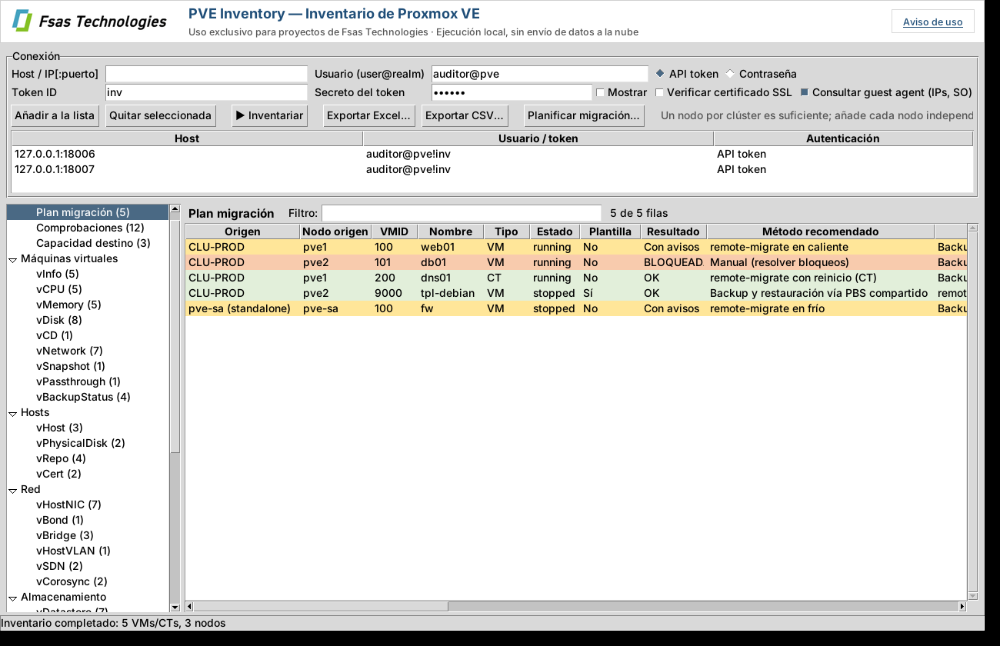

# PVE Inventory: inventario de Proxmox VE al estilo RVTools

> **Uso exclusivo para proyectos de Fsas Technologies.** La herramienta se ejecuta en local, solo lee de los servidores Proxmox VE que indiques y no sube nada a la nube (ver [Aviso de uso](#aviso-de-uso)).

Herramienta para Windows que se conecta a la API de **Proxmox VE 8 y 9**, tanto a **clústeres** como a **nodos independientes**, y genera un inventario completo en pestañas que puedes ver en pantalla y exportar a **Excel** (una hoja por pestaña) o **CSV**. Solo lee: no modifica nada en Proxmox.




## Aviso de uso

* Herramienta interna destinada exclusivamente a proyectos de Fsas Technologies; no está permitida su distribución ni su uso fuera de ese ámbito.
* Se ejecuta íntegramente en el equipo del usuario y no sube nada a la nube. No envía datos a Fsas Technologies ni a terceros y no tiene telemetría.
* Solo se conecta a los servidores Proxmox VE indicados, a través de su API y en modo de solo lectura.
* No guarda contraseñas ni tokens en disco.
* Los informes pueden contener información sensible del cliente: trátalos según la política de confidencialidad del proyecto.
* Se proporciona "tal cual", sin garantía.

El aviso se muestra al abrir la aplicación por primera vez (hay que aceptarlo), está siempre accesible desde el botón *Aviso de uso*, aparece como primera hoja (**Aviso**) de cada Excel y como `LEEME_AVISO.txt` en cada exportación CSV.

## Pestañas

| Hoja | Contenido |
|---|---|
| **vInfo** | Una fila por VM/CT: nodo, estado, plantilla, HA, pool, etiquetas, SO, SO real e IPs (guest agent), vCPU, RAM, discos, NICs, snapshots, uptime, BIOS, bloqueo, fecha de creación |
| **vCPU** | Sockets, cores, tipo de CPU, límites, NUMA, uso actual |
| **vMemory** | Memoria asignada, balloon, swap (CT), uso actual |
| **vDisk** | Cada disco: almacenamiento, volumen, tamaño, formato, caché, SSD, iothread, backup, discos sin usar |
| **vCD** | Unidades CD-ROM e ISOs montadas |
| **vNetwork** | Cada NIC: modelo, MAC, bridge, VLAN, firewall, desconectada, IPs |
| **vSnapshot** | Snapshots con fecha, antigüedad y si incluyen RAM |
| **vPassthrough** | Dispositivos PCI/USB/serie pasados a VMs y CTs, y si usan *resource mapping* |
| **vBackupStatus** | Por VM/CT: nº de copias, último backup, antigüedad, tamaño, almacenamiento y verificación |
| **vHost** | Nodos: versión PVE, kernel, CPU, RAM, swap, disco raíz, uptime, EFI/Secure Boot, nº VMs, ratio vCPU:hilo, suscripción |
| **vPhysicalDisk** | Discos físicos: modelo, serie, tamaño, tipo, estado SMART, desgaste de SSD, uso (LVM, ZFS, OSD…) |
| **vRepo** | Repositorios APT de Proxmox habilitados en cada nodo (enterprise, no-subscription, test, Ceph) |
| **vCert** | Certificados de los nodos: emisor, caducidad, días restantes, huella |
| **vHostNIC** | Todas las interfaces de red de los nodos |
| **vBond** | Teaming: modo (802.3ad, active-backup…), esclavos, hash policy, primario y qué bridge lo usa |
| **vBridge** | Bridges Linux/OVS: puertos, VLAN aware, VLANs permitidas, IP y cuántas NICs de VMs y qué VLANs cuelgan de él |
| **vHostVLAN** | Interfaces VLAN de los nodos (eno1.50, vlan50…) |
| **vSDN** | SDN: zonas, VNets, tags/VNI, subredes, gateway, SNAT, DHCP y cambios pendientes de aplicar |
| **vCorosync** | Red del clúster: enlaces corosync de cada nodo, votos, modo |
| **vDatastore** | Almacenamientos por nodo: tipo, compartido, contenido, capacidad, uso |
| **vZFS** | Pools ZFS: estado, tamaño, uso, fragmentación |
| **vCephOSD** / **vCephPool** | OSDs (estado, clase, uso, latencias) y pools de Ceph (réplicas, PGs, uso) |
| **vCluster** | Resumen por clúster o nodo independiente: quórum, nodos, totales de CPU/RAM/almacenamiento, Ceph |
| **vHA** | Recursos HA, grupos HA (PVE 8) y reglas HA (PVE 9) |
| **vBackup** | Jobs de backup programados |
| **vReplication** | Jobs de replicación ZFS |
| **vTasks** | Tareas con error o avisos de los últimos 7 días |
| **vFirewall** / **vFirewallObj** | Reglas de firewall (datacenter, security groups, nodos), alias e IPSets |
| **vUsers** / **vACL** | Usuarios, API tokens (caducidad, privilegios separados) y permisos asignados |
| **vHealth** | Avisos: almacenamiento o ZFS lleno/degradado, Ceph no OK, OSD caídos, SMART en fallo, SSD gastados, certificados por caducar, VMs sin backup o con backup antiguo, snapshots antiguos, corosync sin redundancia, bonds de una sola interfaz, repositorio enterprise sin suscripción, actualizaciones pendientes, guest agent que no responde, nodos caídos o sin quórum… |
| **vSource** | Con qué se ha conectado, cuándo, versión de PVE y errores |

En la aplicación las pestañas se agrupan en un panel lateral por categorías (Máquinas virtuales, Hosts, Red, Almacenamiento, Clúster, Seguridad, Resumen).

## Planificador de migración a otro Proxmox

Botón **Planificar migración…** (o `--target-host` en la línea de comandos). Lee también el Proxmox de destino **en modo solo lectura**, compara ambos entornos y genera:

* `plan_migracion_*.xlsx`: hoja **Plan** (método recomendado por VM/CT, nodo y VMID destino, mapeos, datos a copiar, tiempo y corte estimados, comando), **Comprobaciones** (bloqueos y avisos), **Capacidad** (almacenamiento y RAM del destino antes/después), **Mapeos** y **Métodos**.
* `migracion_remote_*.sh`: comandos `qm/pct remote-migrate` listos para revisar y lanzar en los nodos de origen.
* `migracion_backup_restore_*.sh`: alternativa con `vzdump` + `qmrestore`/`pct restore` (vía PBS compartido si existe), incluyendo el ajuste de bridges.

**No ejecuta nada**: los scripts empiezan con `exit 1` para que nadie los lance enteros por error; se ejecutan comando a comando.

Métodos que contempla:

| Método | Cuándo |
|---|---|
| `qm remote-migrate --online` | VMs encendidas: copia en caliente entre clústeres, corte de segundos (PVE ≥ 7.3, *experimental* en Proxmox) |
| `qm/pct remote-migrate` en frío | VMs/CTs apagadas o con CPU incompatible para migrar en caliente |
| `pct remote-migrate --restart` | Contenedores encendidos (no hay migración en caliente de CTs) |
| Backup/restauración vía PBS compartido | Plantillas, VMs con passthrough o si se prefiere el método más conservador; *live-restore* reduce el corte |
| vzdump + copia + restauración | Sin PBS común |
| Replicación de almacenamiento (ZFS send/recv, RBD) | Discos muy grandes (manual) |
| Ampliar el clúster | Nodos destino vacíos en la misma red: unirlos, migrar en caliente dentro del clúster y retirar los antiguos |

Comprobaciones por VM: VMID ocupado en destino (propone otro), almacenamiento y bridge/VNet destino existentes y con el tipo de contenido correcto, espacio suficiente (acumulado) y RAM libre en el nodo destino, VLAN sobre bridge no *VLAN aware*, CPU `host` entre modelos o fabricantes distintos, passthrough PCI/USB sin mapping, discos físicos o bind mounts, ISO montada, snapshots, HA, replicación, bloqueos, pools y versión de PVE del destino.

El nodo destino se elige automáticamente (el de más RAM libre, repartiendo) o se fija a mano. Los mapeos de almacenamiento y red se proponen solos (mismo nombre si existe) y se pueden cambiar.

Ejemplo por línea de comandos:

```bat
pveinventory-cli.exe --host pve-viejo --user inventario@pve --token-id inv --token-secret XXXX ^
    --target-host pve-nuevo --target-token-id inv --target-token-secret YYYY ^
    --map-storage local-lvm=local-zfs --map-bridge vmbr1=vmbr0 --bandwidth 10 --plan-dir C:\Migracion
```

## Cómo conectarse

* **Clúster:** basta con añadir **un nodo cualquiera** del clúster; se inventarían todos. Si añades varios del mismo clúster, se usa el primero que responda y el resto se omite (útil como respaldo si un nodo está caído).
* **Nodos independientes:** añade cada uno por separado.
* Puedes mezclar en la misma lista varios clústeres y nodos sueltos, con credenciales distintas.
* Certificados autofirmados: se aceptan por defecto (marca *Verificar certificado SSL* si usas certificados válidos).
* Las contraseñas y secretos **no se guardan en disco**; solo se recuerda la lista de hosts y usuarios (`%APPDATA%\PVEInventory\connections.json`).

### Recomendado: usuario y API token de solo lectura

En cualquier nodo (una vez por clúster):

```bash
pveum user add inventario@pve --comment "Inventario solo lectura"
pveum user token add inventario@pve inv --privsep 0      # guarda el secreto que muestra
```

Asigna los permisos con un rol de solo lectura. Para ver también IPs y SO de las VMs mediante el guest agent hace falta un permiso extra, que cambia entre versiones:

```bash
# PVE 9
pveum role add InventarioRO -privs "Sys.Audit VM.Audit VM.GuestAgent.Audit Datastore.Audit Pool.Audit SDN.Audit Mapping.Audit"
# PVE 8
pveum role add InventarioRO -privs "Sys.Audit VM.Audit VM.Monitor Datastore.Audit Pool.Audit SDN.Audit Mapping.Audit"

pveum acl modify / -user inventario@pve -role InventarioRO
```

Si te basta sin IPs de las VMs, puedes usar el rol incluido `PVEAuditor`. En la herramienta: usuario `inventario@pve`, Token ID `inv` y el secreto.

También funciona con usuario y contraseña (`root@pam`, etc.). Las cuentas con 2FA deben usar token.

## Uso

**Interfaz gráfica:** ejecuta `PVEInventory.exe`, rellena host, usuario y token o contraseña, pulsa *Añadir a la lista* (repite para cada clúster o nodo suelto) y luego *Inventariar*. Cada pestaña tiene filtro y ordenación por columna. Después pulsa *Exportar Excel…* o *Exportar CSV…*.

**Línea de comandos** (para tareas programadas):

```bat
pveinventory-cli.exe --host pve1.midominio.local --host pve-sa.midominio.local ^
    --user inventario@pve --token-id inv --token-secret XXXXXXXX ^
    -o C:\Inventario\pve.xlsx --csv C:\Inventario\csv
```

Opciones: `--password-env VAR` (contraseña desde una variable de entorno), `PVE_TOKEN_SECRET` (secreto desde una variable de entorno), `--no-agent` (más rápido, sin IPs de VMs), `--verify-ssl`. Código de salida: 0 todo OK, 1 alguna conexión falló, 2 fallaron todas.

## Compilar el .exe

Opción A, en un PC Windows con Python 3.10+ instalado: ejecuta `build.bat`. Genera `dist\PVEInventory.exe` (GUI) y `dist\pveinventory-cli.exe` (consola), que son autónomos y se pueden copiar a cualquier Windows 10/11 sin instalar nada.

Opción B, en GitHub: sube el proyecto a un repositorio y el workflow `.github/workflows/build-windows.yml` compila los dos .exe (Actions → *Build Windows exe* → *Run workflow*, o creando un tag `v0.1.0`, que además los publica como release).

## Desarrollo y pruebas

```bash
pip install -r requirements.txt
python -m pvetools                 # GUI (sin argumentos) o CLI (con argumentos)
python tests/test_inventory.py     # prueba con un Proxmox simulado (clúster PVE 9 + nodo PVE 8)
```

`tests/mock_pve.py` simula la API de Proxmox, así que se puede probar sin servidores reales.
