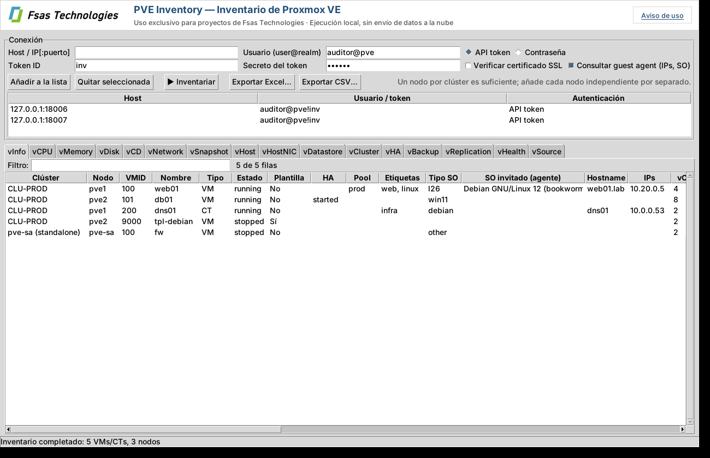

# PVE Inventory: inventario de Proxmox VE al estilo RVTools

> **Uso exclusivo para proyectos de Fsas Technologies.** La herramienta se ejecuta en local, solo lee de los servidores Proxmox VE que indiques y no sube nada a la nube (ver [Aviso de uso](#aviso-de-uso)).

Herramienta para Windows que se conecta a la API de **Proxmox VE 8 y 9**, tanto a **clústeres** como a **nodos independientes**, y genera un inventario completo en pestañas que puedes ver en pantalla y exportar a **Excel** (una hoja por pestaña) o **CSV**. Solo lee: no modifica nada en Proxmox.



## Aviso de uso

* Herramienta interna destinada exclusivamente a proyectos de Fsas Technologies; no está permitida su distribución ni su uso fuera de ese ámbito.
* Se ejecuta íntegramente en el equipo del usuario y no sube nada a la nube. No envía datos a Fsas Technologies ni a terceros y no tiene telemetría.
* Solo se conecta a los servidores Proxmox VE indicados, a través de su API y en modo de solo lectura.
* No guarda contraseñas ni tokens en disco.
* Los informes pueden contener información sensible del cliente: trátalos según la política de confidencialidad del proyecto.
* Se proporciona "tal cual", sin garantía.

El aviso se muestra al abrir la aplicación por primera vez (hay que aceptarlo), está siempre accesible desde el botón *Aviso de uso*, aparece como primera hoja (**Aviso**) de cada Excel y como `LEEME_AVISO.txt` en cada exportación CSV.

## Pestañas

| Hoja | Contenido |
|---|---|
| **vInfo** | Una fila por VM/CT: nodo, estado, plantilla, HA, pool, etiquetas, SO, SO real e IPs (guest agent), vCPU, RAM, discos, NICs, snapshots, uptime, BIOS, bloqueo, fecha de creación |
| **vCPU** | Sockets, cores, tipo de CPU, límites, NUMA, uso actual |
| **vMemory** | Memoria asignada, balloon, swap (CT), uso actual |
| **vDisk** | Cada disco: almacenamiento, volumen, tamaño, formato, caché, SSD, iothread, backup, discos sin usar |
| **vCD** | Unidades CD-ROM e ISOs montadas |
| **vNetwork** | Cada NIC: modelo, MAC, bridge, VLAN, firewall, desconectada, IPs |
| **vSnapshot** | Snapshots con fecha, antigüedad y si incluyen RAM |
| **vPassthrough** | Dispositivos PCI/USB/serie pasados a VMs y CTs, y si usan *resource mapping* |
| **vBackupStatus** | Por VM/CT: nº de copias, último backup, antigüedad, tamaño, almacenamiento y verificación |
| **vHost** | Nodos: versión PVE, kernel, CPU, RAM, swap, disco raíz, uptime, EFI/Secure Boot, nº VMs, ratio vCPU:hilo, suscripción |
| **vPhysicalDisk** | Discos físicos: modelo, serie, tamaño, tipo, estado SMART, desgaste de SSD, uso (LVM, ZFS, OSD…) |
| **vRepo** | Repositorios APT de Proxmox habilitados en cada nodo (enterprise, no-subscription, test, Ceph) |
| **vCert** | Certificados de los nodos: emisor, caducidad, días restantes, huella |
| **vHostNIC** | Todas las interfaces de red de los nodos |
| **vBond** | Teaming: modo (802.3ad, active-backup…), esclavos, hash policy, primario y qué bridge lo usa |
| **vBridge** | Bridges Linux/OVS: puertos, VLAN aware, VLANs permitidas, IP y cuántas NICs de VMs y qué VLANs cuelgan de él |
| **vHostVLAN** | Interfaces VLAN de los nodos (eno1.50, vlan50…) |
| **vSDN** | SDN: zonas (simple, VLAN, QinQ, VXLAN, EVPN), VNets, tags/VNI, subredes, gateway, SNAT, DHCP, controlador, exit nodes, peers, IPAM/DNS, NICs de VMs conectadas y cambios pendientes de aplicar |
| **vSDNObj** | SDN: controladores (EVPN/BGP/ISIS), IPAM (pve, NetBox, phpIPAM), DNS (PowerDNS) y fabrics de PVE 9. Nunca se exportan tokens ni claves |
| **vCorosync** | Red del clúster: enlaces corosync de cada nodo, votos, modo |
| **vDatastore** | Almacenamientos por nodo: tipo, compartido, contenido, capacidad, uso |
| **vZFS** | Pools ZFS: estado, tamaño, uso, fragmentación |
| **vCephOSD** / **vCephPool** | OSDs (estado, clase, uso, latencias) y pools de Ceph (réplicas, PGs, uso) |
| **vCluster** | Resumen por clúster o nodo independiente: quórum, nodos, totales de CPU/RAM/almacenamiento, Ceph |
| **vHA** | Recursos HA, grupos HA (PVE 8) y reglas HA (PVE 9) |
| **vBackup** | Jobs de backup programados |
| **vReplication** | Jobs de replicación ZFS |
| **vTasks** | Tareas con error o avisos de los últimos 7 días |
| **vFirewall** / **vFirewallObj** | Reglas de firewall (datacenter, security groups, nodos), alias e IPSets |
| **vUsers** / **vACL** | Usuarios, API tokens (caducidad, privilegios separados) y permisos asignados |
| **vHealth** | Avisos: almacenamiento o ZFS lleno/degradado, Ceph no OK, OSD caídos, SMART en fallo, SSD gastados, certificados por caducar, VMs sin backup o con backup antiguo, snapshots antiguos, corosync sin redundancia, bonds de una sola interfaz, repositorio enterprise sin suscripción, actualizaciones pendientes, guest agent que no responde, nodos caídos o sin quórum… |
| **vSource** | Con qué se ha conectado, cuándo, versión de PVE y errores |

En la aplicación las pestañas se agrupan en un panel lateral por categorías (Máquinas virtuales, Hosts, Red, Almacenamiento, Clúster, Seguridad, Resumen).

## Formato de exportación

Las hojas y columnas del Excel/CSV son un formato estable y versionado (hoy, versión 1), pensado para que otras aplicaciones lo lean, como el planificador de migración. Está documentado en [docs/FORMATO_EXPORTACION.md](docs/FORMATO_EXPORTACION.md) y definido en `pvetools/schema.py`. Una prueba automática falla si el inventario exporta columnas que no están en el formato.

## Cómo conectarse

* **Clúster:** basta con añadir **un nodo cualquiera** del clúster; se inventarían todos. Si añades varios del mismo clúster, se usa el primero que responda y el resto se omite (útil como respaldo si un nodo está caído).
* **Nodos independientes:** añade cada uno por separado.
* Puedes mezclar en la misma lista varios clústeres y nodos sueltos, con credenciales distintas.
* Certificados autofirmados: se aceptan por defecto (marca *Verificar certificado SSL* si usas certificados válidos).
* Las contraseñas y secretos **no se guardan en disco**; solo se recuerda la lista de hosts y usuarios (`%APPDATA%\PVEInventory\connections.json`).

### Recomendado: usuario y API token de solo lectura

En cualquier nodo (una vez por clúster):

```bash
pveum user add inventario@pve --comment "Inventario solo lectura"
pveum user token add inventario@pve inv --privsep 0      # guarda el secreto que muestra
```

Asigna los permisos con un rol de solo lectura. Para ver también IPs y SO de las VMs mediante el guest agent hace falta un permiso extra, que cambia entre versiones:

```bash
# PVE 9
pveum role add InventarioRO -privs "Sys.Audit VM.Audit VM.GuestAgent.Audit Datastore.Audit Pool.Audit SDN.Audit Mapping.Audit"
# PVE 8
pveum role add InventarioRO -privs "Sys.Audit VM.Audit VM.Monitor Datastore.Audit Pool.Audit SDN.Audit Mapping.Audit"

pveum acl modify / -user inventario@pve -role InventarioRO
```

Si te basta sin IPs de las VMs, puedes usar el rol incluido `PVEAuditor`. En la herramienta: usuario `inventario@pve`, Token ID `inv` y el secreto.

También funciona con usuario y contraseña (`root@pam`, etc.). Las cuentas con 2FA deben usar token.

## Uso

**Interfaz gráfica:** ejecuta `PVEInventory.exe`, rellena host, usuario y token o contraseña, pulsa *Añadir a la lista* (repite para cada clúster o nodo suelto) y luego *Inventariar*. Cada pestaña tiene filtro y ordenación por columna. Después pulsa *Exportar Excel…* o *Exportar CSV…*.

**Línea de comandos** (para tareas programadas):

```bat
pveinventory-cli.exe --host pve1.midominio.local --host pve-sa.midominio.local ^
    --user inventario@pve --token-id inv --token-secret XXXXXXXX ^
    -o C:\Inventario\pve.xlsx --csv C:\Inventario\csv
```

Opciones: `--password-env VAR` (contraseña desde una variable de entorno), `PVE_TOKEN_SECRET` (secreto desde una variable de entorno), `--no-agent` (más rápido, sin IPs de VMs), `--verify-ssl`, `--anonimizar` (ver más abajo). Código de salida: 0 todo OK, 1 alguna conexión falló, 2 fallaron todas.

## Anonimizar el inventario

Para que el cliente pueda enviar el inventario sin datos identificativos, marca **Anonimizar al exportar** antes de
*Exportar Excel…* / *Exportar CSV…* (o usa `--anonimizar` en la línea de comandos). El botón *¿Qué se anonimiza?* lo explica en la propia aplicación.

* **Se sustituyen por seudónimos** los nombres de clústeres, nodos, VMs/CTs, hostnames, dominios, almacenamientos, pools,
  etiquetas, usuarios, grupos, realms, zonas, VNets, controladores, IPAM y DNS de SDN, objetos de firewall, grupos HA, jobs, snapshots, ISOs, rutas y
  servidores de almacenamiento y nº de serie de discos (`CLUSTER-01`, `NODO-01`, `VM-0001`, `STORAGE-01`…). El mismo valor
  recibe siempre el mismo seudónimo en todas las hojas, así que las relaciones VM-nodo-red-almacenamiento se mantienen.
* **IPs:** se transforman conservando la estructura de red (dos IPs de la misma subred siguen en la misma subred y la
  `.1` sigue siendo la `.1`). Con *Conservar IPs* / `--conservar-ips` no se tocan. **MACs:** se conserva el fabricante (OUI).
* **Se vacían** descripciones, comentarios, emails, alias de SDN y huellas de certificados.
* **Se conservan** CPU, RAM, discos y tamaños, tipos de almacenamiento, SO, estados, versiones, VLANs, bridges `vmbrN`,
  los nombres por defecto de Proxmox (`local`, `local-lvm`, `rpool`, `root@pam`…) y una pista de rol en el seudónimo
  (`-crit` si el nombre, pool o etiqueta parece crítico —db, sql, sap, dc…— y `-test` si parece de pruebas), que el
  planificador usa para ordenar las olas. Con todo ello, **el planificador da exactamente el mismo plan** que con el inventario real.
* **Correspondencia:** junto al export se guarda `<nombre>_correspondencia_CONFIDENCIAL.xlsx` con la tabla real ↔ seudónimo.
  **Se la queda el cliente y no se envía.** Con *Revertir anonimización…* (o `--revertir FICHERO --correspondencia MAPA`)
  el cliente puede devolver los nombres reales a cualquier Excel/CSV: el inventario anonimizado o el **Excel del plan de
  migración** que le entreguemos. Si se reutiliza la misma correspondencia en otra exportación (`--correspondencia`), los
  seudónimos no cambian, útil cuando se inventarían varios clústeres por separado.

```bat
pveinventory-cli.exe --host pve1 --user inventario@pve --token-id inv --token-secret XXXX --anonimizar -o inventario_anonimo.xlsx
pveinventory-cli.exe --revertir plan_migracion.xlsx --correspondencia inventario_anonimo_correspondencia_CONFIDENCIAL.xlsx
```

## Compilar el .exe

Opción A, en un PC Windows con Python 3.10+ instalado: ejecuta `build.bat`. Genera `dist\PVEInventory.exe` (GUI) y `dist\pveinventory-cli.exe` (consola), que son autónomos y se pueden copiar a cualquier Windows 10/11 sin instalar nada.

Opción B, en GitHub: sube el proyecto a un repositorio y el workflow `.github/workflows/build-windows.yml` compila los dos .exe (Actions → *Build Windows exe* → *Run workflow*, o creando un tag `v0.1.0`, que además los publica como release).

## Desarrollo y pruebas

```bash
pip install -r requirements.txt
python -m pvetools                 # GUI (sin argumentos) o CLI (con argumentos)
python -m pytest tests             # pruebas con un Proxmox simulado (clúster PVE 9 + nodo PVE 8)
python tools/gen_format_doc.py     # regenera docs/FORMATO_EXPORTACION.md tras cambiar schema.py
```

`tests/mock_pve.py` simula la API de Proxmox, así que se puede probar sin servidores reales.

## Planificador de migración (uso interno)

En la carpeta `pvemigplan/` está **PVE Migration Planner**, una aplicación aparte (no se envía al cliente) que lee el Excel/CSV
de esta herramienta y genera el diseño de la nueva plataforma y el plan de migración en Excel y Word. También tiene un modo
**solo análisis** que genera un informe de la infraestructura actual (con gráficos y hallazgos) sin proponer migración. Ver [docs/PLANIFICADOR.md](docs/PLANIFICADOR.md).
