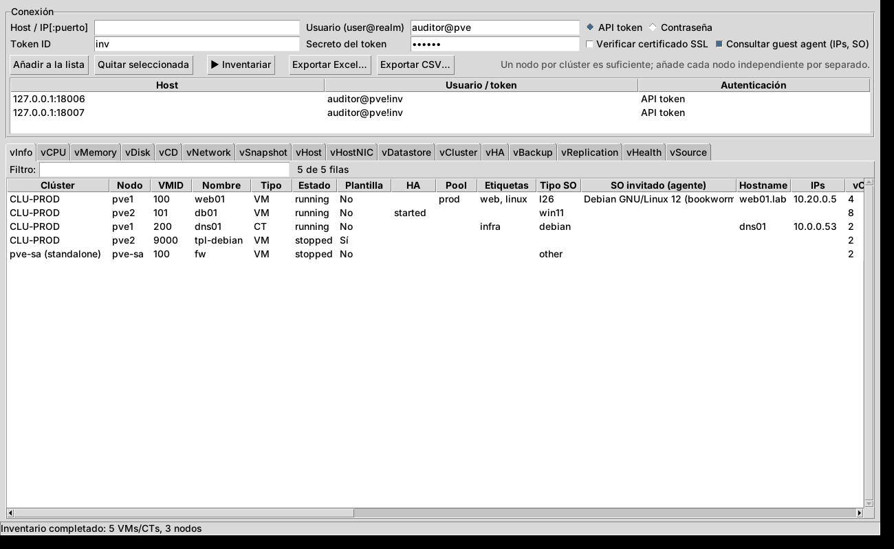

# PVE Inventory: inventario de Proxmox VE al estilo RVTools

Herramienta para Windows que se conecta a la API de **Proxmox VE 8 y 9**, tanto a **clústeres** como a **nodos independientes**, y genera un inventario completo en pestañas que puedes ver en pantalla y exportar a **Excel** (una hoja por pestaña) o **CSV**. Solo lee: no modifica nada en Proxmox.



## Pestañas

| Hoja | Contenido |
|---|---|
| **vInfo** | Una fila por VM/CT: nodo, estado, plantilla, HA, pool, etiquetas, SO, SO real e IPs (guest agent), vCPU, RAM, discos, NICs, snapshots, uptime, BIOS, bloqueo, fecha de creación |
| **vCPU** | Sockets, cores, tipo de CPU, límites, NUMA, uso actual |
| **vMemory** | Memoria asignada, balloon, swap (CT), uso actual |
| **vDisk** | Cada disco: almacenamiento, volumen, tamaño, formato, caché, SSD, iothread, backup, discos sin usar |
| **vCD** | Unidades CD-ROM e ISOs montadas |
| **vNetwork** | Cada NIC: modelo, MAC, bridge, VLAN, firewall, desconectada, IPs |
| **vSnapshot** | Snapshots con fecha, antigüedad y si incluyen RAM |
| **vHost** | Nodos: versión PVE, kernel, CPU, RAM, swap, disco raíz, uptime, EFI/Secure Boot, nº VMs, ratio vCPU:hilo, suscripción |
| **vHostNIC** | Red de los nodos: bridges, bonds, VLANs, IPs, MTU |
| **vDatastore** | Almacenamientos por nodo: tipo, compartido, contenido, capacidad, uso |
| **vCluster** | Resumen por clúster o nodo independiente: quórum, nodos, totales de CPU/RAM/almacenamiento, Ceph |
| **vHA** | Recursos HA, grupos HA (PVE 8) y reglas HA (PVE 9) |
| **vBackup** | Jobs de backup programados |
| **vReplication** | Jobs de replicación ZFS |
| **vHealth** | Avisos: almacenamiento lleno, snapshots antiguos, VMs sin backup, guest agent que no responde, nodos caídos o sin quórum, versiones mezcladas, ISOs montadas, discos sin usar… |
| **vSource** | Con qué se ha conectado, cuándo, versión de PVE y errores |

## Cómo conectarse

* **Clúster:** basta con añadir **un nodo cualquiera** del clúster; se inventarían todos. Si añades varios del mismo clúster, se usa el primero que responda y el resto se omite (útil como respaldo si un nodo está caído).
* **Nodos independientes:** añade cada uno por separado.
* Puedes mezclar en la misma lista varios clústeres y nodos sueltos, con credenciales distintas.
* Certificados autofirmados: se aceptan por defecto (marca *Verificar certificado SSL* si usas certificados válidos).
* Las contraseñas y secretos **no se guardan en disco**; solo se recuerda la lista de hosts y usuarios (`%APPDATA%\PVEInventory\connections.json`).

### Recomendado: usuario y API token de solo lectura

En cualquier nodo (una vez por clúster):

```bash
pveum user add inventario@pve --comment "Inventario solo lectura"
pveum user token add inventario@pve inv --privsep 0      # guarda el secreto que muestra
```

Asigna los permisos con un rol de solo lectura. Para ver también IPs y SO de las VMs mediante el guest agent hace falta un permiso extra, que cambia entre versiones:

```bash
# PVE 9
pveum role add InventarioRO -privs "Sys.Audit VM.Audit VM.GuestAgent.Audit Datastore.Audit Pool.Audit SDN.Audit"
# PVE 8
pveum role add InventarioRO -privs "Sys.Audit VM.Audit VM.Monitor Datastore.Audit Pool.Audit SDN.Audit"

pveum acl modify / -user inventario@pve -role InventarioRO
```

Si te basta sin IPs de las VMs, puedes usar el rol incluido `PVEAuditor`. En la herramienta: usuario `inventario@pve`, Token ID `inv` y el secreto.

También funciona con usuario y contraseña (`root@pam`, etc.). Las cuentas con 2FA deben usar token.

## Uso

**Interfaz gráfica:** ejecuta `PVEInventory.exe`, rellena host, usuario y token o contraseña, pulsa *Añadir a la lista* (repite para cada clúster o nodo suelto) y luego *Inventariar*. Cada pestaña tiene filtro y ordenación por columna. Después pulsa *Exportar Excel…* o *Exportar CSV…*.

**Línea de comandos** (para tareas programadas):

```bat
pveinventory-cli.exe --host pve1.midominio.local --host pve-sa.midominio.local ^
    --user inventario@pve --token-id inv --token-secret XXXXXXXX ^
    -o C:\Inventario\pve.xlsx --csv C:\Inventario\csv
```

Opciones: `--password-env VAR` (contraseña desde una variable de entorno), `PVE_TOKEN_SECRET` (secreto desde una variable de entorno), `--no-agent` (más rápido, sin IPs de VMs), `--verify-ssl`. Código de salida: 0 todo OK, 1 alguna conexión falló, 2 fallaron todas.

## Compilar el .exe

Opción A, en un PC Windows con Python 3.10+ instalado: ejecuta `build.bat`. Genera `dist\PVEInventory.exe` (GUI) y `dist\pveinventory-cli.exe` (consola), que son autónomos y se pueden copiar a cualquier Windows 10/11 sin instalar nada.

Opción B, en GitHub: sube el proyecto a un repositorio y el workflow `.github/workflows/build-windows.yml` compila los dos .exe (Actions → *Build Windows exe* → *Run workflow*, o creando un tag `v0.1.0`, que además los publica como release).

## Desarrollo y pruebas

```bash
pip install -r requirements.txt
python -m pvetools                 # GUI (sin argumentos) o CLI (con argumentos)
python tests/test_inventory.py     # prueba con un Proxmox simulado (clúster PVE 9 + nodo PVE 8)
```

`tests/mock_pve.py` simula la API de Proxmox, así que se puede probar sin servidores reales.
