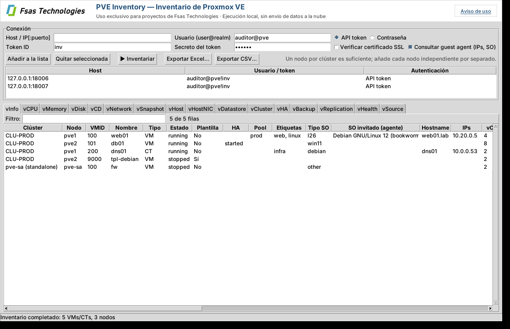

# PVE Inventory: inventário do Proxmox VE ao estilo do RVTools

> **Uso exclusivo em projetos da Fsas Technologies.** A ferramenta é executada localmente, apenas lê dos servidores Proxmox VE indicados e não envia nada para a nuvem (ver [Aviso de utilização](#aviso-de-utilização)).

Ferramenta para Windows que se liga à API do **Proxmox VE 8 e 9**, tanto a **clusters** como a **nós independentes**, e gera um inventário completo em separadores que pode ver no ecrã e exportar para **Excel** (uma folha por separador) ou **CSV**. Apenas leitura: não altera nada no Proxmox.



**Idiomas:** [castellano](README.md) · [English](README.en.md) · [Deutsch](README.de.md) · [Français](README.fr.md) · Português · [Italiano](README.it.md)

## Idiomas

Desde a versão 1.0, as duas ferramentas (inventário e planeador) funcionam em **espanhol, inglês, alemão, francês, português e italiano**: janelas, mensagens, ajuda da linha de comandos, Excel/CSV e todos os documentos Word.

* **Interface gráfica:** seletor *Idioma* (no inventário, no canto superior direito; no planeador, menu *Idioma*). A alteração é imediata e fica guardada para a próxima vez. Na primeira vez usa-se o idioma do Windows (ou inglês, se não for nenhum dos seis).
* **Linha de comandos:** `--lang es|en|de|fr|pt|it` (ou `--idioma`), ou a variável de ambiente `PVE_LANG`. Sem indicação, o idioma do sistema.
* **Excel/CSV:** os cabeçalhos, o aviso e os valores fixos (`Sim`/`Não`, avisos do *vHealth*…) saem no idioma escolhido. O planeador lê um inventário em **qualquer** um dos seis idiomas e gera os documentos no idioma que se escolher, por isso o cliente pode executar o inventário no seu idioma e o plano ser entregue noutro.
* Os nomes dos ficheiros gerados também são traduzidos (`migration_plan.xlsx`, `plano_migracao.xlsx`…).

## Aviso de utilização

* Ferramenta interna destinada exclusivamente a projetos da Fsas Technologies; não é permitida a sua distribuição nem utilização fora desse âmbito.
* É executada integralmente no computador do utilizador e não envia nada para a nuvem. Não envia dados à Fsas Technologies nem a terceiros e não tem telemetria.
* Liga-se apenas aos servidores Proxmox VE indicados, através da sua API e em modo só de leitura.
* Não guarda palavras-passe nem tokens em disco.
* Os relatórios podem conter informação sensível do cliente: trate-os de acordo com a política de confidencialidade do projeto.
* É fornecida "tal como está", sem garantia.

O aviso é mostrado ao abrir a aplicação pela primeira vez (é preciso aceitá-lo), está sempre acessível no botão *Aviso de utilização*, aparece como primeira folha (**Aviso**) de cada Excel e como `LEIAME_AVISO.txt` em cada exportação CSV.

## Separadores

| Folha | Conteúdo |
|---|---|
| **vInfo** | Uma linha por VM/CT: nó, estado, modelo, HA, pool, etiquetas, SO, SO real e IPs (guest agent), vCPU, RAM, discos, NICs, snapshots, uptime, BIOS, bloqueio, data de criação |
| **vCPU** | Sockets, cores, tipo de CPU, limites, NUMA, utilização atual |
| **vMemory** | Memória atribuída, balloon, swap (CT), utilização atual |
| **vDisk** | Cada disco: armazenamento, volume, tamanho, formato, cache, SSD, iothread, backup, discos não usados |
| **vCD** | Unidades de CD-ROM e ISOs montadas |
| **vNetwork** | Cada NIC: modelo, MAC, bridge, VLAN, firewall, desligada, IPs |
| **vSnapshot** | Snapshots com data, antiguidade e se incluem RAM |
| **vPassthrough** | Dispositivos PCI/USB/série passados a VMs e CTs, e se usam *resource mapping* |
| **vBackupStatus** | Por VM/CT: n.º de cópias, último backup, antiguidade, tamanho, armazenamento e verificação |
| **vHost** | Nós: versão PVE, kernel, CPU, RAM, swap, disco raiz, uptime, EFI/Secure Boot, n.º de VMs, rácio vCPU:thread, subscrição |
| **vPhysicalDisk** | Discos físicos: modelo, n.º de série, tamanho, tipo, estado SMART, desgaste de SSD, utilização (LVM, ZFS, OSD…) |
| **vRepo** | Repositórios APT do Proxmox ativos em cada nó (enterprise, no-subscription, test, Ceph) |
| **vCert** | Certificados dos nós: emissor, validade, dias restantes, impressão digital |
| **vHostNIC** | Todas as interfaces de rede dos nós |
| **vBond** | Teaming: modo (802.3ad, active-backup…), escravos, hash policy, primário e que bridge o usa |
| **vBridge** | Bridges Linux/OVS: portas, VLAN aware, VLANs permitidas, IP e quantas NICs de VMs e que VLANs dependem dele |
| **vHostVLAN** | Interfaces VLAN dos nós (eno1.50, vlan50…) |
| **vSDN** | SDN: zonas (simple, VLAN, QinQ, VXLAN, EVPN), VNets, tags/VNI, sub-redes, gateway, SNAT, DHCP, controlador, exit nodes, peers, IPAM/DNS, NICs de VMs ligadas e alterações pendentes de aplicar |
| **vSDNObj** | SDN: controladores (EVPN/BGP/ISIS), IPAM (pve, NetBox, phpIPAM), DNS (PowerDNS) e fabrics do PVE 9. Tokens e chaves nunca são exportados |
| **vCorosync** | Rede do cluster: ligações corosync de cada nó, votos, modo |
| **vDatastore** | Armazenamentos por nó: tipo, partilhado, conteúdo, capacidade, utilização |
| **vZFS** | Pools ZFS: estado, tamanho, utilização, fragmentação |
| **vCephOSD** / **vCephPool** | OSDs (estado, classe, utilização, latências) e pools do Ceph (réplicas, PGs, utilização) |
| **vCluster** | Resumo por cluster ou nó independente: quórum, nós, totais de CPU/RAM/armazenamento, Ceph |
| **vHA** | Recursos HA, grupos HA (PVE 8) e regras HA (PVE 9) |
| **vBackup** | Jobs de backup agendados |
| **vReplication** | Jobs de replicação ZFS |
| **vTasks** | Tarefas com erro ou avisos dos últimos 7 dias |
| **vFirewall** / **vFirewallObj** | Regras de firewall (datacenter, security groups, nós), alias e IPSets |
| **vUsers** / **vACL** | Utilizadores, API tokens (validade, separação de privilégios) e permissões atribuídas |
| **vHealth** | Avisos: armazenamento ou ZFS cheio/degradado, Ceph não OK, OSDs em baixo, SMART em falha, SSDs gastos, certificados a expirar, VMs sem backup ou com backup antigo, snapshots antigos, corosync sem redundância, bonds de uma só interface, repositório enterprise sem subscrição, atualizações pendentes, guest agent que não responde, nós em baixo ou sem quórum… |
| **vSource** | A que se ligou, quando, versão do PVE, idioma e erros |

Na aplicação, os separadores estão agrupados num painel lateral por categorias (Máquinas virtuais, Hosts, Rede, Armazenamento, Cluster, Segurança, Resumo).

## Formato de exportação

As folhas e colunas do Excel/CSV são um formato estável e versionado (atualmente versão 1), pensado para ser lido por outras aplicações, como o planeador de migração. Está documentado em [docs/FORMATO_EXPORTACION.md](docs/FORMATO_EXPORTACION.md) (em espanhol) e definido em `pvetools/schema.py`. Internamente o formato é em espanhol; os cabeçalhos noutros idiomas são traduzidos ao exportar e retraduzidos ao ler. Um teste automático falha se o inventário exportar colunas que não estão no formato.

## Como ligar

* **Cluster:** basta adicionar **um nó qualquer** do cluster; todos são inventariados. Se adicionar vários do mesmo cluster, usa-se o primeiro que responder e os restantes são ignorados (útil como alternativa se um nó estiver em baixo).
* **Nós independentes:** adicione cada um separadamente.
* Pode misturar na mesma lista vários clusters e nós soltos, com credenciais diferentes.
* Certificados autoassinados: são aceites por omissão (marque *Verificar certificado SSL* se usar certificados válidos).
* As palavras-passe e segredos **não são guardados em disco**; apenas se guarda a lista de hosts e utilizadores (`%APPDATA%\PVEInventory\connections.json`).

### Recomendado: utilizador e API token só de leitura

Em qualquer nó (uma vez por cluster):

```bash
pveum user add inventario@pve --comment "Inventario so de leitura"
pveum user token add inventario@pve inv --privsep 0      # guarde o segredo que é mostrado
```

Atribua as permissões com uma função só de leitura. Para ver também IPs e SO das VMs através do guest agent é necessário um privilégio extra, que muda entre versões:

```bash
# PVE 9
pveum role add InventarioRO -privs "Sys.Audit VM.Audit VM.GuestAgent.Audit Datastore.Audit Pool.Audit SDN.Audit Mapping.Audit"
# PVE 8
pveum role add InventarioRO -privs "Sys.Audit VM.Audit VM.Monitor Datastore.Audit Pool.Audit SDN.Audit Mapping.Audit"

pveum acl modify / -user inventario@pve -role InventarioRO
```

Se não precisar dos IPs das VMs, pode usar a função incluída `PVEAuditor`. Na ferramenta: utilizador `inventario@pve`, Token ID `inv` e o segredo.

Também funciona com utilizador e palavra-passe (`root@pam`, etc.).

### Contas com segundo fator (2FA)

Se a conta tiver 2FA, a ferramenta pede o código ao ligar, tal como a interface web do Proxmox:

* **Interface gráfica:** aparece uma janela para escrever o código de 6 dígitos da aplicação de autenticação (TOTP) ou um código de recuperação. Se o código não for válido, volta a pedi-lo (até 3 vezes). O código não é guardado.
* **Linha de comandos:** `--totp 123456` (ou um código de recuperação). Se não for indicado e a consola for interativa, é pedido. Em tarefas agendadas use um API token, porque o código expira a cada 30 segundos.
* São suportados TOTP, códigos de recuperação e Yubico OTP. As contas que **só** têm chave FIDO/WebAuthn não podem ser usadas aqui: é necessário um API token.
* Na folha *vSource* fica registado, p. ex. `Palavra-passe + 2FA (TOTP)`.

Ainda assim, o mais cómodo para o cliente é o **API token só de leitura** da secção anterior: não pede 2FA, não expira aos 30 segundos e tem apenas as permissões necessárias.

## Utilização

**Interface gráfica:** execute `PVEInventory.exe`, preencha host, utilizador e token ou palavra-passe, clique em *Adicionar à lista* (repita para cada cluster ou nó solto) e depois em *Inventariar*. Cada separador tem filtro e ordenação por coluna. Em seguida clique em *Exportar Excel…* ou *Exportar CSV…*.

**Linha de comandos** (para tarefas agendadas):

```bat
pveinventory-cli.exe --host pve1.meudominio.local --host pve-sa.meudominio.local ^
    --user inventario@pve --token-id inv --token-secret XXXXXXXX ^
    -o C:\Inventario\pve.xlsx --csv C:\Inventario\csv --lang pt
```

Opções: `--password-env VAR` (palavra-passe a partir de uma variável de ambiente), `--totp CÓDIGO` (contas com 2FA), `PVE_TOKEN_SECRET` (segredo a partir de uma variável de ambiente), `--no-agent` (mais rápido, sem IPs das VMs), `--verify-ssl`, `--anonymize` (ver abaixo), `--lang` (idioma do Excel/CSV e das mensagens). Código de saída: 0 tudo OK, 1 alguma ligação falhou, 2 falharam todas.

## Anonimizar o inventário

Para que o cliente possa enviar o inventário sem dados identificativos, marque **Anonimizar ao exportar** antes de
*Exportar Excel…* / *Exportar CSV…* (ou use `--anonymize` na linha de comandos). O botão *O que é anonimizado?* explica-o na própria aplicação.

* **São substituídos por pseudónimos** os nomes de clusters, nós, VMs/CTs, hostnames, domínios, armazenamentos, pools,
  etiquetas, utilizadores, grupos, realms, zonas, VNets, controladores, IPAM e DNS de SDN, objetos de firewall, grupos HA, jobs, snapshots, ISOs, caminhos e
  servidores de armazenamento e n.º de série dos discos (`CLUSTER-01`, `NODO-01`, `VM-0001`, `STORAGE-01`…). O mesmo valor
  recebe sempre o mesmo pseudónimo em todas as folhas, por isso as relações VM-nó-rede-armazenamento mantêm-se.
* **IPs:** transformam-se mantendo a estrutura de rede (dois IPs da mesma sub-rede continuam na mesma sub-rede e o
  `.1` continua a ser o `.1`). Com *Manter IPs* / `--keep-ips` não são alterados. **MACs:** mantém-se o fabricante (OUI).
* **São esvaziados** descrições, comentários, emails, alias de SDN e impressões digitais de certificados.
* **Mantêm-se** CPU, RAM, discos e tamanhos, tipos de armazenamento, SO, estados, versões, VLANs, bridges `vmbrN`,
  os nomes predefinidos do Proxmox (`local`, `local-lvm`, `rpool`, `root@pam`…) e uma pista de função no pseudónimo
  (`-crit` se o nome, pool ou etiqueta parecer crítico (db, sql, sap, dc…) e `-test` se parecer de testes), que o
  planeador usa para ordenar as vagas. Com tudo isto, **o planeador dá exatamente o mesmo plano** que com o inventário real.
* **Correspondência:** junto à exportação guarda-se `<nome>_correspondencia_CONFIDENCIAL.xlsx` com a tabela real ↔ pseudónimo.
  **Fica com o cliente e não é enviada.** Com *Reverter anonimização…* (ou `--revert FICHEIRO --mapping MAPA`)
  o cliente pode repor os nomes reais em qualquer Excel/CSV: o inventário anonimizado ou o **Excel do plano de
  migração** que lhe entregarmos. Se a mesma correspondência for reutilizada noutra exportação (`--mapping`), os
  pseudónimos não mudam, o que é útil quando se inventariam vários clusters em separado.

```bat
pveinventory-cli.exe --host pve1 --user inventario@pve --token-id inv --token-secret XXXX --anonymize -o inventario_anonimo.xlsx --lang pt
pveinventory-cli.exe --revert plano_migracao.xlsx --mapping inventario_anonimo_correspondencia_CONFIDENCIAL.xlsx
```

## Se o Excel não aparecer ou não abrir

Desde a versão 0.7.1 do inventário (0.4.1 do planeador), todos os ficheiros são guardados de forma segura: são escritos primeiro num ficheiro temporário da mesma pasta, verifica-se que o Excel/Word é válido e só então é renomeado para o nome final. Se algo falhar, o ficheiro anterior fica intacto e aparece uma mensagem com a causa. No fim, mostra-se o caminho completo com um botão *Mostrar na pasta*.

Se mesmo assim houver problemas, as causas habituais nos computadores dos utilizadores são:

* **O .exe foi aberto a partir do ZIP ou do email** sem descompactar: o Windows executa-o a partir de uma pasta temporária que depois apaga. Descompacte o ZIP antes de o usar.
* **O "Acesso controlado a pastas" do Windows Defender** impede programas novos de escrever em Documentos e Ambiente de Trabalho. Aparece um aviso da Segurança do Windows; guarde noutra pasta ou peça que o .exe seja permitido.
* **Pasta sincronizada (OneDrive, SharePoint) ou unidade de rede:** o ficheiro pode demorar a ser carregado ou ficar "só online". Aguarde que a sincronização termine antes de o enviar ou copiar.
* **O ficheiro estava aberto no Excel** ao exportar de novo com o mesmo nome: feche-o e repita.

## Compilar o .exe

Opção A, num PC Windows com Python 3.10+ instalado: execute `build.bat`. Gera `dist\PVEInventory.exe` (GUI) e `dist\pveinventory-cli.exe` (consola), que são autónomos e podem ser copiados para qualquer Windows 10/11 sem instalar nada.

Opção B, no GitHub: envie o projeto para um repositório e o workflow `.github/workflows/build-windows.yml` compila os dois .exe (Actions → *Build Windows exe* → *Run workflow*, ou criando uma tag `v1.0.0`, que também os publica como release).

## Desenvolvimento e testes

```bash
pip install -r requirements.txt
python -m pvetools                 # GUI (sem argumentos) ou CLI (com argumentos)
PVE_LANG=es python -m pytest tests # testes com um Proxmox simulado (cluster PVE 9 + nó PVE 8)
python tools/gen_format_doc.py     # regenera docs/FORMATO_EXPORTACION*.md após alterar schema.py
python tools/i18n_check.py         # verifica que todos os textos estão traduzidos nos seis idiomas
```

Os textos são escritos em espanhol no código, marcados com `_()` (ou `N_()`/`D()` para valores de dados), e as traduções estão em `pvetools/tr_catalog.py` (inventário) e `pvemigplan/tr_catalog.py` (planeador). Ao adicionar um texto novo, adicione a tradução ao catálogo: o teste `tests/test_i18n.py` falha se faltar alguma.

`tests/mock_pve.py` simula a API do Proxmox, por isso é possível testar sem servidores reais.

## Planeador de migração (uso interno)

Na pasta `pvemigplan/` está o **PVE Migration Planner**, uma aplicação à parte (não é enviada ao cliente) que lê o Excel/CSV
desta ferramenta e gera o desenho da nova plataforma e o plano de migração em Excel e Word. Tem também um modo
**só análise** que gera um relatório da infraestrutura atual (com gráficos e constatações) sem propor migração,
pode gerar os documentos de um **cluster novo sem migração** (sem inventário ou com um inventário sem VMs) e guarda o
trabalho como **projeto** (`.pveplan`, com o inventário dentro) para o retomar mais tarde. Ver [docs/PLANIFICADOR.pt.md](docs/PLANIFICADOR.pt.md).
