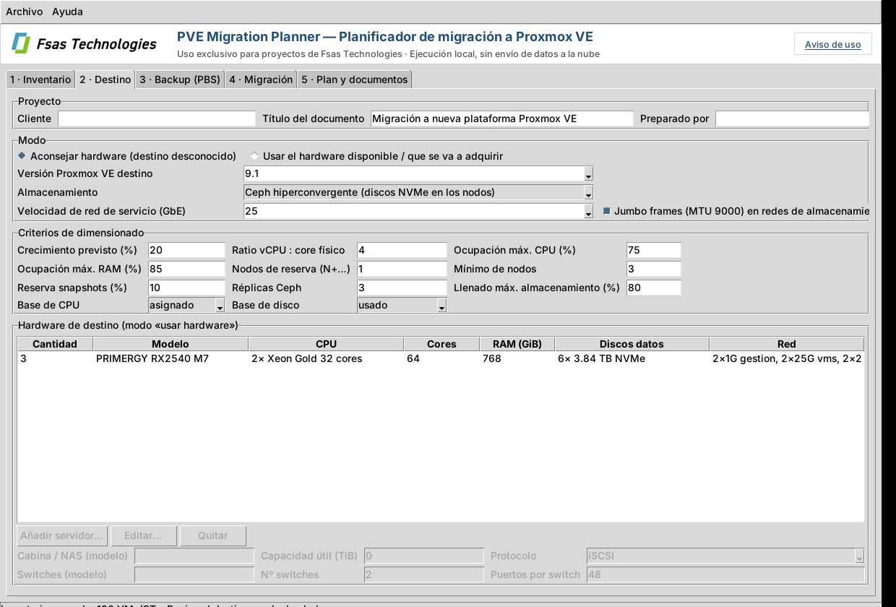
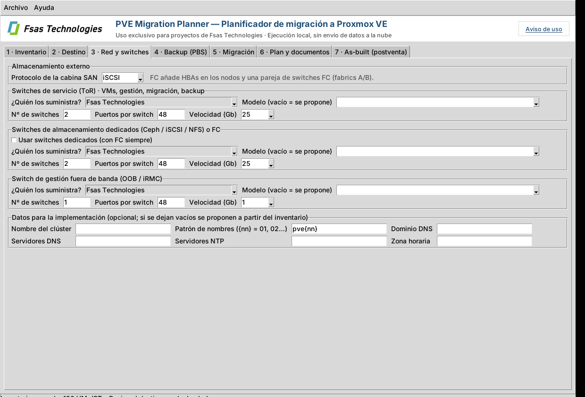
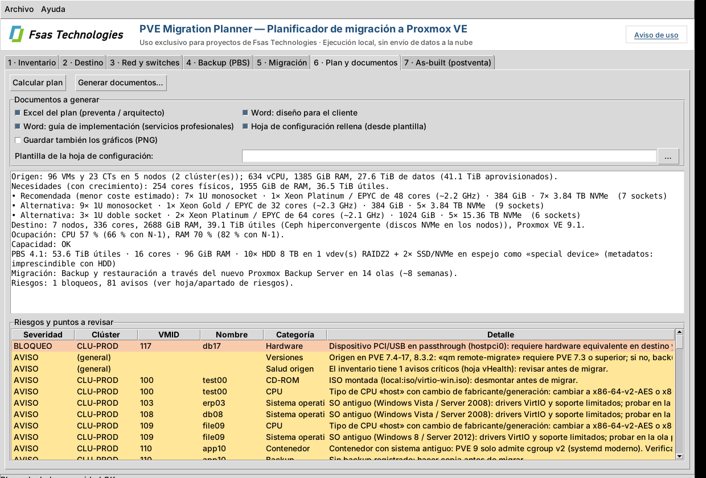

# PVE Migration Planner: Migrationsplaner für Proxmox VE

**Sprachen:** [castellano](PLANIFICADOR.md) · [English](PLANIFICADOR.en.md) · Deutsch · [Français](PLANIFICADOR.fr.md) · [Português](PLANIFICADOR.pt.md) · [Italiano](PLANIFICADOR.it.md)

Anwendung **für den internen Gebrauch bei Fsas Technologies** (wird nicht an den Kunden weitergegeben), die die von
**PVE Inventory** exportierte Excel-Datei oder CSV-Dateien liest und das Design der neuen Proxmox-VE-Plattform sowie den Migrationsplan erstellt.

Sie erzeugt für jede Projektphase einen Satz Dokumente (ohne Preise: die Kalkulation übernimmt der Vertrieb mit diesen Informationen):

| Dokument | Für wen | Inhalt |
|---|---|---|
| `…xlsx` (Excel des Plans) | Presales und Architekt | Hardware-Optionen, Knoten, Kapazität, Platzierung jeder VM, Netze und VLANs, Switches, Knoten-Ports, Verkabelung, Speicher, PBS, Wellen und Risiken pro VM. |
| `…_Kundendesign.docx` | Kunde (von Presales präsentiert) | Ist-Zustand, Anforderungen, Architektur, **Netzwerkdiagramm** mit Servern, Switches und Verbindungen pro Fabric, Speicher, PBS, Wellenplan und Risiken, mit Diagrammen. Optional die PNGs für eine Präsentation. |
| `…_Implementierungsleitfaden.docx` | Professional Services | Zu bestätigende Daten, Ports und Bonds pro Knoten, Verkabelung Switch↔Knoten, VLANs, Installationsschritte (Proxmox VE, Netzwerk, Cluster, Speicher, PBS, HA) und Checkliste für Tests und Migration in Wellen. |
| `…_Konfigurationsblatt.xlsx` | Professional Services | Das **Projekt-Konfigurationsblatt** (*Proxmox VE on PRIMERGY – Customer Interview Configuration Sheet*), ausgefüllt mit dem, was bereits bekannt ist: Knoten-Ports, Netze, Switches, Speicher, PBS und allgemeine Daten. Vorgeschlagene Werte stehen in blauer Kursivschrift und sind mit dem Kunden zu bestätigen. **Passwörter werden nie eingetragen.** Die Vorlage ist nicht im Programm enthalten: Sie wählen Ihre eigene. |
| `Infrastrukturanalyse.docx` + `.xlsx` | Presales / Kunde | **Nur Analyse** (ohne Migration): Bericht im Stil von RVTools / Health Check der aktuellen Infrastruktur mit Diagrammen (Kapazität und Auslastung pro Knoten, Überbuchung, Ausfalltoleranz eines Knotens, Verteilung von VMs und Betriebssystemen, Speicher, Netze, Backup und Snapshots) und Befunden mit Empfehlungen. Schlägt weder Hardware noch Migration oder Wellen vor. |
| `As-built-Dokumentation.docx` | After-Sales | Was konfiguriert wurde: erstellt aus dem Inventar der **neuen** Umgebung (PVE Inventory) und optional dem ausgefüllten Konfigurationsblatt (ohne Passwörter, Schlüssel oder Tokens). Am Ende stehen eine Kurzanleitung (Cheatsheet) für GUI und Befehle (QDevice, Replikation und Disaster Recovery, Verwaltung, Tests und Snapshots) mit den echten Namen der Plattform sowie der Kontakt- und Supportabschnitt von Fsas Technologies. |

Sie läuft lokal, verbindet sich mit keinem Server und sendet nichts in die Cloud. Beim ersten Start zeigt sie den Nutzungshinweis.

**Sprachen:** Die Anwendung und alle erzeugten Dokumente gibt es auf Spanisch, Englisch, Deutsch, Französisch, Portugiesisch und
Italienisch (Menü *Sprache* oder `--lang` auf der Kommandozeile). Die Dokumente werden in der gewählten Sprache erzeugt, unabhängig
davon, in welcher Sprache das Inventar exportiert wurde, und die Dateinamen werden übersetzt (`migration_plan.xlsx`,
`Migrationsplan_Kundendesign.docx`…).



## Arbeitsablauf

1. Der Kunde führt **PVE Inventory** aus und schickt uns die Excel-Datei (oder den CSV-Ordner). Hat er mehrere Cluster, kann er
   eine Datei pro Cluster senden: Der Planer akzeptiert mehrere und führt sie zusammen (ohne VMs zu duplizieren, wenn ein Cluster zweimal geladen wird).
   Möchte der Kunde keine Namen oder IPs senden, kann er **anonymisiert** exportieren (siehe README): Dimensionierung und Wellenplan
   sind identisch, der Planer weist beim Laden darauf hin und die Dokumente zeigen die Pseudonyme (`VM-0001`, `NODO-01`…).
   In diesem Fall sollten Domäne, DNS und NTP in Schritt 3 von Hand eingetragen werden (sonst würden die Pseudonyme aus dem Inventar übernommen).
   Der Kunde kann die echten Namen mit *Anonymisierung rückgängig machen…* in PVE Inventory und seiner
   Zuordnungsdatei in die Excel-Datei des Plans zurückschreiben.
2. In **PVEMigrationPlanner.exe**:
   * **1 · Inventar:** Dateien laden, entscheiden, ob ausgeschaltete VMs und Vorlagen einbezogen werden, und einzelne VMs ausschließen (Doppelklick).
   * **2 · Ziel:** Kundendaten, Proxmox-VE-Version, Speichertyp, Netzwerkgeschwindigkeit und Dimensionierungskriterien.
     Modus wählen:
     * **Hardware empfehlen** (Ziel unbekannt): berechnet Server-Alternativen und empfiehlt die passendste.
     * **Vorhandene / zu beschaffende Hardware verwenden:** Server (Modell, Anzahl, CPU, RAM, Festplatten,
       Netzwerk-Ports) und Storage-System/NAS eingeben; der Plan richtet sich nach dieser Hardware und warnt, wenn sie nicht ausreicht.
   * **3 · Netzwerk und Switches:** ob die Service-Switches (ToR), Speicher-Switches (optional, dediziert) und OOB-/Management-Switches
     **von Fsas Technologies oder vom Kunden geliefert** werden, mit Modell (die wir verkaufen oder die der Kunde bereits hat),
     Anzahl, Ports und Geschwindigkeit. Ohne Modellangabe wird ein Richtmodell vorgeschlagen. Implementierungsdaten: Cluster-Name,
     Namensschema der Knoten (`pve{nn}`), Domäne, DNS, NTP und Zeitzone (leer gelassen, werden sie aus dem Inventar übernommen).
   * **4 · Backup (PBS):** Proxmox Backup Server einbeziehen oder nicht, Aufbewahrung, Annahmen und, falls bekannt, die PBS-Hardware.
   * **5 · Migration:** Methode, Durchsatz, Wellengröße, Wellen pro Woche und Startdatum.
   * **6 · Plan und Dokumente:** *Plan berechnen* zeigt Zusammenfassung und Risiken; die gewünschten Dokumente ankreuzen,
     die Vorlage des Konfigurationsblatts angeben (wird gespeichert) und *Dokumente erzeugen…* legt sie im gewählten Ordner an.
   * **7 · As-built (After-Sales):** Nach der Implementierung das Inventar der neuen Umgebung und das ausgefüllte
     Konfigurationsblatt laden, um die Dokumentation des Konfigurierten zu erzeugen.
   * **8 · Nur Analyse:** Mit dem in Registerkarte 1 geladenen Inventar (auch anonymisiert) zeigt *Analysieren* die Zusammenfassung
     und die Befunde, und *Bericht erzeugen…* erstellt das Word-Dokument mit Diagrammen und die Excel-Datei mit den Daten und Details der Befunde.
     Auch über die Schaltfläche *Nur Analyse (Bericht ohne Migration)…* in Registerkarte 1 oder *Datei → Reiner Analysebericht*.
     Die Registerkarten 2-6 müssen nicht ausgefüllt werden.
3. **Projekt speichern** (*Datei → Projekt speichern*, `Strg+S`) erzeugt eine `.pveplan`-Datei mit allem, was nötig ist,
   um später ohne erneutes Laden weiterzuarbeiten: das **geladene Inventar** (es steckt in der Datei, funktioniert also
   auch, wenn die ursprüngliche Excel-Datei verschoben oder gelöscht wird), die ausgeschlossenen VMs, Kunde, Autor und Titel, die **eingegebene Hardware**,
   Netzwerk und Switches, Implementierungsdaten, PBS, Migration, die Option „ohne Migration“, die angekreuzten Dokumente, die
   Vorlage des Konfigurationsblatts und die Daten der Registerkarten As-built und Nur Analyse. *Datei → Projekt
   öffnen* (`Strg+O`) stellt es unverändert wieder her; es öffnet sich auch, wenn die `.pveplan`-Datei auf die `.exe` gezogen wird.
   Die Datei bleibt auf dem Rechner (sie wird nirgends hochgeladen) und enthält Kundendaten: Behandeln Sie sie wie die Excel-Datei
   des Inventars. Das Szenario nur mit Parametern und Hardware lässt sich weiterhin als JSON speichern (*Datei → Szenario
   speichern…*), um es als Vorlage oder auf der Kommandozeile zu verwenden.

### Nur Dokumente, ohne Migration (neuer Cluster)

Um die Dokumente einer neuen Plattform zu erstellen, ohne etwas zu migrieren (Kundendesign, Implementierungsleitfaden,
Konfigurationsblatt und Excel):

* Registerkarte 1: **Ohne Inventar (neuer Cluster)** klicken (oder einfach kein Inventar laden: Beim Berechnen fragt der
  Planer, ob ein neuer Cluster dokumentiert werden soll). Ein Inventar ohne VMs/CTs funktioniert ebenfalls.
* Registerkarte 2: Modus **Vorhandene Hardware verwenden** und die Server eingeben; Registerkarten 3 und 4 ausfüllen.
* Registerkarte 6: *Dokumente erzeugen…*.

Die Dokumente lassen Ist-Zustand, Wellen, Migrations-Runbook und VM-Platzierung weg; das Design enthält die
Kapazität der Plattform und einen Abschnitt zur Inbetriebnahme. Hat das Inventar zwar VMs, sollen diese aber nicht
migriert werden, in Registerkarte 2 **Ohne Migration: nur die neue Plattform dokumentieren** ankreuzen: Die VMs dienen dann nur
zur Dimensionierung und zur Verteilung der erwarteten Last.





## Wie gerechnet wird

| Thema | Kriterium (alle anpassbar) |
|---|---|
| CPU | Zugewiesene vCPUs × (1 + Wachstum) / Verhältnis vCPU:Kern (4) / maximale Auslastung (75 %). Alternative: beobachtete Nutzung × 1,5. |
| RAM | Zugewiesener RAM × (1 + Wachstum) / maximale Auslastung (85 %) + Reserve pro Knoten (8 GiB Proxmox VE; Ceph 5 GiB pro OSD + 4 GiB; ZFS ARC). |
| Festplatte | Belegter Platz (QEMU-Agent) oder bereitgestellter, falls unbekannt, × (1 + Wachstum) + 10 % Reserve für Snapshots. |
| Hochverfügbarkeit | N+1 (einstellbar): CPU und RAM müssen bei Ausfall des größten Knotens passen; mindestens 3 Knoten. |
| Ceph | Brutto = Daten × Replikate (3) / maximaler Füllgrad (80 %), verteilt auf N-1 Knoten (toleriert den Ausfall eines Knotens). 4-8 NVMe pro Knoten. |
| Lokales ZFS | Spiegel (RAID10) + Platz für die Replikate eines anderen Knotens. |
| SAN / NFS | Nutzkapazität des Storage-Systems = Daten / maximaler Füllgrad. Multipath (iSCSI/FC) oder NFS 4.x. |
| Hardware-Optionen | Vorlagenkatalog (1U 1 Sockel, 1U 2 Sockel, 2U 2 Sockel) × CPUs mit 16-64 Kernen × RAM-Größen. Intern nach einem relativen Index sortiert (ohne Preise in den Dokumenten), der die Proxmox-VE-Subskriptionen pro Sockel berücksichtigt. Der Katalog kann durch ein eigenes JSON ersetzt werden (*Datei → Hardwarekatalog laden…*, siehe `pvemigplan/catalog.py`). |
| Netzwerk | Fabrics ETH-A/ETH-B (Service), STO/FC-A/B (dedizierter Speicher oder FC) und OOB. Logische Netze wie im Konfigurationsblatt: OOB (iRMC), Management, Corosync 1 und 2, Live Migration, iSCSI 1/2, Ceph Public/Private und Payload (aus der Quelle übernommene VLANs). LACP- oder Active-Backup-Bonds, Switch-Ports pro Knoten und Verkabelung. |
| PBS | Belegte Daten × Reduktion (0,6) × (1 + tägliche Änderung × aufbewahrte Änderungstage) / Füllgrad (80 %). Wöchentlich = 2 Tage, monatlich = 4, jährlich = 8. Schlägt CPU, RAM (32 GiB + 1 GiB/TiB), Festplatten (All-Flash bei kleiner Größe, sonst HDD RAIDZ2 + Special Device) und Netzwerk vor. Option für eine externe Kopie. |
| Migration | Mit PBS: vorheriges Backup + abschließendes inkrementelles Backup + Restore (Live-Restore). Ohne PBS: `qm/pct remote-migrate`. Welle 0 Pilot, Standardwellen pro Cluster/Pool und kritische (HA, DB, DC, Startreihenfolge) am Ende. |
| Risiken | Passthrough, Sperren, Snapshots, eingebundene ISOs, CPU „host“ mit Herstellerwechsel, alte BS, alte CTs auf PVE 9 (cgroup v2), kein Agent, kein Backup, große Festplatten, HA, Kapazität und Quellversionen. |

Die Zahlen sind Schätzungen: Das Inventar ist eine Momentaufnahme und die Servermodelle sind Richtwerte.
Prüfen Sie die Konfiguration vor dem Angebot mit dem Konfigurator des Herstellers.

## Kommandozeile

```bat
pvemigplan-cli.exe inventar.xlsx -o C:\Plaene\ACME --customer "ACME" --charts --lang de
pvemigplan-cli.exe inv_clu1.xlsx inv_clu2.xlsx --storage san --pve 9.1 --no-pbs
pvemigplan-cli.exe inventar.xlsx -e szenario.json           :: definierte Hardware und Parameter, aus der GUI gespeichert
pvemigplan-cli.exe inventar.xlsx --config-sheet "C:\Vorlagen\ProxmoxVE Project Configuration Sheet.xlsx"
pvemigplan-cli.exe inventar.xlsx --assessment --customer "ACME" -o C:\Berichte\ACME   :: nur Analyse, ohne Migration
pvemigplan-cli.exe --asbuilt neues_inventar.xlsx --config-sheet ausgefuelltes_blatt.xlsx --customer ACME --author "PS"
pvemigplan-cli.exe -e szenario.json --mode hardware --customer ACME   :: neuer Cluster: ohne Inventar und ohne Migration
pvemigplan-cli.exe inventar.xlsx --no-migration                       :: mit VMs, aber nur die Plattformdokumente
pvemigplan-cli.exe inventar.xlsx -e szenario.json --save-project C:\Plaene\ACME.pveplan
pvemigplan-cli.exe -p C:\Plaene\ACME.pveplan -o C:\Plaene\ACME        :: aus einem gespeicherten Projekt neu erzeugen
```

`--no-implementation` lässt den Implementierungsleitfaden weg, `--no-word` die Word-Dokumente, und `--lang` wählt die Sprache der Dokumente (alle Optionen haben auch einen spanischen Namen: `--cliente`, `--graficos`, `--sin-pbs`, `--analisis`…). Im Modus `--assessment`
lassen `--no-word` / `--no-excel` das Word- bzw. Excel-Dokument des Berichts weg, und `--charts` speichert zusätzlich die PNGs. Der Wert von `--mode` bleibt `aconsejar` (empfehlen) oder `hardware`.

### Befunde des reinen Analyseberichts

Sie werden nach Thema gruppiert (ein Befund mit der Liste der betroffenen Objekte) und nach Schweregrad sortiert (kritisch, Warnung, Information).
Sie umfassen die Warnungen, die PVE Inventory bereits erkennt (Blatt vHealth: Quorum, Speicherbelegung, Ceph, ZFS, SMART,
Zertifikate, Backups, Repositories, Corosync…), sowie diese Prüfungen der Analyse selbst: Proxmox-VE-Versionen ohne
Support oder kurz vor Supportende (6: Jul. 2022, 7: Jul. 2024, 8: Aug. 2026), CPU-Auslastung ≥ 80 %, laufenden VMs zugewiesener RAM
größer als der physische, Cluster, der den Ausfall des größten Knotens nicht verkraftet (Speicher > 90 % auf den übrigen), ungleich
verteilter Speicher zwischen Knoten, 2-Knoten-Cluster ohne QDevice, Einzelknoten, alte Gast-BS, Passthrough, CPU
„host“ mit gemischten Herstellern, keine Backup-Jobs oder Backups auf lokalen Speicher, Cluster ohne HA und VMs, die im Verhältnis
zum Knoten sehr groß sind. Zu SDN: noch nicht angewendete Änderungen, VNets ohne VMs, EVPN-Zonen mit weniger als zwei Exit-Nodes,
SNAT in Simple-Zonen, VMs in Netzen, die das Inventar nicht sieht (fehlendes Recht SDN.Audit), und Cluster mit 3 oder mehr Knoten mit
mehreren VLANs und ohne SDN.

### SDN

Enthält das Inventar SDN (Blätter vSDN und vSDNObj), zeigen es alle Dokumente: Zonen (Typ, Bridge/Peers/Controller,
Exit-Nodes, MTU, IPAM/DNS), VNets mit Subnetzen, Gateway, SNAT, DHCP und Anzahl verbundener VM-NICs sowie EVPN-/BGP-/ISIS-Controller,
externes IPAM und DNS und Fabrics. Der reine Analysebericht und das As-built beschreiben es; das Kundendesign
erklärt, wie es im neuen Cluster nachgebaut wird, und der Implementierungsleitfaden enthält die `pvesh`-Befehle zum Neuanlegen von Zonen,
VNets, Subnetzen, Controllern, IPAM und DNS (Tokens, Schlüssel und IPs der neuen Knoten bleiben als `<…>`). Die VLANs der
VMs, die heute nicht im SDN sind, werden als VLAN-Zone mit einem VNet pro VLAN vorgeschlagen.

Exit-Code: 0 Plan in Ordnung, 1 die Hardware deckt den Bedarf nicht, 2 Fehler.

## Erstellen

`build_planner.bat` unter Windows (Python 3.10+) oder der Workflow `.github/workflows/build-planner.yml`
(Actions → *Build migration planner exe*), der `PVEMigrationPlanner.exe` und `pvemigplan-cli.exe` erzeugt und einen Beispielplan auf Spanisch und Englisch prüft.

## Entwicklung

```bash
pip install -r requirements.txt -r requirements-planner.txt pytest
python -m pvemigplan                                    # GUI (ohne Argumente) oder CLI (mit Argumenten)
PVE_LANG=es python -m pytest tests/test_planner.py tests/test_i18n.py   # synthetisches Inventar mit 120 VMs (tests/planner_sample.py)
```

Der Code liegt in `pvemigplan/` und nutzt aus `pvetools/` nur das Exportformat (`schema.py`), die Übersetzungsschicht (`i18n.py`) und das Logo.
