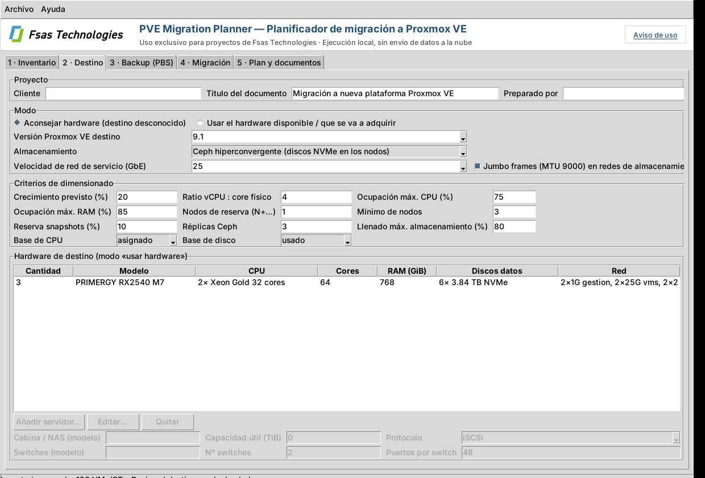
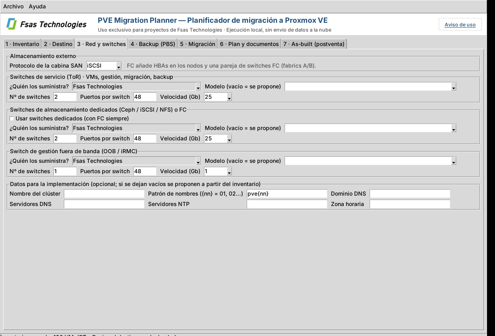
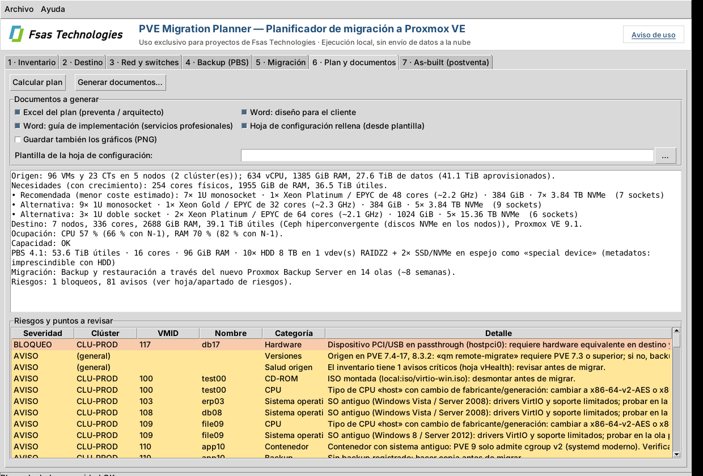

# PVE Migration Planner: migration planner for Proxmox VE

**Languages:** [castellano](PLANIFICADOR.md) · English · [Deutsch](PLANIFICADOR.de.md) · [Français](PLANIFICADOR.fr.md) · [Português](PLANIFICADOR.pt.md) · [Italiano](PLANIFICADOR.it.md)

An application **for internal use at Fsas Technologies** (not handed to the customer) that reads the Excel file or CSVs exported by
**PVE Inventory** and produces the design of the new Proxmox VE platform and the migration plan.

It produces a set of documents for each phase of the project (no prices: sales prepares the quote with this information):

| Document | For whom | Contents |
|---|---|---|
| `…xlsx` (plan Excel) | Presales and architect | Hardware options, nodes, capacity, placement of each VM, networks and VLANs, switches, node ports, cabling, storage, PBS, waves and risks per VM. |
| `…_customer_design.docx` | Customer (presented by presales) | Current situation, requirements, architecture, **network diagram** with servers, switches and links per fabric, storage, PBS, wave plan and risks, with charts. Optionally the PNGs for a presentation. |
| `…_implementation_guide.docx` | Professional services | Data to confirm, ports and bonds per node, switch↔node cabling, VLANs, installation steps (Proxmox VE, network, cluster, storage, PBS, HA) and test and wave-by-wave migration checklist. |
| `…_configuration_sheet.xlsx` | Professional services | The **project configuration sheet** (*Proxmox VE on PRIMERGY – Customer Interview Configuration Sheet*) filled in with what is already known: node ports, networks, switches, storage, PBS and general data. Proposed values are in blue italics, to be confirmed with the customer. **Passwords are never filled in.** The template is not bundled with the program: you choose your own. |
| `infrastructure_assessment.docx` + `.xlsx` | Presales / customer | **Assessment only** (no migration): RVTools-style report / health check of the current infrastructure with charts (capacity and usage per node, overcommitment, tolerance to losing a node, distribution of VMs and operating systems, storage, networks, backup and snapshots) and findings with recommendations. It proposes no hardware, migration or waves. |
| `asbuilt_documentation.docx` | After-sales | What has been configured: built from the inventory of the **new** environment (PVE Inventory) and, optionally, the completed configuration sheet (no passwords, keys or tokens). It ends with a quick guide (cheatsheet) of GUI and commands (QDevice, replication and disaster recovery, management, testing and snapshots) using the real names of the platform, and with the Fsas Technologies contact and support section. |

It runs locally, connects to no server and sends nothing to the cloud. On first start it shows the terms of use.

**Languages:** the application and every document it produces are available in Spanish, English, German, French, Portuguese and
Italian (*Language* menu, or `--lang` on the command line). Documents are produced in the chosen language, whatever
language the inventory was exported in, and file names are translated (`migration_plan.xlsx`,
`Migrationsplan_Kundendesign.docx`…).



## Workflow

1. The customer runs **PVE Inventory** and sends us the Excel file (or the CSV folder). If they have several clusters they can
   send one file per cluster: the planner accepts several and merges them (without duplicating VMs if a cluster is loaded twice).
   If the customer prefers not to send names or IPs, they can export it **anonymised** (see the README): the sizing and the wave
   plan come out identical, the planner warns when loading it and the documents show the pseudonyms (`VM-0001`, `NODO-01`…).
   In that case it is advisable to enter the domain, DNS and NTP by hand in step 3 (otherwise the pseudonyms from the inventory would be used).
   The customer can restore the real names in the plan Excel with *Revert anonymisation…* in PVE Inventory and their
   mapping file.
2. In **PVEMigrationPlanner.exe**:
   * **1 · Inventory:** load the files, decide whether powered-off VMs and templates are included, and exclude specific VMs (double click).
   * **2 · Target:** customer data, Proxmox VE version, storage type, network speed and sizing criteria.
     Choose the mode:
     * **Recommend hardware** (target unknown): calculates server alternatives and recommends the best fit.
     * **Use the available hardware / hardware to be purchased:** enter the servers (model, count, CPU, RAM, disks,
       network ports) and the storage array/NAS; the plan focuses on that hardware and warns if it is not enough.
   * **3 · Network and switches:** whether the service (ToR), storage (optional, dedicated) and OOB/management switches
     are **supplied by Fsas Technologies or by the customer**, with their model (the ones we sell or the ones the customer already has),
     quantity, ports and speed. If no model is given, an indicative one is proposed. Implementation data: cluster
     name, node naming pattern (`pve{nn}`), domain, DNS, NTP and time zone (if left empty they are taken from the inventory).
   * **4 · Backup (PBS):** whether to include Proxmox Backup Server, retention, assumptions and, if already known, the PBS hardware.
   * **5 · Migration:** method, throughput, wave size, waves per week and start date.
   * **6 · Plan and documents:** *Calculate plan* shows the summary and the risks; tick the documents you want,
     choose the configuration sheet template (it is remembered) and *Generate documents…* creates them in the chosen folder.
   * **7 · As-built (after-sales):** after the implementation, load the inventory of the new environment and the completed
     configuration sheet to produce the documentation of what was configured.
   * **8 · Assessment only:** with the inventory loaded in tab 1 (anonymised also works), *Analyse* shows the summary
     and the findings, and *Generate report…* creates the Word file with charts and the Excel file with the data and the details of the findings.
     Also available from the *Assessment only (report without migration)…* button in tab 1 or *File → Assessment-only report*.
     Tabs 2-6 do not need to be filled in.
3. **Saving the project** (*File → Save project*, `Ctrl+S`) creates a `.pveplan` file with everything needed
   to pick it up later without loading anything again: the **loaded inventory** (it goes inside the file, so it works
   even if the original Excel file is moved or deleted), the excluded VMs, customer, author and title, the **hardware entered**,
   network and switches, implementation data, PBS, migration, the "no migration" option, the ticked documents, the
   configuration sheet template and the data of the as-built and assessment tabs. *File → Open
   project* (`Ctrl+O`) restores it exactly; it also opens when the `.pveplan` is dragged onto the `.exe`.
   The file stays on the computer (it is not uploaded anywhere) and contains customer data: treat it like the inventory
   Excel file. The scenario with only parameters and hardware can still be saved as JSON (*File → Save
   scenario*) to use as a template or from the command line.

### Documents only, no migration (new cluster)

To prepare the documents for a new platform without migrating anything (customer design, implementation guide, configuration
sheet and Excel):

* Tab 1: click **No inventory (new cluster)** (or simply do not load an inventory: when calculating, the planner
  asks whether you want to document a new cluster). An inventory without VMs/CTs also works.
* Tab 2: mode **Use the available hardware** and enter the servers; complete tabs 3 and 4.
* Tab 6: *Generate documents…*.

The documents omit the current situation, the waves, the migration runbook and the VM placement; the design includes the
capacity the platform offers and a commissioning section. If the inventory does have VMs but they are not going to be
migrated, tick **No migration: document the new platform only** in tab 2: the VMs are used only to
size and distribute the expected load.





## How it calculates

| Topic | Criterion (all adjustable) |
|---|---|
| CPU | Allocated vCPUs × (1 + growth) / vCPU:core ratio (4) / maximum utilisation (75 %). Alternative: observed usage × 1.5. |
| RAM | Allocated RAM × (1 + growth) / maximum utilisation (85 %) + reserve per node (8 GiB Proxmox VE; Ceph 5 GiB per OSD + 4 GiB; ZFS ARC). |
| Disk | Used space (QEMU agent) or provisioned space if unknown, × (1 + growth) + 10 % reserve for snapshots. |
| High availability | N+1 (configurable): CPU and RAM must fit with the largest node down; minimum 3 nodes. |
| Ceph | Raw = data × replicas (3) / maximum fill (80 %), spread across N-1 nodes (tolerates losing a node). 4-8 NVMe per node. |
| Local ZFS | Mirror (RAID10) + space for the replicas of another node. |
| SAN / NFS | Usable array capacity = data / maximum fill. Multipath (iSCSI/FC) or NFS 4.x. |
| Hardware options | Template catalogue (1U 1 socket, 1U 2 sockets, 2U 2 sockets) × CPUs with 16-64 cores × RAM sizes. They are ranked internally by a relative index (no prices in the documents) that takes the per-socket Proxmox VE subscriptions into account. The catalogue can be replaced by your own JSON (*File → Load hardware catalogue…*, see `pvemigplan/catalog.py`). |
| Network | Fabrics ETH-A/ETH-B (service), STO/FC-A/B (dedicated storage or FC) and OOB. Logical networks as in the configuration sheet: OOB (iRMC), Management, Corosync 1 and 2, Live Migration, iSCSI 1/2, Ceph Public/Private and Payload (VLANs carried over from the source). LACP or active-backup bonds, switch ports per node and cabling. |
| PBS | Used data × reduction (0.6) × (1 + daily change × retained days of changes) / fill (80 %). Weekly = 2 days, monthly = 4, yearly = 8. Proposes CPU, RAM (32 GiB + 1 GiB/TiB), disks (all-flash if small; otherwise HDD RAIDZ2 + special device) and network. Option for an off-site copy. |
| Migration | With PBS: prior backup + final incremental backup + restore (live-restore). Without PBS: `qm/pct remote-migrate`. Wave 0 pilot, standard waves per cluster/pool, and critical ones (HA, DB, DC, boot order) at the end. |
| Risks | Passthrough, locks, snapshots, mounted ISOs, "host" CPU with a vendor change, old OSes, old CTs on PVE 9 (cgroup v2), no agent, no backup, large disks, HA, capacity and source versions. |

The figures are estimates: the inventory is a snapshot at one point in time and the server models are indicative.
Validate the configuration with the vendor's configurator before quoting.

## Command line

```bat
pvemigplan-cli.exe inventory.xlsx -o C:\Plans\ACME --customer "ACME" --charts --lang en
pvemigplan-cli.exe inv_clu1.xlsx inv_clu2.xlsx --storage san --pve 9.1 --no-pbs
pvemigplan-cli.exe inventory.xlsx -e scenario.json          :: defined hardware and parameters saved from the GUI
pvemigplan-cli.exe inventory.xlsx --config-sheet "C:\Templates\ProxmoxVE Project Configuration Sheet.xlsx"
pvemigplan-cli.exe inventory.xlsx --assessment --customer "ACME" -o C:\Reports\ACME   :: assessment only, no migration
pvemigplan-cli.exe --asbuilt new_inventory.xlsx --config-sheet completed_sheet.xlsx --customer ACME --author "PS"
pvemigplan-cli.exe -e scenario.json --mode hardware --customer ACME   :: new cluster: no inventory and no migration
pvemigplan-cli.exe inventory.xlsx --no-migration                      :: with VMs, but only the platform documents
pvemigplan-cli.exe inventory.xlsx -e scenario.json --save-project C:\Plans\ACME.pveplan
pvemigplan-cli.exe -p C:\Plans\ACME.pveplan -o C:\Plans\ACME          :: regenerate from a saved project
```

`--no-implementation` skips the implementation guide, `--no-word` the Word documents and `--lang` chooses the language of the documents (every option also has a Spanish name: `--cliente`, `--graficos`, `--sin-pbs`, `--analisis`…). In `--assessment` mode,
`--no-word` / `--no-excel` skip the report's Word or Excel file and `--charts` also saves the PNGs. The value of `--mode` stays `aconsejar` (recommend) or `hardware`.

### Findings of the assessment-only report

They are grouped by topic (one finding with the list of affected objects) and sorted by severity (critical, warning, informational).
They include the warnings PVE Inventory already detects (vHealth sheet: quorum, storage usage, Ceph, ZFS, SMART,
certificates, backups, repositories, corosync…) and these checks of the assessment itself: Proxmox VE versions out of
support or close to end of support (6: Jul-2022, 7: Jul-2024, 8: Aug-2026), CPU usage ≥ 80 %, RAM allocated to running VMs
greater than physical RAM, cluster that cannot survive losing its largest node (memory > 90 % on the rest), memory
imbalance between nodes, 2-node clusters without QDevice, standalone nodes, old guest OSes, passthrough, "host"
CPU with mixed vendors, no backup jobs or backups to local storage, clusters without HA, and VMs that are very
large compared with the node. For SDN: pending changes, VNets without VMs, EVPN zones with fewer than two exit nodes,
SNAT in simple zones, VMs on networks the inventory cannot see (missing SDN.Audit permission) and clusters of 3 or more nodes with
several VLANs and no SDN.

### SDN

If the inventory includes SDN (vSDN and vSDNObj sheets), every document shows it: zones (type, bridge/peers/controller,
exit nodes, MTU, IPAM/DNS), VNets with their subnets, gateway, SNAT, DHCP and number of connected VM NICs, and EVPN/BGP/ISIS
controllers, external IPAM and DNS, and fabrics. The assessment-only report and the as-built describe it; the customer design
explains how it is recreated on the new cluster and the implementation guide includes the `pvesh` commands to recreate zones,
VNets, subnets, controllers, IPAM and DNS (tokens, keys and IPs of the new nodes are left as `<…>`). The VLANs of
VMs that are not in SDN today are proposed as a VLAN zone with one VNet per VLAN.

Exit code: 0 plan OK, 1 the hardware does not cover the requirements, 2 error.

## Building

`build_planner.bat` on Windows (Python 3.10+) or the `.github/workflows/build-planner.yml` workflow
(Actions → *Build migration planner exe*), which produces `PVEMigrationPlanner.exe` and `pvemigplan-cli.exe` and checks a sample plan in Spanish and English.

## Development

```bash
pip install -r requirements.txt -r requirements-planner.txt pytest
python -m pvemigplan                                    # GUI (no arguments) or CLI (with arguments)
PVE_LANG=es python -m pytest tests/test_planner.py tests/test_i18n.py   # synthetic inventory of 120 VMs (tests/planner_sample.py)
```

The code lives in `pvemigplan/` and reuses from `pvetools/` only the export format (`schema.py`), the translation layer (`i18n.py`) and the logo.
