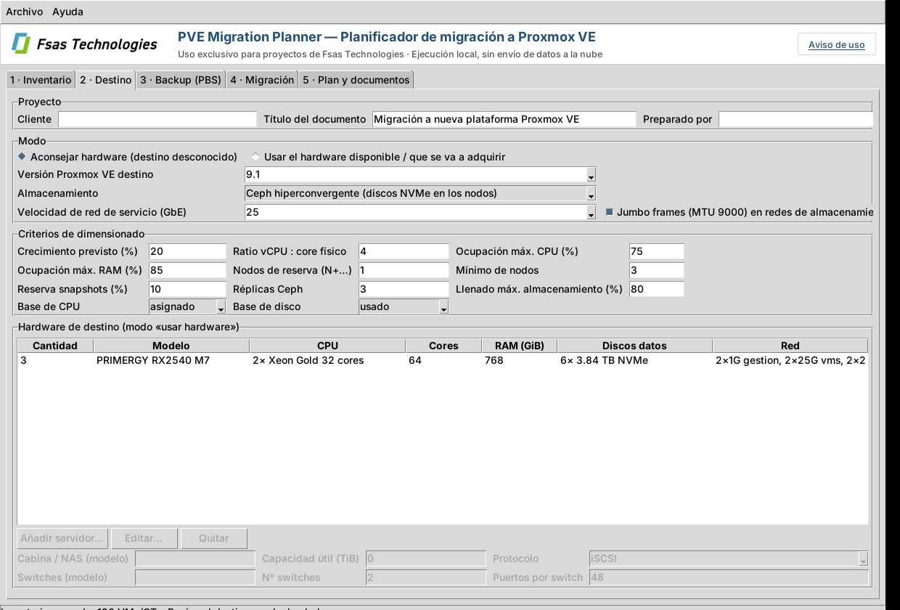
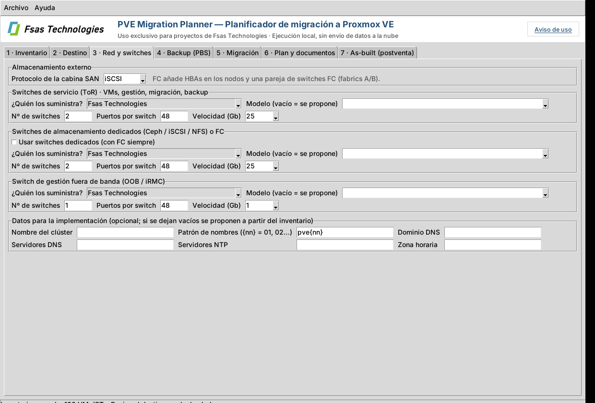
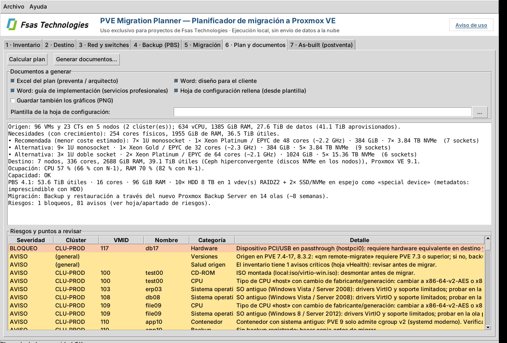

# PVE Migration Planner : planificateur de migration vers Proxmox VE

**Langues :** [castellano](PLANIFICADOR.md) · [English](PLANIFICADOR.en.md) · [Deutsch](PLANIFICADOR.de.md) · Français · [Português](PLANIFICADOR.pt.md) · [Italiano](PLANIFICADOR.it.md)

Application **à usage interne de Fsas Technologies** (non remise au client) qui lit l'Excel ou les CSV exportés par
**PVE Inventory** et produit la conception de la nouvelle plateforme Proxmox VE et le plan de migration.

Elle produit un jeu de documents pour chaque phase du projet (sans prix : le commercial établit le chiffrage avec ces informations) :

| Document | Pour qui | Contenu |
|---|---|---|
| `…xlsx` (Excel du plan) | Avant-vente et architecte | Options matérielles, nœuds, capacité, placement de chaque VM, réseaux et VLAN, switchs, ports des nœuds, câblage, stockage, PBS, vagues et risques par VM. |
| `…_conception_client.docx` | Client (présenté par l'avant-vente) | Situation actuelle, exigences, architecture, **schéma réseau** avec serveurs, switchs et liens par fabric, stockage, PBS, plan par vagues et risques, avec graphiques. En option, les PNG pour une présentation. |
| `…_guide_mise_en_oeuvre.docx` | Services professionnels | Données à confirmer, ports et bonds par nœud, câblage switch↔nœud, VLAN, étapes d'installation (Proxmox VE, réseau, cluster, stockage, PBS, HA) et checklist de tests et de migration par vagues. |
| `…_fiche_configuration.xlsx` | Services professionnels | La **fiche de configuration du projet** (*Proxmox VE on PRIMERGY – Customer Interview Configuration Sheet*) remplie avec ce que l'on sait déjà : ports des nœuds, réseaux, switchs, stockage, PBS et données générales. Les valeurs proposées sont en bleu italique, à confirmer avec le client. **Les mots de passe ne sont jamais remplis.** Le modèle n'est pas inclus dans le programme : on choisit le sien. |
| `analyse_infrastructure.docx` + `.xlsx` | Avant-vente / client | **Analyse seule** (sans migration) : rapport de type RVTools / health check de l'infrastructure actuelle avec graphiques (capacité et utilisation par nœud, surallocation, tolérance à la perte d'un nœud, répartition des VM et des systèmes d'exploitation, stockage, réseaux, sauvegarde et snapshots) et constats avec recommandations. Ne propose ni matériel, ni migration, ni vagues. |
| `documentation_asbuilt.docx` | Après-vente | Ce qui a été configuré : produit à partir de l'inventaire du **nouvel** environnement (PVE Inventory) et, en option, de la fiche de configuration complétée (sans mots de passe, clés ni jetons). Se termine par un guide rapide (cheatsheet) de la GUI et des commandes (QDevice, réplication et reprise après sinistre, administration, tests et snapshots) avec les vrais noms de la plateforme, et par la section contact et support de Fsas Technologies. |

Elle s'exécute en local, ne se connecte à aucun serveur et n'envoie rien vers le cloud. Au premier lancement, elle affiche les conditions d'utilisation.

**Langues :** l'application et tous les documents qu'elle produit existent en espagnol, anglais, allemand, français, portugais et
italien (menu *Langue* ou `--lang` en ligne de commande). Les documents sont produits dans la langue choisie, quelle que soit
la langue dans laquelle l'inventaire a été exporté, et les noms de fichiers sont traduits (`migration_plan.xlsx`,
`plan_migration_conception_client.docx`…).



## Déroulement

1. Le client exécute **PVE Inventory** et nous renvoie l'Excel (ou le dossier de CSV). S'il a plusieurs clusters, il peut
   envoyer un fichier par cluster : le planificateur en accepte plusieurs et les fusionne (sans dupliquer les VM si un cluster est chargé deux fois).
   Si le client préfère ne pas envoyer de noms ni d'IP, il peut l'exporter **anonymisé** (voir le README) : le dimensionnement et le plan
   de vagues sont identiques, le planificateur le signale au chargement et les documents affichent les pseudonymes (`VM-0001`, `NODO-01`…).
   Dans ce cas, il est conseillé de saisir à la main le domaine, le DNS et le NTP à l'étape 3 (sinon les pseudonymes de l'inventaire seraient repris).
   Le client peut rétablir les vrais noms dans l'Excel du plan avec *Annuler l'anonymisation…* de PVE Inventory et son
   fichier de correspondance.
2. Dans **PVEMigrationPlanner.exe** :
   * **1 · Inventaire :** charger les fichiers, décider si les VM éteintes et les modèles sont inclus, et exclure des VM précises (double clic).
   * **2 · Cible :** données du client, version de Proxmox VE, type de stockage, débit réseau et critères de dimensionnement.
     Choisir le mode :
     * **Conseiller le matériel** (cible inconnue) : calcule des alternatives de serveurs et recommande la plus adaptée.
     * **Utiliser le matériel disponible / à acquérir :** on saisit les serveurs (modèle, nombre, CPU, RAM, disques,
       ports réseau) et la baie/le NAS ; le plan se concentre sur ce matériel et avertit s'il ne suffit pas.
   * **3 · Réseau et switchs :** si les switchs de service (ToR), de stockage (optionnels, dédiés) et OOB/administration
     sont **fournis par Fsas Technologies ou par le client**, avec leur modèle (ceux que nous vendons ou ceux que le client possède déjà),
     quantité, ports et débit. Sans modèle indiqué, un modèle indicatif est proposé. Données de mise en œuvre : nom du
     cluster, schéma de nommage des nœuds (`pve{nn}`), domaine, DNS, NTP et fuseau horaire (laissés vides, ils sont repris de l'inventaire).
   * **4 · Sauvegarde (PBS) :** inclure ou non Proxmox Backup Server, rétention, hypothèses et, s'il est connu, le matériel du PBS.
   * **5 · Migration :** méthode, débit, taille des vagues, vagues par semaine et date de début.
   * **6 · Plan et documents :** *Calculer le plan* affiche le résumé et les risques ; on coche les documents souhaités,
     on indique le modèle de la fiche de configuration (il est mémorisé) et *Générer les documents…* les crée dans le dossier choisi.
   * **7 · As-built (après-vente) :** après la mise en œuvre, charger l'inventaire du nouvel environnement et la fiche de configuration
     complétée pour produire la documentation de ce qui a été configuré.
   * **8 · Analyse seule :** avec l'inventaire chargé dans l'onglet 1 (anonymisé aussi), *Analyser* affiche le résumé
     et les constats, et *Générer le rapport…* crée le Word avec graphiques et l'Excel avec les données et le détail des constats.
     Également via le bouton *Analyse seule (rapport sans migration)…* de l'onglet 1 ou *Fichier → Rapport d'analyse seule*.
     Il n'est pas nécessaire de remplir les onglets 2 à 6.
3. **Enregistrer le projet** (*Fichier → Enregistrer le projet*, `Ctrl+S`) crée un fichier `.pveplan` contenant tout le nécessaire
   pour reprendre plus tard sans rien recharger : l'**inventaire chargé** (il est inclus dans le fichier, cela fonctionne donc
   même si l'Excel d'origine est déplacé ou supprimé), les VM exclues, client, auteur et titre, le **matériel saisi**,
   réseau et switchs, données de mise en œuvre, PBS, migration, l'option « sans migration », les documents cochés, le
   modèle de la fiche de configuration et les données des onglets as-built et analyse seule. *Fichier → Ouvrir
   un projet* (`Ctrl+O`) le restaure à l'identique ; il s'ouvre aussi en faisant glisser le `.pveplan` sur le `.exe`.
   Le fichier reste sur le poste (il n'est envoyé nulle part) et contient des données du client : traitez-le comme l'Excel de
   l'inventaire. Le scénario avec seulement les paramètres et le matériel peut toujours être enregistré en JSON (*Fichier → Enregistrer
   le scénario…*) pour servir de modèle ou être utilisé en ligne de commande.

### Documents seuls, sans migration (nouveau cluster)

Pour préparer les documents d'une nouvelle plateforme sans rien migrer (conception client, guide de mise en œuvre, fiche
de configuration et Excel) :

* Onglet 1 : cliquer sur **Sans inventaire (nouveau cluster)** (ou simplement ne pas charger d'inventaire : au calcul, le planificateur
  demande si l'on veut documenter un nouveau cluster). Un inventaire sans VM/CT convient aussi.
* Onglet 2 : mode **Utiliser le matériel disponible** et saisir les serveurs ; compléter les onglets 3 et 4.
* Onglet 6 : *Générer les documents…*.

Les documents omettent la situation actuelle, les vagues, le runbook de migration et le placement des VM ; la conception inclut la
capacité offerte par la plateforme et une section de mise en service. Si l'inventaire contient des VM mais qu'elles ne seront pas
migrées, cocher **Sans migration : documenter uniquement la nouvelle plateforme** dans l'onglet 2 : les VM servent seulement à
dimensionner et à répartir la charge prévue.





## Méthode de calcul

| Sujet | Critère (tous ajustables) |
|---|---|
| CPU | vCPU allouées × (1 + croissance) / ratio vCPU:cœur (4) / occupation maximale (75 %). Alternative : utilisation observée × 1,5. |
| RAM | RAM allouée × (1 + croissance) / occupation maximale (85 %) + réserve par nœud (8 Gio Proxmox VE ; Ceph 5 Gio par OSD + 4 Gio ; ARC ZFS). |
| Disque | Espace utilisé (agent QEMU) ou provisionné s'il est inconnu, × (1 + croissance) + 10 % de réserve pour les snapshots. |
| Haute disponibilité | N+1 (configurable) : CPU et RAM doivent tenir avec le plus gros nœud hors service ; 3 nœuds minimum. |
| Ceph | Brut = données × réplicas (3) / remplissage maximal (80 %), réparti sur N-1 nœuds (tolère la perte d'un nœud). 4 à 8 NVMe par nœud. |
| ZFS local | Miroir (RAID10) + espace pour les réplicas d'un autre nœud. |
| SAN / NFS | Capacité utile de la baie = données / remplissage maximal. Multipath (iSCSI/FC) ou NFS 4.x. |
| Options matérielles | Catalogue de modèles (1U 1 socket, 1U 2 sockets, 2U 2 sockets) × CPU de 16 à 64 cœurs × tailles de RAM. Classées en interne par un indice relatif (sans prix dans les documents) qui tient compte des abonnements Proxmox VE par socket. Le catalogue peut être remplacé par un JSON personnel (*Fichier → Charger un catalogue matériel…*, voir `pvemigplan/catalog.py`). |
| Réseau | Fabrics ETH-A/ETH-B (service), STO/FC-A/B (stockage dédié ou FC) et OOB. Réseaux logiques comme dans la fiche de configuration : OOB (iRMC), Management, Corosync 1 et 2, Live Migration, iSCSI 1/2, Ceph Public/Private et Payload (VLAN repris de la source). Bonds LACP ou active-backup, ports de switch par nœud et câblage. |
| PBS | Données utilisées × réduction (0,6) × (1 + changement quotidien × jours de changements conservés) / remplissage (80 %). Hebdomadaires = 2 jours, mensuelles = 4, annuelles = 8. Propose CPU, RAM (32 Gio + 1 Gio/Tio), disques (all-flash si petit ; sinon HDD RAIDZ2 + special device) et réseau. Option de copie externe. |
| Migration | Avec PBS : sauvegarde préalable + sauvegarde finale incrémentale + restauration (live-restore). Sans PBS : `qm/pct remote-migrate`. Vague 0 pilote, vagues standard par cluster/pool et critiques (HA, BD, DC, ordre de démarrage) à la fin. |
| Risques | Passthrough, verrous, snapshots, ISO montées, CPU « host » avec changement de fabricant, OS anciens, CT anciens sur PVE 9 (cgroup v2), sans agent, sans sauvegarde, gros disques, HA, capacité et versions source. |

Les chiffres sont des estimations : l'inventaire est une photo à un instant donné et les modèles de serveurs sont indicatifs.
Validez la configuration avec le configurateur du fabricant avant de faire une offre.

## Ligne de commande

```bat
pvemigplan-cli.exe inventaire.xlsx -o C:\Plans\ACME --customer "ACME" --charts --lang fr
pvemigplan-cli.exe inv_clu1.xlsx inv_clu2.xlsx --storage san --pve 9.1 --no-pbs
pvemigplan-cli.exe inventaire.xlsx -e scenario.json         :: matériel défini et paramètres enregistrés depuis la GUI
pvemigplan-cli.exe inventaire.xlsx --config-sheet "C:\Modeles\ProxmoxVE Project Configuration Sheet.xlsx"
pvemigplan-cli.exe inventaire.xlsx --assessment --customer "ACME" -o C:\Rapports\ACME   :: analyse seule, sans migration
pvemigplan-cli.exe --asbuilt nouvel_inventaire.xlsx --config-sheet fiche_completee.xlsx --customer ACME --author "PS"
pvemigplan-cli.exe -e scenario.json --mode hardware --customer ACME   :: nouveau cluster : sans inventaire ni migration
pvemigplan-cli.exe inventaire.xlsx --no-migration                     :: avec VM, mais uniquement les documents de la plateforme
pvemigplan-cli.exe inventaire.xlsx -e scenario.json --save-project C:\Plans\ACME.pveplan
pvemigplan-cli.exe -p C:\Plans\ACME.pveplan -o C:\Plans\ACME          :: régénérer depuis un projet enregistré
```

`--no-implementation` omet le guide de mise en œuvre, `--no-word` les documents Word et `--lang` choisit la langue des documents (toutes les options ont aussi un nom espagnol : `--cliente`, `--graficos`, `--sin-pbs`, `--analisis`…). En mode `--assessment`,
`--no-word` / `--no-excel` omettent le Word ou l'Excel du rapport et `--charts` enregistre aussi les PNG. La valeur de `--mode` reste `aconsejar` (conseiller) ou `hardware`.

### Constats du rapport d'analyse seule

Ils sont regroupés par thème (un constat avec la liste des objets concernés) et triés par gravité (critique, avertissement, information).
Ils incluent les alertes déjà détectées par PVE Inventory (feuille vHealth : quorum, occupation des stockages, Ceph, ZFS, SMART,
certificats, sauvegardes, dépôts, corosync…) et ces vérifications propres à l'analyse : versions de Proxmox VE non
supportées ou proches de la fin du support (6 : juil. 2022, 7 : juil. 2024, 8 : août 2026), utilisation CPU ≥ 80 %, RAM allouée aux VM
allumées supérieure à la RAM physique, cluster qui ne supporte pas la perte du plus gros nœud (mémoire > 90 % sur les autres), déséquilibre
de mémoire entre nœuds, clusters de 2 nœuds sans QDevice, nœuds autonomes, OS invités anciens, passthrough, CPU
« host » avec fabricants mélangés, absence de tâches de sauvegarde ou sauvegarde sur stockage local, clusters sans HA et VM très
grandes par rapport au nœud. Pour le SDN : modifications en attente d'application, VNets sans VM, zones EVPN avec moins de deux exit nodes,
SNAT dans les zones simples, VM sur des réseaux que l'inventaire ne voit pas (permission SDN.Audit manquante) et clusters de 3 nœuds ou plus avec
plusieurs VLAN et sans SDN.

### SDN

Si l'inventaire contient du SDN (feuilles vSDN et vSDNObj), tous les documents le présentent : zones (type, bridge/peers/contrôleur,
exit nodes, MTU, IPAM/DNS), VNets avec leurs sous-réseaux, passerelle, SNAT, DHCP et nombre de cartes réseau de VM connectées, ainsi que les contrôleurs
EVPN/BGP/ISIS, l'IPAM et le DNS externes et les fabrics. Le rapport d'analyse seule et l'as-built le décrivent ; la conception client
explique comment il est recréé sur le nouveau cluster et le guide de mise en œuvre inclut les commandes `pvesh` pour recréer zones,
VNets, sous-réseaux, contrôleurs, IPAM et DNS (jetons, clés et IP des nouveaux nœuds restent sous la forme `<…>`). Les VLAN des
VM qui ne sont pas aujourd'hui dans le SDN sont proposés sous forme de zone VLAN avec une VNet par VLAN.

Code de sortie : 0 plan correct, 1 le matériel ne couvre pas les besoins, 2 erreur.

## Compiler

`build_planner.bat` sous Windows (Python 3.10+) ou le workflow `.github/workflows/build-planner.yml`
(Actions → *Build migration planner exe*), qui produit `PVEMigrationPlanner.exe` et `pvemigplan-cli.exe` et vérifie un plan d'exemple en espagnol et en anglais.

## Développement

```bash
pip install -r requirements.txt -r requirements-planner.txt pytest
python -m pvemigplan                                    # GUI (sans arguments) ou CLI (avec arguments)
PVE_LANG=es python -m pytest tests/test_planner.py tests/test_i18n.py   # inventaire synthétique de 120 VM (tests/planner_sample.py)
```

Le code se trouve dans `pvemigplan/` et ne reprend de `pvetools/` que le format d'export (`schema.py`), la couche de traduction (`i18n.py`) et le logo.
