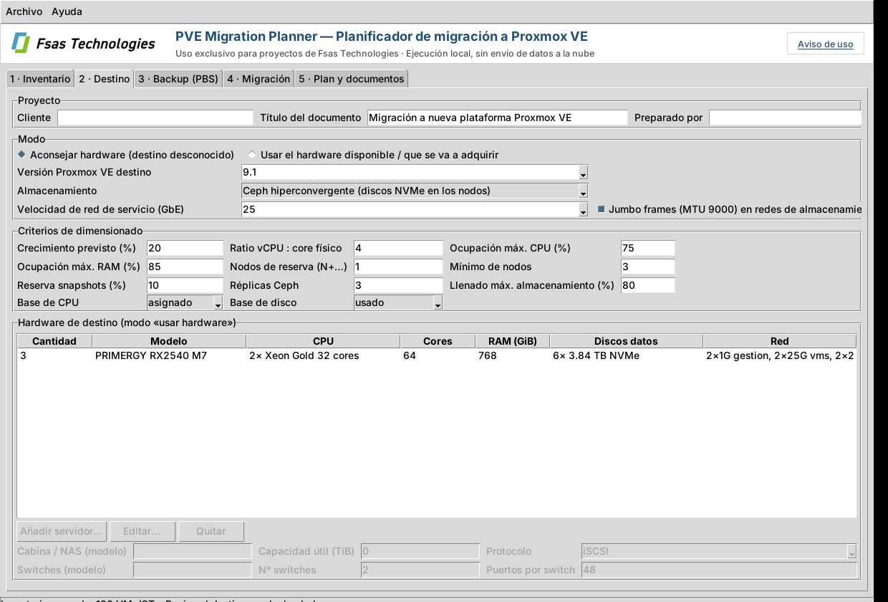
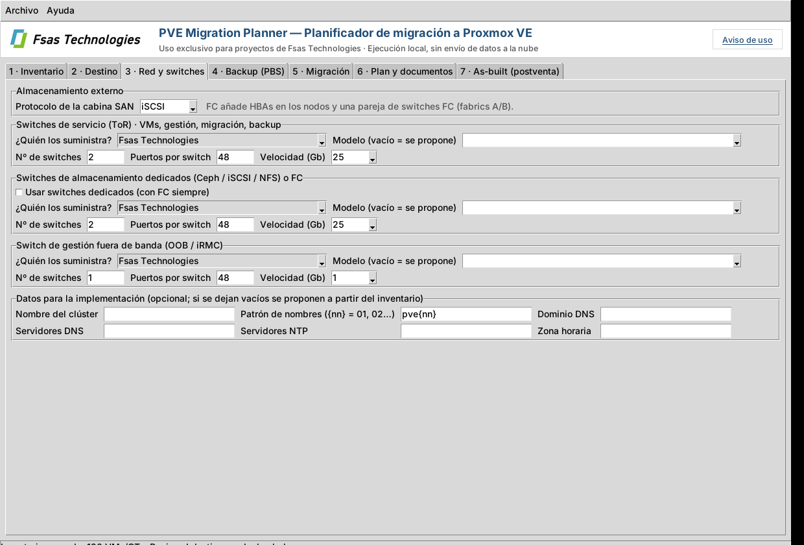
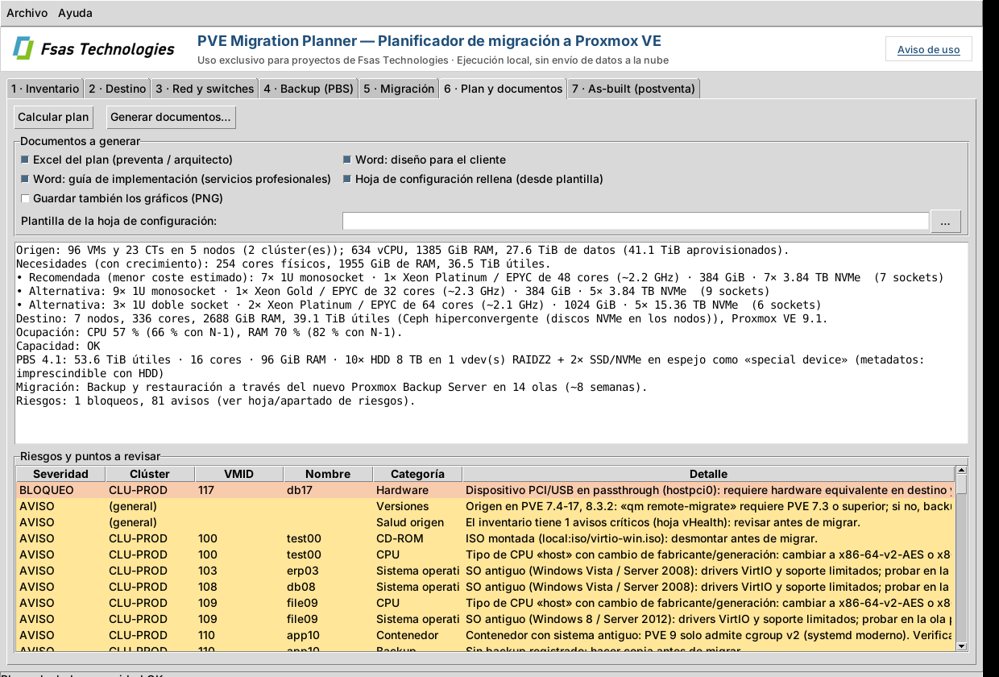

# PVE Migration Planner: pianificatore di migrazione verso Proxmox VE

**Lingue:** [castellano](PLANIFICADOR.md) · [English](PLANIFICADOR.en.md) · [Deutsch](PLANIFICADOR.de.md) · [Français](PLANIFICADOR.fr.md) · [Português](PLANIFICADOR.pt.md) · Italiano

Applicazione **a uso interno di Fsas Technologies** (non viene consegnata al cliente) che legge l'Excel o i CSV esportati da
**PVE Inventory** e genera il progetto della nuova piattaforma Proxmox VE e il piano di migrazione.

Genera un insieme di documenti per ogni fase del progetto (senza prezzi: la quotazione la prepara il commerciale con queste informazioni):

| Documento | Per chi | Contenuto |
|---|---|---|
| `…xlsx` (Excel del piano) | Prevendita e architetto | Opzioni hardware, nodi, capacità, collocazione di ogni VM, reti e VLAN, switch, porte dei nodi, cablaggio, storage, PBS, ondate e rischi per VM. |
| `…_progetto_cliente.docx` | Cliente (presentato dalla prevendita) | Situazione attuale, requisiti, architettura, **schema di rete** con server, switch e collegamenti per fabric, storage, PBS, piano per ondate e rischi, con grafici. Facoltativamente i PNG per una presentazione. |
| `…_guida_implementazione.docx` | Servizi professionali | Dati da confermare, porte e bond per nodo, cablaggio switch↔nodo, VLAN, passi di installazione (Proxmox VE, rete, cluster, storage, PBS, HA) e checklist di test e di migrazione per ondate. |
| `…_scheda_configurazione.xlsx` | Servizi professionali | La **scheda di configurazione del progetto** (*Proxmox VE on PRIMERGY – Customer Interview Configuration Sheet*) compilata con ciò che si sa già: porte dei nodi, reti, switch, storage, PBS e dati generali. I valori proposti sono in blu corsivo, da confermare con il cliente. **Le password non vengono mai compilate.** Il modello non è incluso nel programma: si sceglie il proprio. |
| `analisi_infrastruttura.docx` + `.xlsx` | Prevendita / cliente | **Solo analisi** (senza migrazione): report in stile RVTools / health check dell'infrastruttura attuale con grafici (capacità e utilizzo per nodo, sovrallocazione, tolleranza alla perdita di un nodo, distribuzione di VM e sistemi operativi, storage, reti, backup e snapshot) e rilievi con raccomandazioni. Non propone hardware, migrazione né ondate. |
| `documentazione_asbuilt.docx` | Post-vendita | Ciò che è stato configurato: si genera dall'inventario del **nuovo** ambiente (PVE Inventory) e, facoltativamente, dalla scheda di configurazione compilata (senza password, chiavi né token). Termina con una guida rapida (cheatsheet) di GUI e comandi (QDevice, repliche e disaster recovery, gestione, test e snapshot) con i nomi reali della piattaforma, e con la sezione contatti e supporto di Fsas Technologies. |

Viene eseguita in locale, non si collega ad alcun server e non invia nulla al cloud. Al primo avvio mostra l'avviso d'uso.

**Lingue:** l'applicazione e tutti i documenti che genera sono disponibili in spagnolo, inglese, tedesco, francese, portoghese e
italiano (menu *Lingua* o `--lang` dalla riga di comando). I documenti vengono generati nella lingua scelta, qualunque sia
la lingua in cui è stato esportato l'inventario, e i nomi dei file vengono tradotti (`migration_plan.xlsx`,
`piano_migrazione_progetto_cliente.docx`…).



## Flusso di lavoro

1. Il cliente esegue **PVE Inventory** e ci restituisce l'Excel (o la cartella di CSV). Se ha più cluster può
   inviare un file per cluster: il pianificatore ne accetta più di uno e li unisce (senza duplicare le VM se un cluster viene caricato due volte).
   Se il cliente preferisce non inviare nomi né IP, può esportarlo **anonimizzato** (vedi il README): il dimensionamento e il piano
   delle ondate risultano identici, il pianificatore lo segnala al caricamento e i documenti mostrano gli pseudonimi (`VM-0001`, `NODO-01`…).
   In questo caso conviene inserire a mano dominio, DNS e NTP al passo 3 (altrimenti verrebbero presi gli pseudonimi dell'inventario).
   Il cliente può ripristinare i nomi reali nell'Excel del piano con *Annulla anonimizzazione…* di PVE Inventory e il suo
   file di corrispondenza.
2. In **PVEMigrationPlanner.exe**:
   * **1 · Inventario:** caricare i file, decidere se includere VM spente e template, ed escludere VM specifiche (doppio clic).
   * **2 · Destinazione:** dati del cliente, versione di Proxmox VE, tipo di storage, velocità di rete e criteri di dimensionamento.
     Scegliere la modalità:
     * **Consiglia hardware** (destinazione sconosciuta): calcola alternative di server e raccomanda la più adatta.
     * **Usa l'hardware disponibile / da acquistare:** si inseriscono i server (modello, numero, CPU, RAM, dischi,
       porte di rete) e lo storage array/NAS; il piano si concentra su quell'hardware e avvisa se non è sufficiente.
   * **3 · Rete e switch:** se gli switch di servizio (ToR), di storage (facoltativi, dedicati) e di OOB/gestione
     sono **forniti da Fsas Technologies o dal cliente**, con il loro modello (quelli che vendiamo o quelli che il cliente ha già),
     quantità, porte e velocità. Se non si indica un modello, ne viene proposto uno indicativo. Dati di implementazione: nome del
     cluster, schema dei nomi dei nodi (`pve{nn}`), dominio, DNS, NTP e fuso orario (se lasciati vuoti vengono presi dall'inventario).
   * **4 · Backup (PBS):** includere o meno Proxmox Backup Server, retention, ipotesi e, se già noto, l'hardware del PBS.
   * **5 · Migrazione:** metodo, throughput, dimensione delle ondate, ondate per settimana e data di inizio.
   * **6 · Piano e documenti:** *Calcola piano* mostra il riepilogo e i rischi; si spuntano i documenti desiderati,
     si indica il modello della scheda di configurazione (viene ricordato) e *Genera documenti…* li crea nella cartella scelta.
   * **7 · As-built (post-vendita):** dopo l'implementazione, caricare l'inventario del nuovo ambiente e la scheda di configurazione
     compilata per generare la documentazione di quanto configurato.
   * **8 · Solo analisi:** con l'inventario caricato nella scheda 1 (anche anonimizzato), *Analizza* mostra il riepilogo
     e i rilievi, e *Genera report…* crea il Word con i grafici e l'Excel con i dati e il dettaglio dei rilievi.
     Anche dal pulsante *Solo analisi (report senza migrazione)…* della scheda 1 o da *File → Report di sola analisi*.
     Non è necessario compilare le schede 2-6.
3. **Salvare il progetto** (*File → Salva progetto*, `Ctrl+S`) crea un file `.pveplan` con tutto il necessario
   per riprenderlo più tardi senza ricaricare nulla: l'**inventario caricato** (è incluso nel file, quindi funziona
   anche se l'Excel originale viene spostato o cancellato), le VM escluse, cliente, autore e titolo, l'**hardware inserito**,
   rete e switch, dati di implementazione, PBS, migrazione, l'opzione «senza migrazione», i documenti spuntati, il
   modello della scheda di configurazione e i dati delle schede as-built e solo analisi. *File → Apri
   progetto* (`Ctrl+O`) lo ripristina così com'era; si apre anche trascinando il `.pveplan` sul `.exe`.
   Il file resta sul computer (non viene caricato da nessuna parte) e contiene dati del cliente: trattalo come l'Excel
   dell'inventario. Lo scenario con soli parametri e hardware si può ancora salvare come JSON (*File → Salva
   scenario…*) per usarlo come modello o dalla riga di comando.

### Solo documenti, senza migrazione (nuovo cluster)

Per preparare i documenti di una nuova piattaforma senza migrare nulla (progetto per il cliente, guida di implementazione, scheda
di configurazione ed Excel):

* Scheda 1: premere **Senza inventario (nuovo cluster)** (o semplicemente non caricare l'inventario: al calcolo, il pianificatore
  chiede se si vuole documentare un nuovo cluster). Va bene anche un inventario senza VM/CT.
* Scheda 2: modalità **Usa l'hardware disponibile** e inserire i server; completare le schede 3 e 4.
* Scheda 6: *Genera documenti…*.

I documenti omettono la situazione attuale, le ondate, il runbook di migrazione e la collocazione delle VM; il progetto include la
capacità offerta dalla piattaforma e una sezione di messa in servizio. Se l'inventario contiene VM ma non si migreranno,
spuntare **Senza migrazione: documentare solo la nuova piattaforma** nella scheda 2: le VM servono solo per
dimensionare e distribuire il carico previsto.





## Come calcola

| Tema | Criterio (tutti regolabili) |
|---|---|
| CPU | vCPU assegnate × (1 + crescita) / rapporto vCPU:core (4) / occupazione massima (75 %). Alternativa: utilizzo osservato × 1,5. |
| RAM | RAM assegnata × (1 + crescita) / occupazione massima (85 %) + riserva per nodo (8 GiB Proxmox VE; Ceph 5 GiB per OSD + 4 GiB; ARC ZFS). |
| Disco | Spazio usato (agente QEMU) o allocato se non noto, × (1 + crescita) + 10 % di riserva per gli snapshot. |
| Alta disponibilità | N+1 (configurabile): CPU e RAM devono starci con il nodo più grande fuori servizio; minimo 3 nodi. |
| Ceph | Lordo = dati × repliche (3) / riempimento massimo (80 %), distribuito su N-1 nodi (tollera la perdita di un nodo). 4-8 NVMe per nodo. |
| ZFS locale | Mirror (RAID10) + spazio per le repliche di un altro nodo. |
| SAN / NFS | Capacità utile dello storage = dati / riempimento massimo. Multipath (iSCSI/FC) o NFS 4.x. |
| Opzioni hardware | Catalogo di modelli (1U 1 socket, 1U 2 socket, 2U 2 socket) × CPU da 16-64 core × tagli di RAM. Ordinati internamente con un indice relativo (senza prezzi nei documenti) che tiene conto delle sottoscrizioni Proxmox VE per socket. Il catalogo può essere sostituito da un JSON proprio (*File → Carica catalogo hardware…*, vedi `pvemigplan/catalog.py`). |
| Rete | Fabric ETH-A/ETH-B (servizio), STO/FC-A/B (storage dedicato o FC) e OOB. Reti logiche come nella scheda di configurazione: OOB (iRMC), Management, Corosync 1 e 2, Live Migration, iSCSI 1/2, Ceph Public/Private e Payload (VLAN riportate dall'origine). Bond LACP o active-backup, porte switch per nodo e cablaggio. |
| PBS | Dati usati × riduzione (0,6) × (1 + variazione giornaliera × giorni di variazioni conservati) / riempimento (80 %). Settimanali = 2 giorni, mensili = 4, annuali = 8. Propone CPU, RAM (32 GiB + 1 GiB/TiB), dischi (all-flash se piccolo; altrimenti HDD RAIDZ2 + special device) e rete. Opzione di copia esterna. |
| Migrazione | Con PBS: backup preliminare + backup finale incrementale + ripristino (live-restore). Senza PBS: `qm/pct remote-migrate`. Ondata 0 pilota, ondate standard per cluster/pool e critiche (HA, DB, DC, ordine di avvio) alla fine. |
| Rischi | Passthrough, blocchi, snapshot, ISO montate, CPU «host» con cambio di produttore, SO vecchi, CT vecchi su PVE 9 (cgroup v2), senza agente, senza backup, dischi grandi, HA, capacità e versioni di origine. |

Le cifre sono stime: l'inventario è una fotografia in un dato istante e i modelli di server sono indicativi.
Convalida la configurazione con il configuratore del produttore prima di fare un'offerta.

## Riga di comando

```bat
pvemigplan-cli.exe inventario.xlsx -o C:\Piani\ACME --customer "ACME" --charts --lang it
pvemigplan-cli.exe inv_clu1.xlsx inv_clu2.xlsx --storage san --pve 9.1 --no-pbs
pvemigplan-cli.exe inventario.xlsx -e scenario.json         :: hardware definito e parametri salvati dalla GUI
pvemigplan-cli.exe inventario.xlsx --config-sheet "C:\Modelli\ProxmoxVE Project Configuration Sheet.xlsx"
pvemigplan-cli.exe inventario.xlsx --assessment --customer "ACME" -o C:\Report\ACME   :: solo analisi, senza migrazione
pvemigplan-cli.exe --asbuilt inventario_nuovo.xlsx --config-sheet scheda_compilata.xlsx --customer ACME --author "PS"
pvemigplan-cli.exe -e scenario.json --mode hardware --customer ACME   :: nuovo cluster: senza inventario né migrazione
pvemigplan-cli.exe inventario.xlsx --no-migration                     :: con VM, ma solo i documenti della piattaforma
pvemigplan-cli.exe inventario.xlsx -e scenario.json --save-project C:\Piani\ACME.pveplan
pvemigplan-cli.exe -p C:\Piani\ACME.pveplan -o C:\Piani\ACME          :: rigenerare da un progetto salvato
```

`--no-implementation` omette la guida di implementazione, `--no-word` i documenti Word e `--lang` sceglie la lingua dei documenti (tutte le opzioni hanno anche un nome spagnolo: `--cliente`, `--graficos`, `--sin-pbs`, `--analisis`…). In modalità `--assessment`,
`--no-word` / `--no-excel` omettono il Word o l'Excel del report e `--charts` salva anche i PNG. Il valore di `--mode` resta `aconsejar` (consigliare) o `hardware`.

### Rilievi del report di sola analisi

Sono raggruppati per tema (un rilievo con l'elenco degli oggetti interessati) e ordinati per gravità (critico, avviso, informativo).
Includono gli avvisi che PVE Inventory rileva già (foglio vHealth: quorum, occupazione degli storage, Ceph, ZFS, SMART,
certificati, backup, repository, corosync…) e questi controlli propri dell'analisi: versioni di Proxmox VE senza
supporto o prossime alla fine del supporto (6: lug-2022, 7: lug-2024, 8: ago-2026), utilizzo CPU ≥ 80 %, RAM assegnata a VM
accese superiore a quella fisica, cluster che non regge la perdita del nodo più grande (memoria > 90 % sugli altri), squilibrio
di memoria tra nodi, cluster a 2 nodi senza QDevice, nodi indipendenti, SO guest vecchi, passthrough, CPU
«host» con produttori misti, assenza di job di backup o backup su storage locale, cluster senza HA e VM molto
grandi rispetto al nodo. Per l'SDN: modifiche in attesa di applicazione, VNet senza VM, zone EVPN con meno di due exit node,
SNAT in zone simple, VM su reti che l'inventario non vede (manca il permesso SDN.Audit) e cluster di 3 o più nodi con
più VLAN e senza SDN.

### SDN

Se l'inventario contiene l'SDN (fogli vSDN e vSDNObj), tutti i documenti lo mostrano: zone (tipo, bridge/peer/controller,
exit node, MTU, IPAM/DNS), VNet con le relative subnet, gateway, SNAT, DHCP e numero di NIC di VM collegate, e controller
EVPN/BGP/ISIS, IPAM e DNS esterni e fabric. Il report di sola analisi e l'as-built lo descrivono; il progetto per il cliente
spiega come viene ricreato nel nuovo cluster e la guida di implementazione include i comandi `pvesh` per ricreare zone,
VNet, subnet, controller, IPAM e DNS (token, chiavi e IP dei nuovi nodi restano come `<…>`). Le VLAN delle
VM che oggi non sono nell'SDN vengono proposte come una zona VLAN con una VNet per VLAN.

Codice di uscita: 0 piano corretto, 1 l'hardware non copre le esigenze, 2 errore.

## Compilare

`build_planner.bat` su Windows (Python 3.10+) o il workflow `.github/workflows/build-planner.yml`
(Actions → *Build migration planner exe*), che genera `PVEMigrationPlanner.exe` e `pvemigplan-cli.exe` e verifica un piano di esempio in spagnolo e in inglese.

## Sviluppo

```bash
pip install -r requirements.txt -r requirements-planner.txt pytest
python -m pvemigplan                                    # GUI (senza argomenti) o CLI (con argomenti)
PVE_LANG=es python -m pytest tests/test_planner.py tests/test_i18n.py   # inventario sintetico di 120 VM (tests/planner_sample.py)
```

Il codice si trova in `pvemigplan/` e riutilizza da `pvetools/` solo il formato di esportazione (`schema.py`), il livello di traduzione (`i18n.py`) e il logo.
