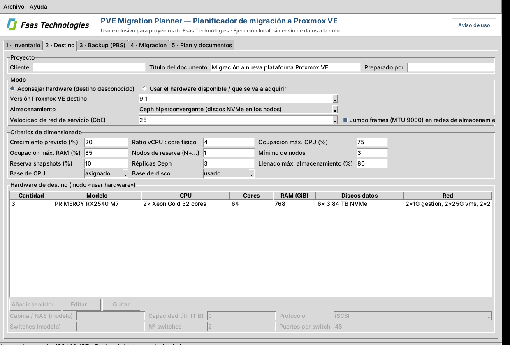
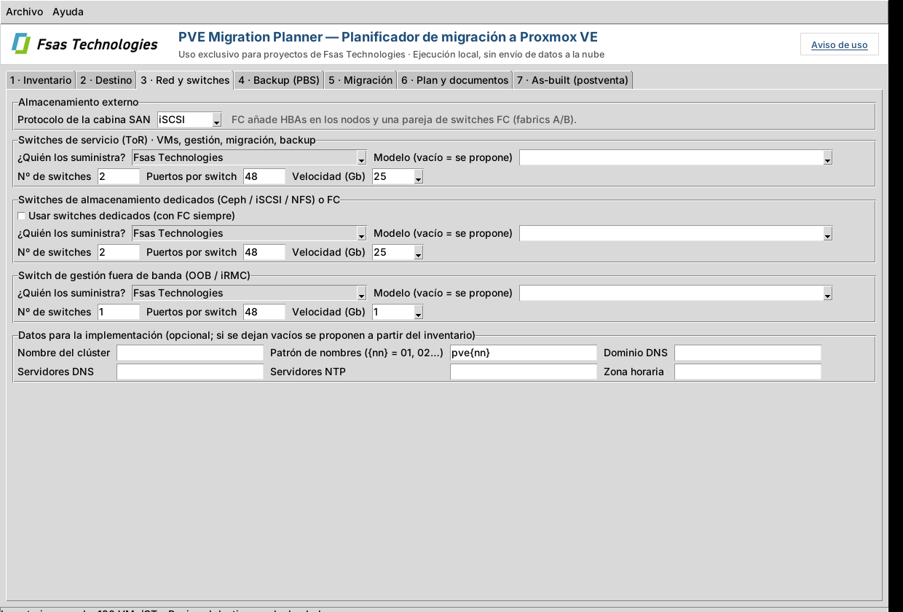
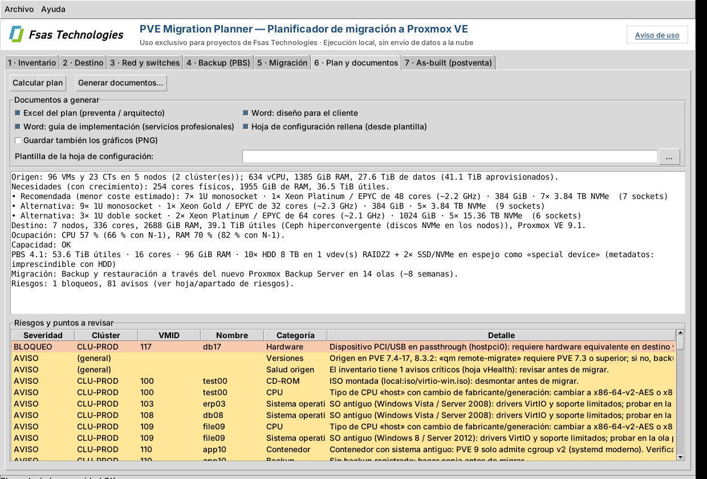

# PVE Migration Planner — Planificador de migración a Proxmox VE

Aplicación **de uso interno de Fsas Technologies** (no se entrega al cliente) que lee el Excel o los CSV exportados por
**PVE Inventory** y genera el diseño de la nueva plataforma Proxmox VE y el plan de migración:

Genera un juego de documentos para cada fase del proyecto (sin precios: la valoración la hace el comercial con esta información):

| Documento | Para quién | Contenido |
|---|---|---|
| `…xlsx` (Excel del plan) | Preventa y arquitecto | Opciones de hardware, nodos, capacidad, ubicación de cada VM, redes y VLANs, switches, puertos de nodo, cableado, almacenamiento, PBS, olas y riesgos por VM. |
| `…_diseno_cliente.docx` | Cliente (presentado por preventa) | Situación actual, requisitos, arquitectura, **diagrama de red** con servidores, switches y enlaces por fabric, almacenamiento, PBS, plan por olas y riesgos, con gráficos. Opcionalmente los PNG para una presentación. |
| `…_guia_implementacion.docx` | Servicios profesionales | Datos a confirmar, puertos y bonds por nodo, cableado switch↔nodo, VLANs, pasos de instalación (Proxmox VE, red, clúster, almacenamiento, PBS, HA) y checklist de pruebas y migración por olas. |
| `…_hoja_configuracion.xlsx` | Servicios profesionales | La **hoja de configuración del proyecto** (*Proxmox VE on PRIMERGY – Customer Interview Configuration Sheet*) rellena con lo que ya se sabe: puertos de los nodos, redes, switches, almacenamiento, PBS y datos generales. Los valores propuestos van en azul cursiva para confirmar con el cliente. **Las contraseñas nunca se rellenan.** La plantilla no se incluye en el programa: se elige la propia. |
| `documentacion_asbuilt.docx` | Postventa | Lo que queda configurado: se genera a partir del inventario del **nuevo** entorno (PVE Inventory) y, opcionalmente, de la hoja de configuración completada (sin contraseñas, claves ni tokens). |

Se ejecuta en local, no se conecta a ningún servidor y no envía nada a la nube. Al arrancar por primera vez muestra el aviso de uso.



## Flujo de trabajo

1. El cliente ejecuta **PVE Inventory** y nos devuelve el Excel (o la carpeta de CSV). Si tiene varios clústeres puede
   enviar un fichero por clúster: el planificador acepta varios y los une (sin duplicar VMs si un clúster se carga dos veces).
   Si el cliente prefiere no enviar nombres ni IPs, puede exportarlo **anonimizado** (ver el README): el cálculo y el plan de
   olas salen idénticos, el planificador avisa al cargarlo y los documentos muestran los seudónimos (`VM-0001`, `NODO-01`…).
   En ese caso conviene rellenar a mano dominio, DNS y NTP en el paso 3 (si no, se tomarían los seudónimos del inventario).
   El cliente puede devolver los nombres reales al Excel del plan con *Revertir anonimización…* de PVE Inventory y su
   fichero de correspondencia.
2. En **PVEMigrationPlanner.exe**:
   * **1 · Inventario:** cargar los ficheros, decidir si entran VMs apagadas y plantillas, y excluir VMs concretas (doble clic).
   * **2 · Destino:** datos del cliente, versión de Proxmox VE, tipo de almacenamiento, velocidad de red y criterios de dimensionado.
     Elegir el modo:
     * **Aconsejar hardware** (destino desconocido): calcula alternativas de servidor y recomienda la más ajustada.
     * **Usar el hardware disponible / que se va a adquirir:** se introducen los servidores (modelo, nº, CPU, RAM, discos,
       puertos de red) y la cabina/NAS; el plan se centra en ese hardware y avisa si no es suficiente.
   * **3 · Red y switches:** si los switches de servicio (ToR), de almacenamiento (opcionales, dedicados) y de OOB/gestión
     los **suministra Fsas Technologies o el cliente**, con su modelo (los que se venden o los que ya tiene el cliente),
     cantidad, puertos y velocidad. Si no se indica modelo se propone uno orientativo. Datos de implementación: nombre del
     clúster, patrón de nombres de los nodos (`pve{nn}`), dominio, DNS, NTP y zona horaria (si se dejan vacíos se toman del inventario).
   * **4 · Backup (PBS):** incluir o no Proxmox Backup Server, retención, supuestos y, si ya se conoce, el hardware del PBS.
   * **5 · Migración:** método, rendimiento, tamaño de las olas, olas por semana y fecha de inicio.
   * **6 · Plan y documentos:** *Calcular plan* muestra el resumen y los riesgos; se marcan los documentos que se quieren,
     se indica la plantilla de la hoja de configuración (se recuerda) y *Generar documentos* los crea en la carpeta elegida.
   * **7 · As-built (postventa):** tras la implementación, cargar el inventario del nuevo entorno y la hoja de configuración
     completada para generar la documentación de lo configurado.
3. El escenario (todos los parámetros y el hardware) se puede guardar como JSON (*Archivo → Guardar escenario*) para
   retomarlo o para usarlo desde la línea de comandos.





## Cómo calcula

| Tema | Criterio (todos ajustables) |
|---|---|
| CPU | vCPU asignadas × (1 + crecimiento) / ratio vCPU:core (4) / ocupación máxima (75 %). Alternativa: uso observado × 1,5. |
| RAM | RAM asignada × (1 + crecimiento) / ocupación máxima (85 %) + reserva por nodo (8 GiB Proxmox VE; Ceph 5 GiB por OSD + 4 GiB; ZFS ARC). |
| Disco | Espacio usado (agente QEMU) o aprovisionado si no se conoce, × (1 + crecimiento) + 10 % de reserva para snapshots. |
| Alta disponibilidad | N+1 (configurable): CPU y RAM deben caber con el nodo mayor caído; mínimo 3 nodos. |
| Ceph | Bruto = datos × réplicas (3) / llenado máximo (80 %), repartido entre N-1 nodos (tolera la caída de un nodo). 4-8 NVMe por nodo. |
| ZFS local | Espejo (RAID10) + espacio para las réplicas de otro nodo. |
| SAN / NFS | Capacidad útil de la cabina = datos / llenado máximo. Multipath (iSCSI/FC) o NFS 4.x. |
| Opciones de hardware | Catálogo de plantillas (1U 1 socket, 1U 2 sockets, 2U 2 sockets) × CPUs de 16-64 cores × tamaños de RAM. Se ordenan internamente por un índice relativo (sin precios en los documentos) que tiene en cuenta las suscripciones de Proxmox VE por socket. El catálogo se puede sustituir por un JSON propio (*Archivo → Cargar catálogo*, ver `pvemigplan/catalog.py`). |
| Red | Fabrics ETH-A/ETH-B (servicio), STO/FC-A/B (almacenamiento dedicado o FC) y OOB. Redes lógicas como en la hoja de configuración: OOB (iRMC), Management, Corosync 1 y 2, Live Migration, iSCSI 1/2, Ceph Public/Private y Payload (VLANs trasladadas del origen). Bonds LACP o active-backup, puertos de switch por nodo y cableado. |
| PBS | Datos usados × reducción (0,6) × (1 + cambio diario × días de cambios retenidos) / llenado (80 %). Semanales = 2 días, mensuales = 4, anuales = 8. Propone CPU, RAM (32 GiB + 1 GiB/TiB), discos (all-flash si es pequeño; HDD RAIDZ2 + special device si no) y red. Opción de copia externa. |
| Migración | Con PBS: backup previo + backup final incremental + restore (live-restore). Sin PBS: `qm/pct remote-migrate`. Ola 0 piloto, olas estándar por clúster/pool y críticas (HA, BD, DC, orden de arranque) al final. |
| Riesgos | Passthrough, bloqueos, snapshots, ISOs montadas, CPU «host» con cambio de fabricante, SO antiguos, CTs antiguos en PVE 9 (cgroup v2), sin agente, sin backup, discos grandes, HA, capacidad y versiones de origen. |

Las cifras son estimaciones: el inventario es una foto en un instante y los modelos de servidor son orientativos.
Valida la configuración con el configurador del fabricante antes de ofertar.

## Línea de comandos

```bat
pvemigplan-cli.exe inventario.xlsx -o C:\Planes\ACME --cliente "ACME" --graficos
pvemigplan-cli.exe inv_clu1.xlsx inv_clu2.xlsx --almacenamiento san --pve 9.1 --sin-pbs
pvemigplan-cli.exe inventario.xlsx -e escenario.json        :: hardware definido y parámetros guardados desde la GUI
pvemigplan-cli.exe inventario.xlsx --hoja-config "C:\Plantillas\ProxmoxVE Project Configuration Sheet.xlsx"
pvemigplan-cli.exe --asbuilt inventario_nuevo.xlsx --hoja-config hoja_completada.xlsx --cliente ACME --autor "PS"
```

`--sin-implementacion` omite la guía de implementación y `--sin-word` los documentos Word.

Código de salida: 0 plan correcto, 1 el hardware no cubre las necesidades, 2 error.

## Compilar

`build_planner.bat` en Windows (Python 3.10+) o el workflow `.github/workflows/build-planner.yml`
(Actions → *Build migration planner exe*), que genera `PVEMigrationPlanner.exe` y `pvemigplan-cli.exe` y comprueba un plan de ejemplo.

## Desarrollo

```bash
pip install -r requirements.txt -r requirements-planner.txt pytest
python -m pvemigplan                       # GUI (sin argumentos) o CLI (con argumentos)
python -m pytest tests/test_planner.py     # usa un inventario sintético de 120 VMs (tests/planner_sample.py)
```

El código está en `pvemigplan/` y reutiliza de `pvetools/` solo el formato de exportación (`schema.py`) y el logo.
