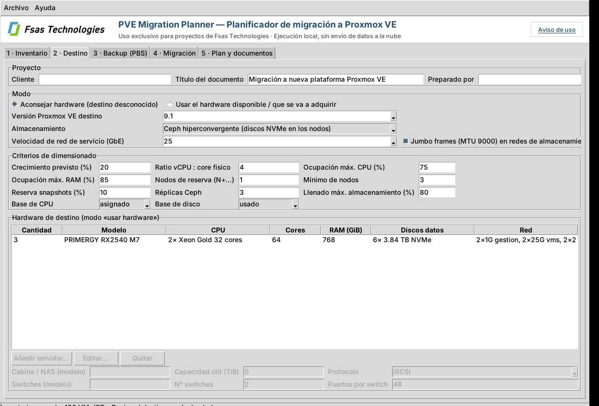
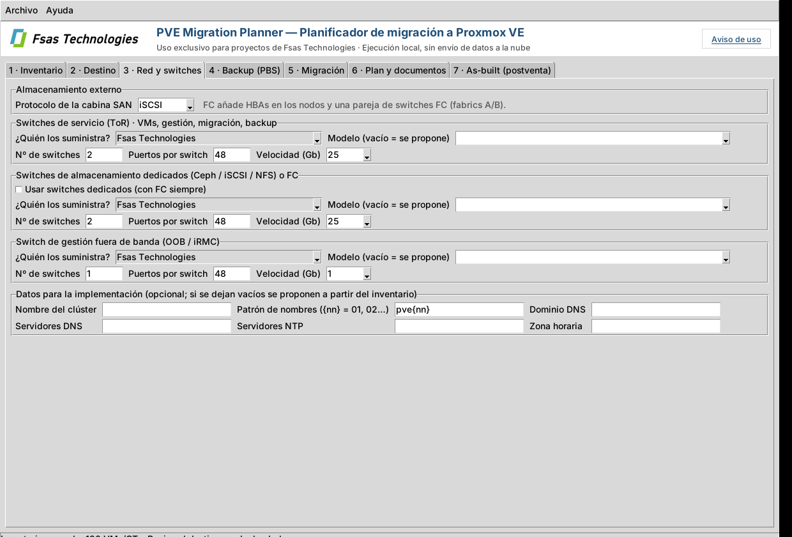
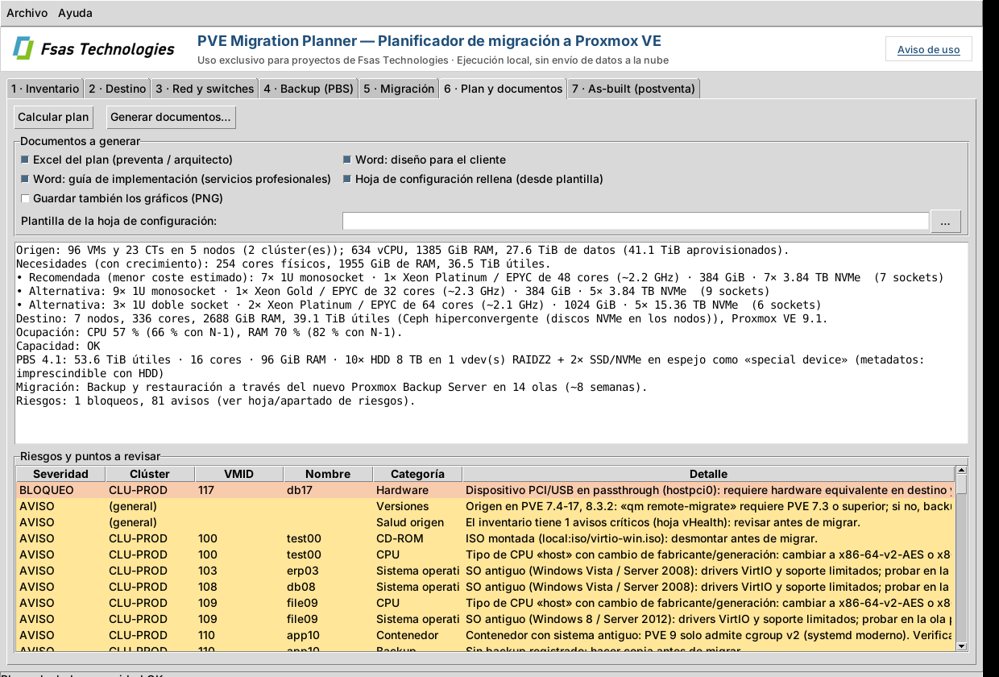

# PVE Migration Planner: planeador de migração para Proxmox VE

**Idiomas:** [castellano](PLANIFICADOR.md) · [English](PLANIFICADOR.en.md) · [Deutsch](PLANIFICADOR.de.md) · [Français](PLANIFICADOR.fr.md) · Português · [Italiano](PLANIFICADOR.it.md)

Aplicação **de uso interno da Fsas Technologies** (não é entregue ao cliente) que lê o Excel ou os CSV exportados pelo
**PVE Inventory** e gera o desenho da nova plataforma Proxmox VE e o plano de migração.

Gera um conjunto de documentos para cada fase do projeto (sem preços: a orçamentação é feita pelo comercial com esta informação):

| Documento | Para quem | Conteúdo |
|---|---|---|
| `…xlsx` (Excel do plano) | Pré-venda e arquiteto | Opções de hardware, nós, capacidade, localização de cada VM, redes e VLANs, switches, portas dos nós, cablagem, armazenamento, PBS, vagas e riscos por VM. |
| `…_desenho_cliente.docx` | Cliente (apresentado pela pré-venda) | Situação atual, requisitos, arquitetura, **diagrama de rede** com servidores, switches e ligações por fabric, armazenamento, PBS, plano por vagas e riscos, com gráficos. Opcionalmente os PNG para uma apresentação. |
| `…_guia_implementacao.docx` | Serviços profissionais | Dados a confirmar, portas e bonds por nó, cablagem switch↔nó, VLANs, passos de instalação (Proxmox VE, rede, cluster, armazenamento, PBS, HA) e checklist de testes e migração por vagas. |
| `…_folha_configuracao.xlsx` | Serviços profissionais | A **folha de configuração do projeto** (*Proxmox VE on PRIMERGY – Customer Interview Configuration Sheet*) preenchida com o que já se sabe: portas dos nós, redes, switches, armazenamento, PBS e dados gerais. Os valores propostos ficam a azul itálico para confirmar com o cliente. **As palavras-passe nunca são preenchidas.** O modelo não está incluído no programa: escolhe-se o próprio. |
| `analise_infraestrutura.docx` + `.xlsx` | Pré-venda / cliente | **Só análise** (sem migração): relatório tipo RVTools / health check da infraestrutura atual com gráficos (capacidade e utilização por nó, sobre-atribuição, tolerância à falha de um nó, distribuição de VMs e sistemas operativos, armazenamento, redes, backup e snapshots) e constatações com recomendações. Não propõe hardware, migração nem vagas. |
| `documentacao_asbuilt.docx` | Pós-venda | O que fica configurado: é gerado a partir do inventário do **novo** ambiente (PVE Inventory) e, opcionalmente, da folha de configuração preenchida (sem palavras-passe, chaves nem tokens). Termina com um guia rápido (cheatsheet) de GUI e comandos (QDevice, réplicas e recuperação de desastres, gestão, testes e snapshots) com os nomes reais da plataforma, e com a secção de contacto e suporte da Fsas Technologies. |

É executada localmente, não se liga a nenhum servidor e não envia nada para a nuvem. No primeiro arranque mostra o aviso de utilização.

**Idiomas:** a aplicação e todos os documentos que gera estão disponíveis em espanhol, inglês, alemão, francês, português e
italiano (menu *Idioma* ou `--lang` na linha de comandos). Os documentos são gerados no idioma escolhido, seja qual for
o idioma em que o inventário foi exportado, e os nomes dos ficheiros são traduzidos (`migration_plan.xlsx`,
`plano_migracao_desenho_cliente.docx`…).



## Fluxo de trabalho

1. O cliente executa o **PVE Inventory** e devolve-nos o Excel (ou a pasta de CSV). Se tiver vários clusters pode
   enviar um ficheiro por cluster: o planeador aceita vários e junta-os (sem duplicar VMs se um cluster for carregado duas vezes).
   Se o cliente preferir não enviar nomes nem IPs, pode exportá-lo **anonimizado** (ver o README): o dimensionamento e o plano de
   vagas são idênticos, o planeador avisa ao carregá-lo e os documentos mostram os pseudónimos (`VM-0001`, `NODO-01`…).
   Nesse caso convém preencher à mão domínio, DNS e NTP no passo 3 (caso contrário seriam usados os pseudónimos do inventário).
   O cliente pode repor os nomes reais no Excel do plano com *Reverter anonimização…* do PVE Inventory e o seu
   ficheiro de correspondência.
2. No **PVEMigrationPlanner.exe**:
   * **1 · Inventário:** carregar os ficheiros, decidir se entram VMs desligadas e modelos, e excluir VMs concretas (duplo clique).
   * **2 · Destino:** dados do cliente, versão do Proxmox VE, tipo de armazenamento, velocidade de rede e critérios de dimensionamento.
     Escolher o modo:
     * **Aconselhar hardware** (destino desconhecido): calcula alternativas de servidor e recomenda a mais ajustada.
     * **Usar o hardware disponível / a adquirir:** introduzem-se os servidores (modelo, n.º, CPU, RAM, discos,
       portas de rede) e o storage/NAS; o plano centra-se nesse hardware e avisa se não for suficiente.
   * **3 · Rede e switches:** se os switches de serviço (ToR), de armazenamento (opcionais, dedicados) e de OOB/gestão
     são **fornecidos pela Fsas Technologies ou pelo cliente**, com o seu modelo (os que vendemos ou os que o cliente já tem),
     quantidade, portas e velocidade. Se não for indicado modelo, propõe-se um indicativo. Dados de implementação: nome do
     cluster, padrão de nomes dos nós (`pve{nn}`), domínio, DNS, NTP e fuso horário (se ficarem vazios são retirados do inventário).
   * **4 · Backup (PBS):** incluir ou não o Proxmox Backup Server, retenção, pressupostos e, se já for conhecido, o hardware do PBS.
   * **5 · Migração:** método, débito, tamanho das vagas, vagas por semana e data de início.
   * **6 · Plano e documentos:** *Calcular plano* mostra o resumo e os riscos; marcam-se os documentos pretendidos,
     indica-se o modelo da folha de configuração (fica memorizado) e *Gerar documentos…* cria-os na pasta escolhida.
   * **7 · As-built (pós-venda):** após a implementação, carregar o inventário do novo ambiente e a folha de configuração
     preenchida para gerar a documentação do que foi configurado.
   * **8 · Só análise:** com o inventário carregado no separador 1 (também anonimizado), *Analisar* mostra o resumo
     e as constatações, e *Gerar relatório…* cria o Word com gráficos e o Excel com os dados e o detalhe das constatações.
     Também a partir do botão *Só análise (relatório sem migração)…* do separador 1 ou *Ficheiro → Relatório só de análise*.
     Não é preciso preencher os separadores 2-6.
3. **Guardar o projeto** (*Ficheiro → Guardar projeto*, `Ctrl+S`) cria um ficheiro `.pveplan` com tudo o necessário
   para o retomar mais tarde sem voltar a carregar nada: o **inventário carregado** (vai dentro do ficheiro, por isso funciona
   mesmo que o Excel original seja movido ou apagado), as VMs excluídas, cliente, autor e título, o **hardware introduzido**,
   rede e switches, dados de implementação, PBS, migração, a opção «sem migração», os documentos marcados, o
   modelo da folha de configuração e os dados dos separadores de as-built e de só análise. *Ficheiro → Abrir
   projeto* (`Ctrl+O`) recupera-o tal como estava; também se abre ao arrastar o `.pveplan` para o `.exe`.
   O ficheiro fica no computador (não é enviado para lado nenhum) e contém dados do cliente: trate-o como o Excel do
   inventário. O cenário só com parâmetros e hardware continua a poder ser guardado como JSON (*Ficheiro → Guardar
   cenário…*) para o usar como modelo ou a partir da linha de comandos.

### Só documentos, sem migração (cluster novo)

Para preparar os documentos de uma plataforma nova sem migrar nada (desenho para o cliente, guia de implementação, folha
de configuração e Excel):

* Separador 1: clicar em **Sem inventário (cluster novo)** (ou simplesmente não carregar inventário: ao calcular, o planeador
  pergunta se se pretende documentar um cluster novo). Também serve um inventário sem VMs/CTs.
* Separador 2: modo **Usar o hardware disponível** e introduzir os servidores; completar os separadores 3 e 4.
* Separador 6: *Gerar documentos…*.

Os documentos omitem a situação atual, as vagas, o runbook de migração e a localização das VMs; o desenho inclui a
capacidade que a plataforma oferece e uma secção de arranque. Se o inventário tiver VMs mas não se for
migrar, marcar **Sem migração: documentar apenas a nova plataforma** no separador 2: as VMs são usadas apenas para
dimensionar e distribuir a carga prevista.





## Como calcula

| Tema | Critério (todos ajustáveis) |
|---|---|
| CPU | vCPU atribuídas × (1 + crescimento) / rácio vCPU:core (4) / ocupação máxima (75 %). Alternativa: utilização observada × 1,5. |
| RAM | RAM atribuída × (1 + crescimento) / ocupação máxima (85 %) + reserva por nó (8 GiB Proxmox VE; Ceph 5 GiB por OSD + 4 GiB; ZFS ARC). |
| Disco | Espaço usado (agente QEMU) ou aprovisionado se não for conhecido, × (1 + crescimento) + 10 % de reserva para snapshots. |
| Alta disponibilidade | N+1 (configurável): CPU e RAM têm de caber com o maior nó em baixo; mínimo de 3 nós. |
| Ceph | Bruto = dados × réplicas (3) / enchimento máximo (80 %), repartido por N-1 nós (tolera a falha de um nó). 4-8 NVMe por nó. |
| ZFS local | Espelho (RAID10) + espaço para as réplicas de outro nó. |
| SAN / NFS | Capacidade útil do storage = dados / enchimento máximo. Multipath (iSCSI/FC) ou NFS 4.x. |
| Opções de hardware | Catálogo de modelos (1U 1 socket, 1U 2 sockets, 2U 2 sockets) × CPUs de 16-64 cores × tamanhos de RAM. São ordenadas internamente por um índice relativo (sem preços nos documentos) que tem em conta as subscrições do Proxmox VE por socket. O catálogo pode ser substituído por um JSON próprio (*Ficheiro → Carregar catálogo de hardware…*, ver `pvemigplan/catalog.py`). |
| Rede | Fabrics ETH-A/ETH-B (serviço), STO/FC-A/B (armazenamento dedicado ou FC) e OOB. Redes lógicas como na folha de configuração: OOB (iRMC), Management, Corosync 1 e 2, Live Migration, iSCSI 1/2, Ceph Public/Private e Payload (VLANs transferidas da origem). Bonds LACP ou active-backup, portas de switch por nó e cablagem. |
| PBS | Dados usados × redução (0,6) × (1 + alteração diária × dias de alterações retidos) / enchimento (80 %). Semanais = 2 dias, mensais = 4, anuais = 8. Propõe CPU, RAM (32 GiB + 1 GiB/TiB), discos (all-flash se for pequeno; caso contrário HDD RAIDZ2 + special device) e rede. Opção de cópia externa. |
| Migração | Com PBS: backup prévio + backup final incremental + restauro (live-restore). Sem PBS: `qm/pct remote-migrate`. Vaga 0 piloto, vagas padrão por cluster/pool e críticas (HA, BD, DC, ordem de arranque) no fim. |
| Riscos | Passthrough, bloqueios, snapshots, ISOs montadas, CPU «host» com mudança de fabricante, SO antigos, CTs antigos no PVE 9 (cgroup v2), sem agente, sem backup, discos grandes, HA, capacidade e versões de origem. |

Os números são estimativas: o inventário é uma fotografia num instante e os modelos de servidor são indicativos.
Valide a configuração com o configurador do fabricante antes de apresentar proposta.

## Linha de comandos

```bat
pvemigplan-cli.exe inventario.xlsx -o C:\Planos\ACME --customer "ACME" --charts --lang pt
pvemigplan-cli.exe inv_clu1.xlsx inv_clu2.xlsx --storage san --pve 9.1 --no-pbs
pvemigplan-cli.exe inventario.xlsx -e cenario.json          :: hardware definido e parâmetros guardados a partir da GUI
pvemigplan-cli.exe inventario.xlsx --config-sheet "C:\Modelos\ProxmoxVE Project Configuration Sheet.xlsx"
pvemigplan-cli.exe inventario.xlsx --assessment --customer "ACME" -o C:\Relatorios\ACME   :: só análise, sem migração
pvemigplan-cli.exe --asbuilt inventario_novo.xlsx --config-sheet folha_preenchida.xlsx --customer ACME --author "PS"
pvemigplan-cli.exe -e cenario.json --mode hardware --customer ACME    :: cluster novo: sem inventário nem migração
pvemigplan-cli.exe inventario.xlsx --no-migration                     :: com VMs, mas só os documentos da plataforma
pvemigplan-cli.exe inventario.xlsx -e cenario.json --save-project C:\Planos\ACME.pveplan
pvemigplan-cli.exe -p C:\Planos\ACME.pveplan -o C:\Planos\ACME        :: regenerar a partir de um projeto guardado
```

`--no-implementation` omite o guia de implementação, `--no-word` os documentos Word e `--lang` escolhe o idioma dos documentos (todas as opções têm também nome em espanhol: `--cliente`, `--graficos`, `--sin-pbs`, `--analisis`…). No modo `--assessment`,
`--no-word` / `--no-excel` omitem o Word ou o Excel do relatório e `--charts` guarda também os PNG. O valor de `--mode` continua a ser `aconsejar` (aconselhar) ou `hardware`.

### Constatações do relatório só de análise

São agrupadas por tema (uma constatação com a lista de objetos afetados) e ordenadas por gravidade (crítico, aviso, informativo).
Incluem os avisos que o PVE Inventory já deteta (folha vHealth: quórum, ocupação dos armazenamentos, Ceph, ZFS, SMART,
certificados, backups, repositórios, corosync…) e estas verificações da própria análise: versões do Proxmox VE sem
suporte ou próximas do fim do suporte (6: jul-2022, 7: jul-2024, 8: ago-2026), utilização de CPU ≥ 80 %, RAM atribuída a VMs
ligadas maior do que a física, cluster que não resiste à falha do maior nó (memória > 90 % nos restantes), desequilíbrio
de memória entre nós, clusters de 2 nós sem QDevice, nós independentes, SO convidados antigos, passthrough, CPU
«host» com fabricantes misturados, sem jobs de backup ou com backup para armazenamento local, clusters sem HA e VMs muito
grandes em relação ao nó. De SDN: alterações pendentes de aplicar, VNets sem VMs, zonas EVPN com menos de dois exit nodes,
SNAT em zonas simples, VMs em redes que o inventário não vê (falta a permissão SDN.Audit) e clusters de 3 ou mais nós com
várias VLANs e sem SDN.

### SDN

Se o inventário trouxer SDN (folhas vSDN e vSDNObj), todos os documentos o mostram: zonas (tipo, bridge/peers/controlador,
exit nodes, MTU, IPAM/DNS), VNets com as suas sub-redes, gateway, SNAT, DHCP e n.º de NICs de VMs ligadas, e controladores
EVPN/BGP/ISIS, IPAM e DNS externos e fabrics. O relatório só de análise e o as-built descrevem-no; o desenho para o cliente
explica como é recriado no novo cluster e o guia de implementação inclui os comandos `pvesh` para recriar zonas,
VNets, sub-redes, controladores, IPAM e DNS (tokens, chaves e IPs dos nós novos ficam como `<…>`). As VLANs das
VMs que hoje não estão em SDN são propostas como uma zona VLAN com uma VNet por VLAN.

Código de saída: 0 plano correto, 1 o hardware não cobre as necessidades, 2 erro.

## Compilar

`build_planner.bat` no Windows (Python 3.10+) ou o workflow `.github/workflows/build-planner.yml`
(Actions → *Build migration planner exe*), que gera `PVEMigrationPlanner.exe` e `pvemigplan-cli.exe` e verifica um plano de exemplo em espanhol e em inglês.

## Desenvolvimento

```bash
pip install -r requirements.txt -r requirements-planner.txt pytest
python -m pvemigplan                                    # GUI (sem argumentos) ou CLI (com argumentos)
PVE_LANG=es python -m pytest tests/test_planner.py tests/test_i18n.py   # inventário sintético de 120 VMs (tests/planner_sample.py)
```

O código está em `pvemigplan/` e reutiliza de `pvetools/` apenas o formato de exportação (`schema.py`), a camada de tradução (`i18n.py`) e o logótipo.
